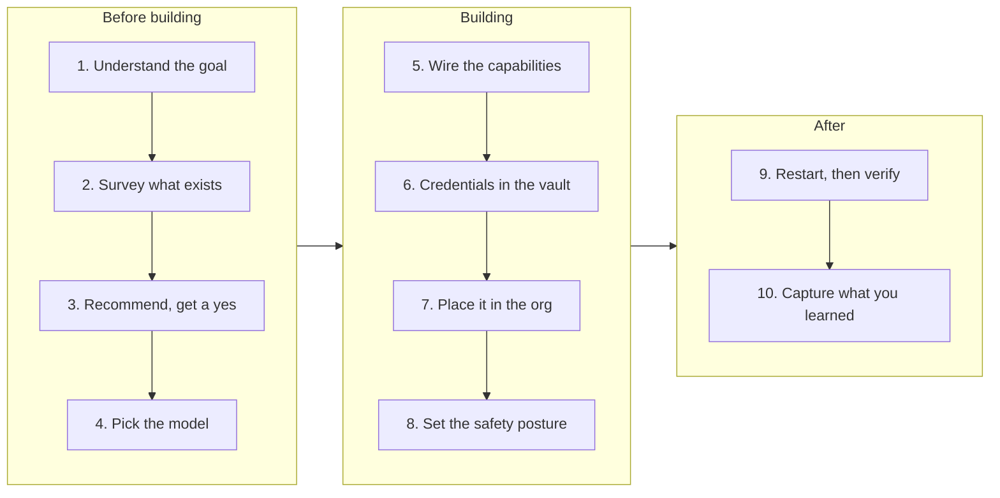

# Building agents from a conversation

This section is the recipe an agent-building agent (AgentFather) follows, and
it works just as well as a checklist for a person.

**1. Understand the goal before naming a solution.** What work needs doing, who
it is for, what systems it must reach, and what "done" looks like. Restate it
back and confirm before building anything.

**2. Survey what already exists.** Olano ships a catalog of ready-made agents,
teams and integration agents. Always look before building custom:

- `olano_list_builtin_agents` — every ready-made agent. Each can be installed
  standalone *or* composed as a subagent of another agent.
- `olano_list_archetypes` — the picker list (label, description, category).
- `olano_read_archetype` — **read this before describing an archetype.** The
  list only returns picker fields; it does not tell you an archetype's prompt,
  tools, memory model or security posture. Never answer "what does this ship
  with?" from memory.
- `olano_list_tools` / `olano_list_integrations` / `olano_list_bundles` — tools
  for the `tools` list.
- `olano_find_tools(tag)` — search by capability (`customer_service`, `privacy`,
  `memory`, …) when you know what you need but not what it is called. Some tools
  are wired from a config flag rather than a `tools` entry; when a result says
  so, enable that config instead of adding the name.
- `olano_list_platforms` — connectors for `channels`, and the vault key each
  one expects.
- `olano_search_mcp_directory(query)` / `olano_get_mcp_directory_entry(slug)` —
  the catalog of MCP servers, with each one's verified endpoint, transport,
  auth mode and the credential names it expects.
- `olano_list_builtin_skills` — skills that ship with Olano.

Never invent a tool, agent, platform or skill that is not in these lists — and
never write an MCP server URL from memory. A wrong endpoint saves without
complaint and fails later, in front of whoever is using the agent.

**3. Recommend before you build.** When more than one approach fits, lay out two
or three concrete options with their trade-offs — effort, capability, cost,
safety, maintenance — and give a recommendation. Surface the simpler option the
person may not have considered. Get explicit confirmation on the approach before
writing anything.

**4. Pick the model deliberately.** Call `olano_list_models` before creating any
agent — it reports which providers are genuinely usable on this deployment and
ranks their models by cost. Default to the cheapest model that can do the job;
on a managed deployment that means `olano:turbo`. Reserve a top tier for work
that genuinely needs deep reasoning, and say why you chose it. Never write a
model string from memory — the available models differ per deployment.

**5. Wire the capabilities.**
- To reach an outside platform, prefer an MCP server. It usually carries its own
  sign-in, so the person clicks a consent screen they recognise instead of
  hunting for an API key in a settings page they have never opened. Search the
  directory first, add the server, then sign in — in that order ([MCP servers](feature-guides/mcp-servers.md)).
- A matching toolkit (`sql`, `google`, `slack`, `stripe`) when it is already
  credentialled, or when no MCP server exists for the platform.
- Building a small MCP server when the platform matters and nothing covers it.
- Skills for repeatable procedures.
- Subagents for specialties that do not need their own inbox.

**6. Credentials go in the vault, never in the config.** Check what is already
stored (names only, `secret_list`) before asking for anything. Prefer a magic
link that lets the person enter the value themselves
(`magic_link_request_secret`) — it goes straight into the vault without passing
through the chat, the transcript, or the agent's context. Never ask anyone to
paste a key into a conversation. For a connector, remember the
per-agent override rule from [Channels and connectors](feature-guides/channels-and-connectors.md): two agents
sharing one token become one bot.

**7. Place it in the organization.** Set `org.manager` / `org.reports` so
delegation works, and set the allow-lists or `human_only` if the agent should be
reachable by fewer parties than the default (which is: everyone).

**8. Set the safety posture.** Choose a `security.profile` that matches how much
the agent can affect the outside world, and decide what needs human approval
([Human in the loop (HITL) and approvals](feature-guides/human-in-the-loop.md)). An agent that sends email or
moves money should not be on `developer`.

**9. Restart, then verify.** Config changes need a restart to take effect. Then
check it actually booted, its connectors came up, and its MCP servers connected
— do not report success from a config write alone.

**10. Capture what you learned.** If you taught the agent a repeatable flow,
make it a skill or a subagent so it survives the conversation.
