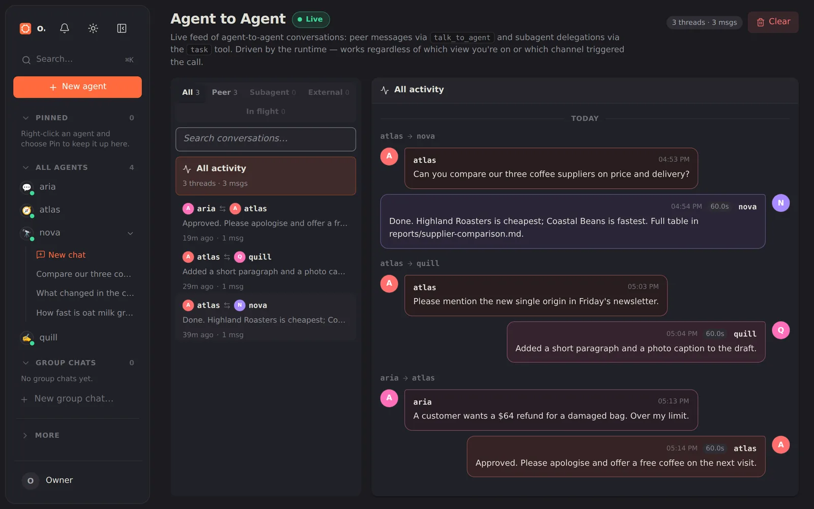

# Agent to Agent

A live view of messages passing between agents: who asked whom to do what, and
what came back. The place to look when a delegation chain does not behave the
way you expected.

<figure markdown="span">
  { loading=lazy }
  <figcaption>Delegations between agents, grouped by pair, with each message and its reply.</figcaption>
</figure>

Calls that cross the deployment boundary are listed here too, under the
**External** segment, and never mixed in with peer conversations: an outside
system asking one of your agents over MCP or A2A shows the caller by the label
of the token or sign-in it used, with an **MCP** or **A2A** badge and a globe
instead of an agent avatar; an agent calling a remote A2A agent shows the
remote by its configured name with an **A2A** badge. Open a row to read the
full exchange. The same conversations appear in the agent's **Chat** history
carrying an **External** pill plus the protocol pill, and the agent's
**External access** tab lists its most recent inbound calls with links to both
views.
