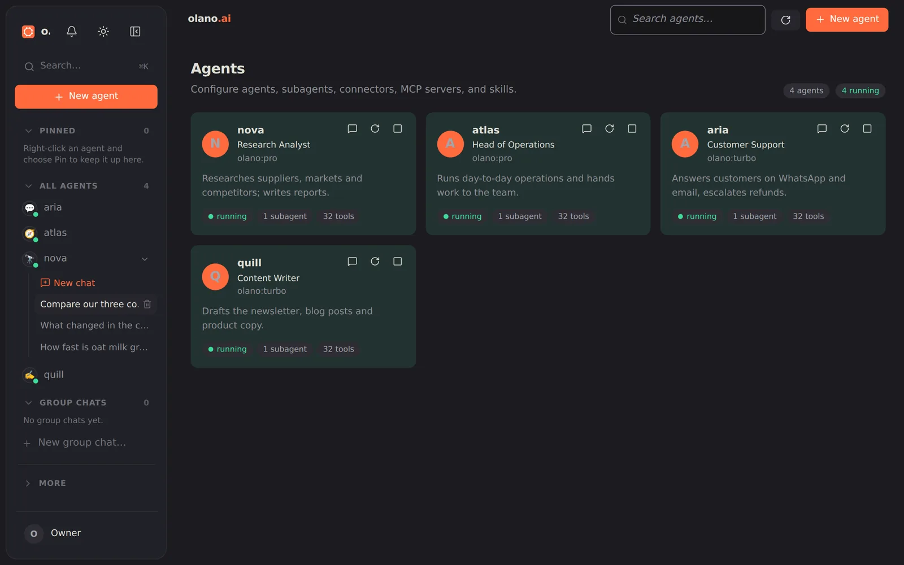
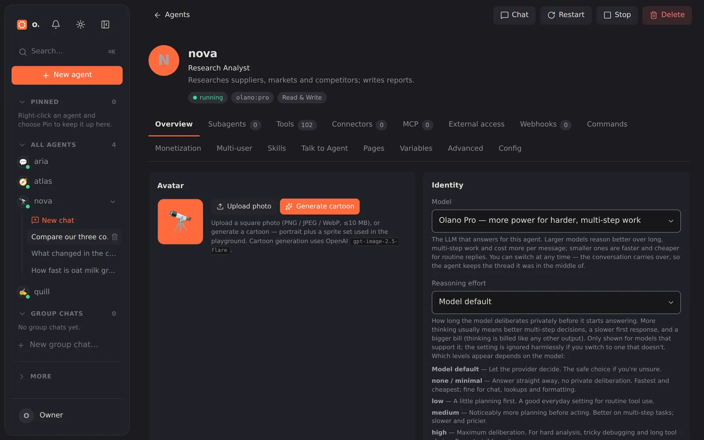

# Agents

The roster: every agent, online or offline, with its emoji, model, and status.
From here you create agents (from a ready-made archetype or from scratch),
start, stop and restart them, and open one for editing.

<figure markdown="span">
  { loading=lazy }
  <figcaption>The roster. Each card shows the agent's title, model and status, with quick Chat, Restart and Stop buttons.</figcaption>
</figure>

**Stopping is not deleting.** A stopped agent keeps its config, workspace,
memory and history, and stays offline across runtime restarts until you start it
again. Prefer stopping over deleting when you just want an agent out of the way.

Opening an agent gives you a detail page with these tabs:

| Tab | What you set there |
|---|---|
| **Overview** | Name, emoji, colour, avatar, description, model, system prompt, and the core behaviour switches. |
| **Subagents** | Specialists this agent can delegate to (see [Agent-to-agent and the org chart](../feature-guides/agent-to-agent.md)). |
| **Tools** | Which tools the agent may use, by category, with a description of each. |
| **Connectors** | Messaging channels — Telegram, Slack, WhatsApp, email and the rest (see [Channels and connectors](../feature-guides/channels-and-connectors.md)). |
| **MCP** | External MCP servers this agent connects to, with live connection health (see [MCP servers](../feature-guides/mcp-servers.md)). |
| **Browser** | The agent's web browser: what it has open, who is in control, and whether it has saved sign-ins. Watching the screen and **Take control** happen in the browser window in the agent's chat; **Open chat** goes there, and **Hand back to the agent** shows here while you hold control. **Close browser** and **Forget sign-ins** are here too. Below them, **When a site asks for a person** (wait for you, hold with no time limit, or skip; empty uses Config → Browser, see [Browser control](../feature-guides/browser.md#when-a-site-asks-for-a-person)) a **Debug trace** for a check that keeps coming back (see [Browser control](../feature-guides/browser.md#when-the-check-keeps-coming-back)), and **Actions that don't ask**: the narrow rules (a site, and send / submit / sign up on it) that let the agent act there without an approval card; admins and the agent's owners edit them, everyone else sees them read-only (see [Browser control](../feature-guides/browser.md#actions-that-dont-ask)). |
| **Webhooks** | Inbound and outbound webhooks (see [Webhooks](../feature-guides/webhooks.md)). |
| **Commands** | Which slash commands are exposed, plus your own custom ones. What you enable here is what the messengers' slash menus offer; changes apply without a restart. |
| **Monetization** | Paid subscriptions for this agent's end users (see [Subscriptions and monetization](../feature-guides/subscriptions-and-monetization.md)). |
| **Multi-user** | Per-end-user isolation for a shared agent (see [Multi-user: two different features](../feature-guides/multi-user.md)), plus **Message policy** — message length caps, silence rules and a reply-length ceiling, which apply to any agent (see [`agent.json5` reference](../agent-json5.md#message_policy-message-length-caps-and-silence-rules)). |
| **Skills** | Reusable procedures the agent can follow. Every skill opens: see [Reading a skill](#reading-a-skill). |
| **Talk to Agent** | Who may message this agent and who it may message, plus its place in the org chart (see [Agent-to-agent and the org chart](../feature-guides/agent-to-agent.md)). |
| **Pages** | Pages this agent publishes at `/pages/<slug>/`: each page's kind (files, static build or server), its state, last error and logs, with Restart and Stop, plus the viewer password that guards all of them. See [Pages](../feature-guides/pages.md). |
| **Variables** | Per-agent environment values. |
| **Advanced** | Backend/sandbox, ACP, budgets, prompt mode, iteration limits. |
| **Config** | The raw `agent.json5`, when the raw editor is enabled. |

<figure markdown="span">
  { loading=lazy }
  <figcaption>An agent's detail page, Overview tab: identity, model and reasoning effort.</figcaption>
</figure>

The Overview tab also carries an **Observability (Langfuse)** card: whether
this agent's turns are traced, what each trace contains and the share of turns
traced. Each choice can be **Follow Config**, which keeps the deployment's
setting from Config → Observability, or a value of this agent's own. The line
at the bottom says what is in effect right now, including where the keys come
from. Changes apply from the agent's next turn, with no restart. To send this
agent's traces to a different Langfuse project, an admin saves keys for it; the
card's settings and the Config card's keys are admin-only.

Most changes need a **Restart** of that agent to take effect. The UI tells you
when one is pending.

## Reading a skill

The **Skills** tab lists every skill this agent can actually reach, and each row
carries two labels that tell you what you are looking at before you open it:

- **Where it lives.** *Common skill* — the shared set every agent on the box
  loads. *Agent skill* — this agent's own, in its workspace. *Learned skill* —
  one the agent wrote for itself. *Configured skill* — from an extra directory
  named in the agent's `skills` setting.
- **Whether you can change it here.** *Editable* or *Read-only*. Common skills
  are read-only from an agent's page on purpose: they are shared, so editing one
  from a single agent would quietly change what every other agent loads. Change
  those in the shared skills folder on the box, or ask AgentFather
  (`olano_install_skill` for every agent, `olano_create_skill` for a new one).

## Switching a skill on or off

Every row also carries an **on/off switch**. It decides whether *this* agent
loads that skill — nothing more:

- **Off** means the skill is not described in the agent's prompt, cannot be
  delegated to, and is ignored by the agent's self-learning. The agent behaves
  as though it does not have it.
- The skill is **not deleted**. It stays on disk and stays in this list, marked
  *Off*, so you can switch it back on whenever you want.
- Turning off a **common skill affects only this agent**. Every other agent on
  the box keeps it. That is the whole reason the switch exists: common skills
  live in one shared folder, so before this the only way to take one away from a
  single agent was to delete it for everybody.
- All skills are **on** by default.

Changes save immediately and apply the next time the agent restarts — the page
reminds you when a restart is pending. Under the hood this writes the agent's
`disabled_skills` list (see [`agent.json5` reference](../agent-json5.md)), so you can also set
it by hand in the raw config.

A row marked **Needs admin tools** has no switch. That skill declares the
tools it is written for (the AgentFather playbooks *olano-admin* and
*olano-agent-builder* need the `olano_*` tools) and this agent does not have
them, so it is never described in the agent's prompt whatever the switch
would say. Granting the tools — the agent's **Tools** tab, or `tools` in its
config — is what makes it appear; *Turn all on* leaves such rows alone.

An agent can work its own switches from a conversation too (*"stop using the
spreadsheet skill"*), if **Manage its own skills** is on in its
self-configuration settings — see
[Ask the agent: self-configuration, magic links and admin tools](../feature-guides/ask-the-agent.md). It can list its skills and switch
them on and off for itself; it can never install, edit or delete one that way.

Click any row to open the skill. The viewer takes most of the screen, because
a `SKILL.md` is a document you are meant to read, not a summary to glance at.
You get it rendered — the actual instructions the agent follows — with the YAML
header folded away above it, and a list of everything bundled with the skill
beside it: scripts, forms, reference documents, example images. Click a file to
preview it; images render inline, and anything the browser cannot show offers a
link to open it raw. On a phone the file list becomes a short index above the
text.

Under the labels, every skill explains in a line where it lives and what that
means for changing it. Editable ones also get an **Open in Files** button that
jumps straight to the folder in the Files tab, which is where you edit it.
