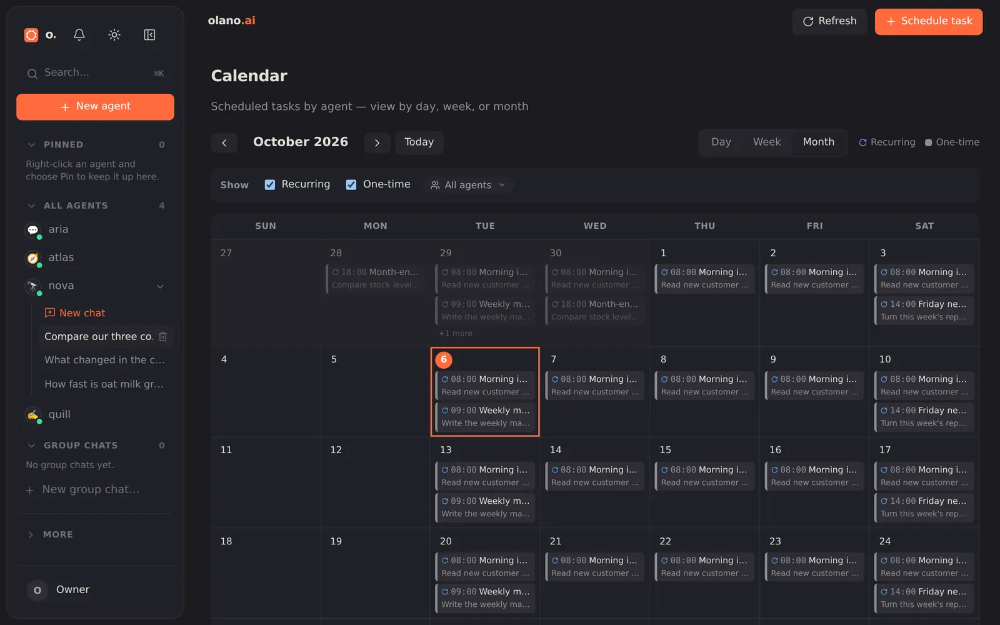

# Calendar

A time-based view of scheduled work and events — the schedule laid out on a
calendar rather than as a list.

<figure markdown="span">
  { loading=lazy }
  <figcaption>The same tasks laid out by month.</figcaption>
</figure>
