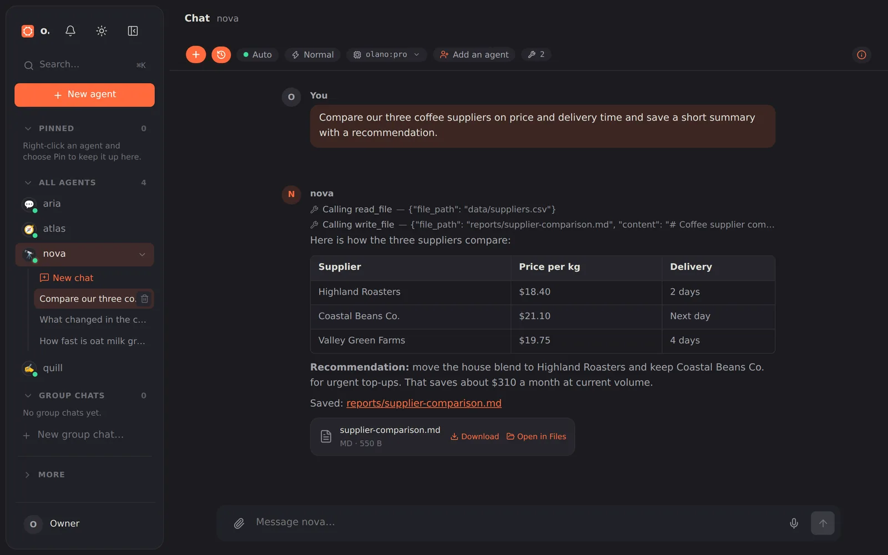

# Chat

Talk to any agent you have access to. Pick the agent in the header, and switch
threads in the conversation list — each thread is a separate conversation with
its own memory of what was said. The header also exposes a per-conversation
model override and, for models that support it, a reasoning-effort control. Live
progress shows what the agent is doing as it works.

**The model chip belongs to the conversation you are in.** A new conversation
always opens on the agent's configured model; pick another in the chip and only
that conversation changes, from its next reply on. Every reply records the
model that wrote it, so when you reopen a conversation later, from any device,
it continues on the model it last answered with rather than on whatever another
chat was set to. You can switch as often as you like within one conversation
and each reply is billed to the model that produced it. If that model is no
longer available on the deployment, the conversation says so once and falls
back to the agent's default. To change the model for every new conversation,
change it on the agent itself.

<figure markdown="span">
  { loading=lazy }
  <figcaption>Tool calls appear in the order they happened, and a file the agent names in its answer becomes a card with Download and Open in Files.</figcaption>
</figure>

**While the agent is still replying you have three choices for your next
message.** Press **Enter** and it **waits**: it is sent as your next message
the moment the reply finishes. Press **Steer** (the ▸▸ button, or
**Cmd/Ctrl+Enter**) and the agent gets it *now*, without stopping: it reads
your message at its next step — as soon as the tool it is running finishes,
before it decides what to do next — and adjusts the work in progress. Steering
is for "not that file", "use blue", "also include Q3": corrections you would
otherwise watch it finish a version without. If the reply finishes before the
agent reaches its next step, the message is simply sent as your next one, so
nothing is lost either way. Press **Stop** (■) to cancel the reply; whatever
was waiting stays waiting. Every waiting message shows as a chip above the
message box with its own **Steer**, **Edit** (take it back into the message
box) and **Cancel** buttons, and **Cancel all** clears them. A message the
agent read mid-reply is tagged **Steered in** in the conversation. Messages
with files attached wait for the reply; they cannot be steered.

**Attach any file with the paperclip**, or by pasting or dropping it onto the
conversation. Each file can be up to 10 MB. What happens next depends on what
the file *is*, judged from its contents rather than its name:

| You attach | The agent gets |
|---|---|
| A photo, screenshot or other image | The file, saved in `uploads/`; it looks at it with its vision tool |
| A voice note, audio or video | The file, saved in `uploads/`, plus a transcript when speech-to-text is on |
| A short text file of any kind (`.txt`, `.md`, `.csv`, `.json`, `.yaml`, `.py`, `.sql`, a `Dockerfile`, a log) | The text itself, in your message |
| A long text file (over about 60 KB) | The file, saved in `uploads/`, so it can read every line rather than a cut-off copy |
| PDF, Word, Excel or PowerPoint, including older `.doc`, `.xls`, `.ppt` and OpenDocument files | The file, saved in `uploads/`; it reads it with its document reader, which converts older formats and reads **scanned** PDFs with OCR |
| A `.zip` or any other file | The file, saved in `uploads/`; an agent with a shell can unpack or inspect it |

Agents open these files only with the tool made for each kind. If an agent tries
to read a recording, a video, a document or an archive as a plain file, it is
told which tool to use instead (speech-to-text for audio and video, the
document reader for PDF and Office files, the shell for archives), so a voice
note never enters the conversation as raw audio data. Images in PNG, JPEG, GIF
or WebP it can still look at directly, up to about 3.7 MB each; larger ones go
through its vision tool.

Because saved files are the real files, the agent works on every row and formula
of a spreadsheet, not a summary. A saved file shows as a card in your message
with **Download** and **Open in Files**. Team members with read-only access
cannot save into the agent's workspace, so for them the text of a document or
text file is read once and added to the message instead, and other types arrive
as a note that the file could not be read.

**Add an agent** sits in the same header row, beside the MCP status, whenever
group chats are on and you have a second agent. It brings another agent into
this conversation by turning it into a *group chat*: the agent you were talking
to stays the one that answers anything that names nobody, the agents you add
reply when you @mention them, and — unless you switch **Bring the conversation
along** off in the dialog — the recent messages of this chat are copied in so
nobody starts blind. Your one-to-one chat is left exactly as it is; the group
is a separate conversation, listed under **Group chats** in the sidebar, and
it opens as soon as it is made.

**When the agent is using its live browser, you can watch it.** A small window
appears in the corner of the conversation with the agent's screen and a cursor
that moves to whatever it clicks. Click the window to open it large and take
control (to sign in, enter a code or finish a step yourself), hand back, and
collapse it again. When the agent waits for your approval (to submit a form,
buy or send), the window folds into a small **Approval needed** pill and the
approval card is scrolled into view, in every approval mode. On a phone the
window is always the pill; tap it to open the browser full screen. It appears
only when browser control is set to live; see
[Browser control](../feature-guides/browser.md#watching-and-taking-control-live-mode).

**A conversation is live on every device, whichever surface the turn came from.**
Open the same thread on your laptop and your phone and both follow it as it
happens: a message that arrives over Telegram, a scheduled run, a turn sent
through the OpenAI-compatible connector, or something you type in another
browser shows up in the open conversation without a reload — the agent's
working indicator, its tool calls as they run, the reply forming, and the final
answer. The indicator names the surface the turn is running from ("Working on
this from Telegram…"). New conversations started elsewhere appear in the
conversation list the same way, and one touched elsewhere moves to the top. If
a device was asleep or offline, the thread catches up on its own when the tab
comes back.

**The agent keeps working when you put the device down.** Closing the tab,
locking your phone, switching apps or moving between Wi-Fi and mobile data does
not stop a reply in progress: the turn runs on the deployment, not in your
browser, and only the *view* of it goes away. Come back — the same tab, a new
tab, or a different device — and it rejoins the reply exactly where you stopped
seeing it, filling in the words, tool steps and files you missed, then carries
on live. A reply that finished while you were away is simply there when you
return, and a conversation the agent is still working on shows as busy in the
conversation list even on a device that never saw the turn start.

This is why **Stop** (■) is the way to end a reply: it tells the deployment to
stop, so it works from any device, and the agent stops whether or not the tab
that started the reply is still open. Closing the tab is not a stop.

Two consequences worth knowing. Sending again while a reply is still running
does not start a second one — a conversation runs one reply at a time, so the
message either steers the reply in progress or waits its turn, exactly as
described above. And "Connection lost while … was replying" now means what it
says: the reply is genuinely gone (the deployment restarted, or it ended long
enough ago to have been cleared), which is when **Retry** appears. While the
reply is merely catching up you see **Reconnecting** instead, with no Retry —
nothing was lost, so there is nothing to resend.

**Everyone who can chat with an agent shares its whole conversation list, and
can pick up any conversation in it.** A scheduled run, a heartbeat, a
conversation that arrived over Telegram or WhatsApp, a chat a colleague started
here — open it from the list and reply, and the agent continues with everything
that was said in it (ask "what did you just do?" under a scheduled run and it
answers about that run). Messages show who wrote them, so a thread several
people have typed into stays readable. Two things to know: a reply you type here
into a messaging-platform conversation is recorded and badged in that thread but
is not sent out to the platform, and deleting a conversation removes it for
everyone, so that is reserved for admins and the agent's owner — anyone with
access can still rename or compact it.

Three buttons in your theme's own colour frame the header row, laid out the
way the simple view's chat header is. A filled pair leads it: a **+** that
starts a new conversation and, right beside it, a **clock** that opens your
past ones. An **info** button (ⓘ) closes the row at the right: it opens the
agent's **profile card** — its face, name, title and description, an **Edit
profile** button for those allowed to change them, and (for admins) doors
into its settings, connections and keys — as a panel that slides in from the
right, exactly where the simple view keeps the same card. Only one of the two
panels, the conversation list or the profile card, is open at a time; pressing
either button closes the other.

**The conversation list is a panel that slides in from the right, not a column
that sits there.** The conversation itself always gets the full width of the
window; press the clock and your past conversations slide in over the right-hand
side. Pick one (or start a new one) and the panel closes again — so does
clicking the page beside it, pressing Escape, or the ✕ in its corner. It opens
closed every time you arrive, at every screen size, so the list is one click
away without ever costing you room to read. On a desktop you can drag its left
edge to make it wider or narrower, and that width is remembered; on a phone it
is sized to always leave a strip of the page beside it to tap on.

**Every conversation shows where it came from.** A thread that arrived over a
messaging platform carries a coloured badge with that platform's name beside its
title — TELEGRAM, WHATSAPP, SLACK, DISCORD, WECHAT and so on, one colour each —
and the person you are talking to on the line underneath. Conversations you
start here in the dashboard carry no badge: they are the default that everything
else is read against. The same badge appears in the header of the open
conversation.

Inside a conversation, a badge appears on an individual message only when that
message arrived by a **different** route than the thread itself. So a reply you
type here inside a Telegram conversation is marked, and the Telegram messages
around it are not — which is what makes a conversation that moved between
surfaces readable at a glance, without putting the same label on every line.

Conversations that predate this all still get labelled: the agent already
remembers every chat it has been messaged in, and the badge is recovered from
that. A conversation that only ever existed here stays unbadged, as it should.

One badge is not about a messaging platform: a violet **CORTEX** marks a
conversation you opened from the Cortex tab — pressing **Chat** on a Pulse card,
a self-check finding, or a Cortex item brings the discussion here, and the badge
is how you find it again among your other dashboard chats. It is an ordinary
conversation in every other respect: reply to it, rename it, keep it, delete it.

## Rating a reply

Under each finished reply, beside **Copy**, are a thumbs up and a thumbs down.
They are there for everyone who can read the conversation, in the dashboard
chat and in the simple chat.

- **Thumbs up** records that the reply was good. **Thumbs down** records that
  it was not, and opens a small box for an optional comment on what went wrong
  (up to 2000 characters). The vote counts as soon as you press the thumb; the
  comment is extra, and **Skip** closes the box without one.
- The thumbs are the same plain colour as **Copy** until you vote. Your vote
  then turns green (up) or red (down) and stays lit, so you can see it later
  and after a reload. Press the
  other thumb to change it, or the lit one again to take it back.
- Each person has one vote per reply, and only you see your own. **Insights**
  shows the totals per agent.
- Votes are kept on this deployment, with or without Langfuse. When the
  agent's turns are traced to Langfuse (Config → Observability), the vote is
  also sent there as a `user_feedback` score on that reply's trace (1 for up,
  -1 for down; taking the vote back removes the score). The comment is sent
  only when traces include full content; with the default, metadata-only
  traces, it stays on the deployment. Votes cast while tracing is off are never
  sent later.
- Replies from before this feature have no thumbs.
- Deleting a conversation deletes its votes too.

## Opening a reply in Langfuse

When tracing to Langfuse is on (Config → Observability) and the connection has
been tested, an admin whose account has **Langfuse** links switched on (Admin →
Users, off by default) sees a **Langfuse** link beside **Copy** under each traced
reply. It opens that reply's trace in Langfuse in a new tab: the turn with every
model call and tool call under it. Members never see the link, and a reply that
was not traced (tracing off, or not chosen by the sampling rate) has none. Deleting
a conversation also deletes its traces in Langfuse.
