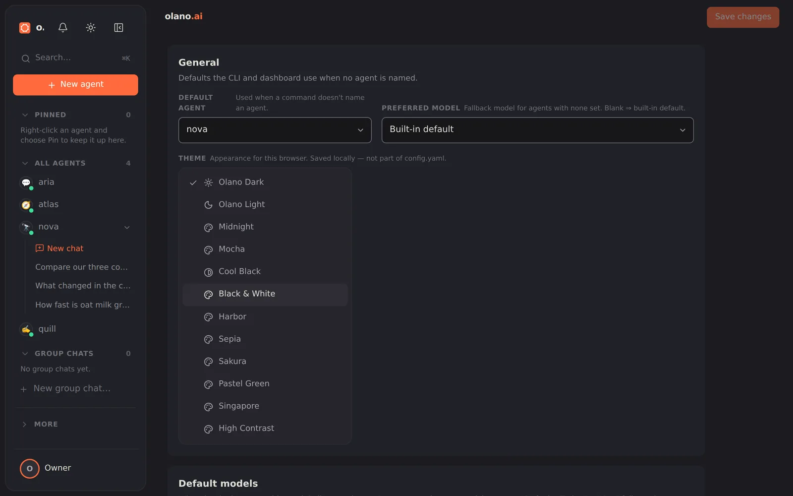

# Config (admin only)

Not a tab in the left navigation: open it from the **account menu** — your name
at the bottom-left of the sidebar — under **Administration**, or type "Config"
into the ⌘K search. Admins only; members do not see the entry.

Deployment-wide settings — everything in [`config.yaml`](../config-yaml.md)
with a form for each block: team accounts, member bot creation (whether
non-admins may create their own bots, how many each may own, and which
templates they may pick from), cognition defaults, heartbeat, disk monitoring,
MCP connection health, deployed pages (the switch for page builds and servers, servers per agent, health checks and request limits; see [Pages](../feature-guides/pages.md)), browser control (mode, where it runs, how many agents
may browse at once and the idle timeout, plus the live browser's install
status; see [Browser control](../feature-guides/browser.md)), context window (what a compaction keeps and the MCP
result cap), revisions, issues, speech, media, web search, rate limits,
catalog sync, and the ports.

<figure markdown="span">
  { loading=lazy }
  <figcaption>The General card: default agent, preferred model and the theme for this browser.</figcaption>
</figure>

The **Mobile app** card decides what the Olano app on people's phones shows:
the Cortex tab, the Inbox tab and each of its sections (Approvals, Alerts,
Issues), and the Files, Credits and Usage, and Transcribe on this phone rows in
the app's Settings, plus where voice notes are transcribed for people who have
not chosen (on the deployment, by default). It is saved with the page's Save
button, and phones pick it up the next time the app is opened or brought back
to the foreground. The keys are in the
[`config.yaml` reference](../config-yaml.md#mobile_app-what-the-mobile-app-shows).

The **Cloud catalogs** card shows each synced catalog (model pricing, the MCP
directory, credit rates, agent archetypes, official connector clients) with its
revision and where it is being served from, and a **Sync now** button that
re-fetches everything immediately instead of waiting for the hourly background
check — useful right after a new official connector is enabled for your
deployment, so its one-click Connect button appears without the wait.

The **Observability (Langfuse)** card sends each agent turn to a
[Langfuse](https://langfuse.com) project as one trace, so you can see every model
call and tool call of a conversation with its timings, tokens and credits, and
search them over time. It is off by default and agents cannot change it. The
switches (on or off, the Langfuse address, what each trace contains, the share
of turns traced, an environment name, whether Cortex background work is traced)
are saved with the page's Save button, like the rest of the page; the field
meanings are in the [`config.yaml` reference](../config-yaml.md#observability-tracing-to-langfuse).
Choosing **Full content** puts a warning on the card before you save: traces
then hold the conversations themselves. The keys and the connection test act at
once instead:

- **Langfuse keys**: paste the public key (`pk-lf-…`) and secret key
  (`sk-lf-…`) from Langfuse → Settings → API keys and press **Save keys**. They
  are stored in the vault, hidden from agents and from the Vault page, and never
  shown again. The line above the boxes says which keys are in use: the ones
  saved here, the server's `LANGFUSE_*` environment variables, or none.
- **Test connection** checks the keys against the Langfuse address and
  remembers the project, which is what lets conversations link to their traces.
  A failure says why; a refusal on Langfuse Cloud is usually the wrong region.
- **Status** shows how many steps were sent since the last restart, or the last
  problem, with a link to open the project in Langfuse, and **Agents with their
  own setting** lists the agents that override the card from their own
  Observability card (see [Agents](agents.md)).

The **Disk encryption** card appears only on a managed instance whose data
lives on an encrypted volume (see [Privacy and security](../feature-guides/privacy-and-security.md)); a
self-hosted install never shows it. It reads the state of that volume (the
custody mode, the volume's identifier, whether a header backup exists and which
generation is current, whether the instance's encryption service is answering)
and holds the one action the volume asks of you: **Create recovery key**. The
key is generated on the instance, shown to you once, and confirmed by typing it
back, so a copy you never checked cannot be the one you rely on. A key that was
shown and not confirmed stays pending for fifteen minutes (**Confirm the shown
key** or **Cancel pending key** on the card), and **Replace recovery key** makes
a new one that takes over only once it is confirmed. The **Encryption
service** row names the version of the service on the instance that answers
these actions; when it reads *Unavailable*, that service is not answering: your
data stays encrypted and the instance keeps working, only the recovery-key
actions pause (**Refresh** re-reads the state; if it stays unavailable after a
restart of the instance from the cloud console, contact support). Every row's
hint explains what the value means and what the buttons do.

Some fields (ports, team accounts) only take effect after a runtime restart; the
form says so.

**Saving.** The page is long, so **Save changes** and **Discard** live in the
bar at the top, which stays put while you scroll — you never have to scroll
back up to save. While anything on the page differs from what is saved, an
**Unsaved changes** badge sits beside the buttons. Three things then guard the
edits: clicking anywhere that would leave the page (a sidebar entry, the ⌘K
search, a link inside the page) asks **Save and leave / Leave without saving /
Stay on this page** — *Save and leave* is greyed out while a field is invalid,
and the dialog says which case you are in; closing or reloading the tab gets
the browser's own "leave site?" prompt; and if the edits sit untouched for
about a minute, one reminder toast says so. The browser's **Back** button is
the one exit that is not intercepted, so use the sidebar or the dialog to
leave. The **Usage budgets** card has its own Save button beside its fields
and is not part of this — save it where you edit it.
