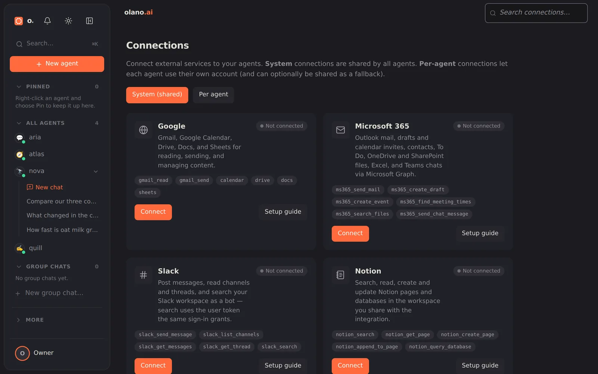

# Connections

Opened from the **account menu** (bottom-left) under **Setup**, or from ⌘K.

One card per service an agent can be signed in to — GitHub, Google, Microsoft
365, Salesforce, HubSpot, QuickBooks, Shopify, Slack, Notion, LinkedIn, X, Meta, Reddit,
DocuSign and more. Each card shows whether it is connected, which sign-in
methods it offers, and — when a connection has expired — a way to renew it.
A connection made here is *the* credential for that service: the service's
toolkit, any MCP server for it and the git tools all use it, with nothing else
to configure and no restart.

<figure markdown="span">
  { loading=lazy }
  <figcaption>One card per service, listing what that connection lets an agent do.</figcaption>
</figure>

Each card also lists the tools that service brings. They turn **green** once the
service is connected — those tools are live for your agents; while it is not
connected they stay neutral, as a preview of what connecting would grant.

There are four ways to connect, and a card shows the ones its service offers:

- **Connect with Olano's app** (shown when available): one click, nothing to
  configure. You approve access on the service's own consent screen — no
  developer account, no OAuth client, no redirect URI to register. The card
  shows *via Olano's app* on connections made this way, and tokens are stored
  only on your deployment. Which services offer this arrives via background
  sync: opening this page checks for updates within seconds, and Config →
  Cloud catalogs → **Sync now** forces an immediate refresh. This option is
  for Olano Cloud deployments: an Olano API key on a self-hosted install does
  not unlock it, so a self-hosted install uses its own OAuth app instead.
- **Use your own OAuth app**: the classic **Connect** form — create an OAuth
  client in the service's developer console, register the shown redirect URI,
  and paste the Client ID and Secret. Your own client always takes precedence
  when both are configured.
- **Sign in with a code**: for services that offer it (GitHub does), no app to
  create and no fields to fill. The panel shows a short one-time code and a
  button to the service's device page; enter the code there on any device — a
  phone is fine — approve, and the card turns Connected on its own. This is
  the route to use when you have no OAuth app and do not want to create one.
- **Paste a key**: store the service's API key or personal access token in the
  **Vault** under the name the service's toolkit reads. The reference list is
  on each card's setup guide. A key still works for every service — it is
  simply the last resort, since it never expires on its own and has to be
  rotated by hand.

**Scopes.** Every card works at two scopes: **System** (one connection every
agent uses) and **Per agent** (that agent's own account, optionally shared
with the others as a fallback). Inside a tool call the agent's own connection
wins, then a shared one, then the system one — which is how three agents can
post from three accounts of the same service. The **Vault** page (account menu
→ Administration) remains the place to see and manage stored keys.

An agent can hand you any of these from a chat: ask it to connect a service
and it sends a magic link ([Ask the agent: self-configuration, magic links and admin tools](../feature-guides/ask-the-agent.md))
for the best method the card offers — Olano's app if there is one, otherwise
your own app, otherwise a code, and a secure form for a key. Nothing is ever
pasted into the conversation.

**When a connection stops working.** Any service on this page, Google
included, can refuse a saved sign-in while its card still says *Connected*: an
admin revoked the session, the grant died with a password change, or the token
outlived what was stored. The card cannot see that; the agent's tools can,
because they are the ones handed the `401 Unauthorized`. The first refusal is
repaired silently when it can be (the token is refreshed and the call retried
once), whichever service and whichever tool. When that fails, the card turns
**Needs reconnecting** with the service's own words under the badge, its
button reads **Reconnect**, and the agent does not stop at the error: it tells
you the sign-in has expired, offers the routes this deployment has (a
reconnect link, a sign-in code or a pasted personal token where the service
allows one, the card's Disconnect then Connect as the manual route), suggests
what else can reach the same service if you cannot reconnect right now, and
finishes your request once you have signed in again. A reconnect replaces the
broken connection in place; you never have to disconnect first. A token you
pasted into the Vault by hand gets the same treatment with a different fix,
since nothing renews it: connect the service through this page so its tokens
refresh on their own, or store a fresh token when asked. MCP servers get the
same care in the agent's MCP tab (see [MCP servers](../feature-guides/mcp-servers.md)).
