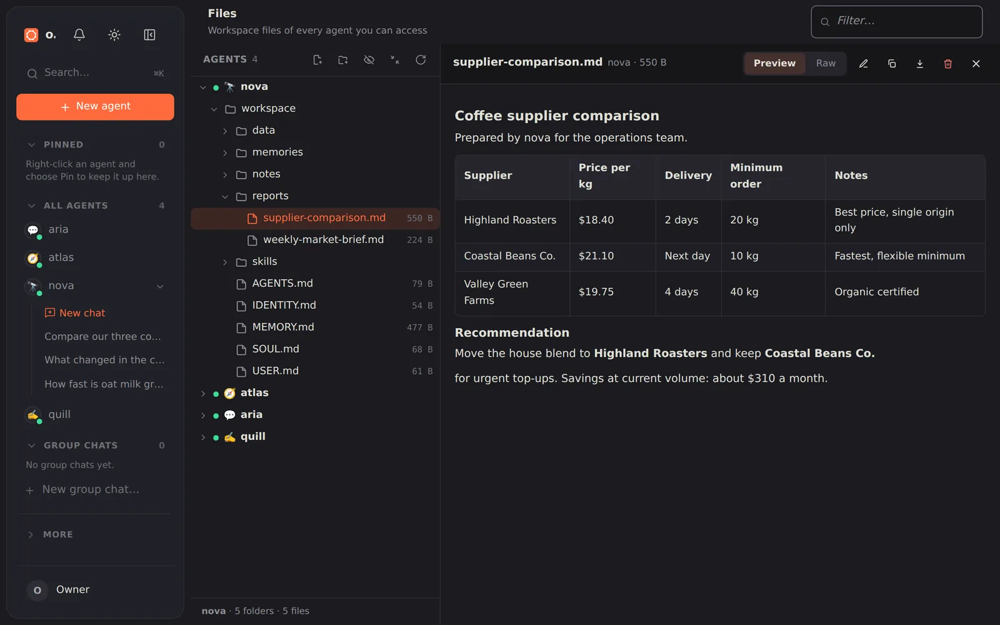

# Files

A file browser for agent workspaces. Read, edit, download and delete files,
including the identity and memory markdown files that shape the agent's
behaviour. Deleting through the agent's own tools moves files to a recoverable
`trash/` folder rather than destroying them.

<figure markdown="span">
  { loading=lazy }
  <figcaption>nova's workspace, with a report open in the preview.</figcaption>
</figure>

The tree lists **every agent you have access to**, each as a collapsed row
with a `workspace` folder under it, so you browse the whole team from one
place without switching the agent picked elsewhere in the dashboard. Nothing
is loaded until you open it: expand an agent, then its workspace, then the
folders you want — each one lists on demand. Right-click an agent or its
workspace row to create a file or folder there or refresh it; the toolbar's
**New file / New folder** buttons land wherever the row you last clicked lives.
The footer names the agent whose files you are looking at. Links from other
tabs (a Cortex item's files, a skill's folder) open straight to the file under
its agent.

**Upload files from your computer or phone.** Tap or click the folder you want
the files in (or a file, to use its folder; or the agent or `workspace` row,
for the workspace root), then press **Upload** in the toolbar, the arrow next
to New folder, and pick one or more files. Right-clicking a folder, an agent or
its workspace row offers **Upload files…** too. Each file can be up to 100 MB;
larger ones are skipped with a message naming them. A line under the toolbar
shows progress, and when the upload finishes the folder opens in the tree (a
single file opens in the preview). If a file of the same name is already
there, you are asked whether to replace it; **Keep existing** skips just that
file. Files keep the names you gave them, and the agent can use them straight
away: tell it in chat where you put them. Members with read-only access do not
see the Upload button.

**Files an agent produces.** Every agent keeps one layout: `reports/` holds
everything it makes for you (charts, images, PDFs, spreadsheets, documents,
exports — one canonical file per deliverable, revised in place), `scratch/`
holds its scripts and intermediate files, and `uploads/` holds what you sent
it in chat or on a messenger. When an agent names a file in its reply — its own `Saved:` line,
a path in backticks, or a full path — the chat shows it: images, audio and
video render inline, and every other file appears as a card with **Download**
and **Open in Files**, which jumps to that file in this tab. The same works
when you reopen an old conversation. On a messaging channel the agent's
`Saved:` line attaches the file to the chat instead. Members see and download
the files of the agents they have access to; editing and deleting stay with
admins.

Only the agent's **finished answer** attaches files, and only the files it
names there. A path that came up while it was working — a file it opened to
read, a scratch file, a path quoted out of some document — is not attached, so
you get the deliverables and not everything the agent touched on the way. If it
names the same file more than once in one answer, you still get one card. Agents
are told to list every file they made or changed for you, with its full path, so
if one leaves something out, say so — and if you would rather it not attach a
particular file, tell it that too.

**What an agent can do with documents.** Every box now carries the tools an
office document actually needs, so an agent does not have to explain that it
cannot: it can turn a Word file, a spreadsheet or a slide deck into a PDF (and
open a legacy `.doc`), read a **scanned** PDF or photographed page with OCR,
merge, split, rotate and unlock PDFs, and check its own work by looking at the
pages it produced. Two limits worth knowing: OCR reads **English** — for another
language the agent reads the page with its vision instead, which it will say —
and a converted document uses substitute fonts for any typeface the box does not
have, so the common ones (Arial, Times New Roman, Courier New) keep their layout
and an unusual one may shift. Ask for the result you want ("turn this into a
PDF", "what does this scan say") rather than naming a tool.

If an agent runs on your own machine rather than a hosted box, whoever installed
Olano could have declined these packages — the agent checks before it relies on
one, and tells you what it did instead.

On a hosted box every agent also has Olano's four document skills, **docx**,
**xlsx**, **pptx** and **pdf**: step-by-step know-how for building, editing and
checking Word files, spreadsheets, slide decks and PDFs. They arrive with the
box's shared skills and update on their own; you see them on the agent's
**Skills** tab as common skills. A self-hosted installation does not include
those four skills. Its agents can still work with documents using the tools
above, they just do it without that extra guidance.

The tree is fully keyboard-driven: ↑/↓ move, → opens a folder or steps into
it, ← closes one or steps back to its parent, Home/End jump, Enter opens,
**F2** renames, ⌘⌫ / Ctrl+⌫ deletes, and typing a few letters jumps to the next
row that starts with them. Very large folders show their first 2,000 entries
and say how many more there are — use the filter box to narrow. A very large
text file previews its beginning, says so, and offers the download for the
rest; editing is switched off for it so a save can never lose the part you
were not shown.

The **Filter** box searches by name across **every workspace you can access**,
not just the folders you have opened: type `memor` and each agent's
`MEMORY.md` appears under its agent row even with everything collapsed. Matching
is case-insensitive and looks at the file or folder name and at its path, so
`memories/2026` finds a daily log by its folder. It starts from two characters,
waits for you to pause typing, and searches everything at once — press Enter to
search without the pause, Escape to clear. Version-control, dependency and cache
folders are skipped, and dot-files only take part while the eye button shows
them. Click a match to open it and reveal it in the tree; when there are more
matches than it shows, it says so — keep typing to narrow.

Markdown and HTML files open in a rendered preview, with a **Preview / Raw**
toggle in the preview header to switch to the source. An HTML page renders
live in an isolated frame: stylesheets, scripts and images it references by
relative path are pulled from the same workspace folder, so a small prototype
site looks the way a browser would show it. The frame is sandboxed — the page
runs cut off from your dashboard session and cannot read or change anything
outside its own preview.

Images, audio, video and PDFs play or display inline. A file that is none of
those and not text either (a `.zip`, an Office document, a database, a program)
is never printed as text: the preview shows its type and size with a
**Download** button, so you can open it in an app that understands it.

On a phone the tree and the preview are not side by side — whichever you are
using gets the whole screen. The tree is what you browse; opening a file hands
the screen to the preview, and the **All files** button at the left of its
header hands it back. The **Preview / Raw** toggle and the file actions sit on
their own row under the file's name, so the name stays readable however long it
is.

Files whose name starts with a dot — `.env`, `.olano/`, `.git/` — are left
out of the tree by default, so a workspace opens on the files you work in. The
**eye button** in the tree toolbar shows them; click it again to hide them. The
button lights up while they are showing, and your choice is remembered the next
time you open the dashboard. It only changes what the tree *lists*: a hidden
file you open, edit or delete behaves like any other file, and a link that
points at one turns the toggle on for you.
