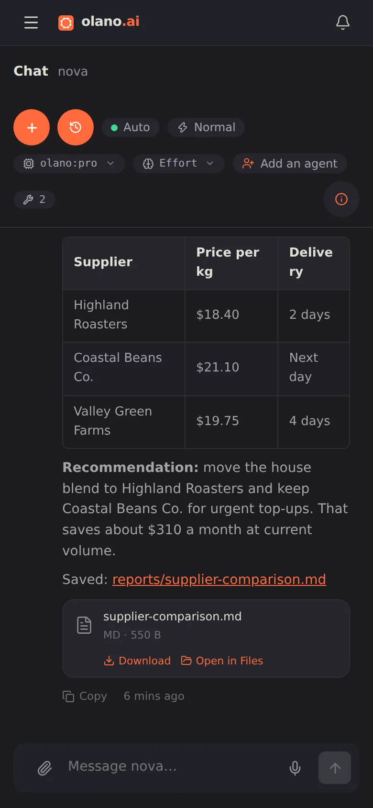

# The dashboard

## Two interfaces: full dashboard and simple chat

Olano can show a person one of two entirely different screens after they sign
in, chosen per account:

- **Full dashboard** — the complete control panel described in the rest of this
  section: every agent, the scheduler, files, memory, tools, connectors,
  configuration and diagnostics. This is the default for **every** account,
  including all existing ones, so nothing changes for anyone unless you change
  it deliberately.
- **Simple chat** — a stripped agent-chat app. A list of the agents that person has
  been given, the conversation with the selected one, attachments, voice, and
  the agent's profile. No settings, no diagnostics, no token counts, no model
  pickers. Suited to staff who only need to talk to an agent and would find the
  full console noisy.

  People can also **create agents of their own** here: the **New agent** button in
  the agent list (and on the you-have-no-agents screen) builds one from a template
  or from a plain-words description. It asks for a **name** — a real name,
  like "Hillary" — and shows the permanent handle it will generate from it;
  a template's own label becomes the agent's **title** (shown under its name in
  the profile and chat header), never its name. A **Model** dropdown lists only
  the models this deployment can run right now — the deployment defaults, the
  Olano tiers and any provider connected with its own key — pre-selected to
  **Default · Turbo**; with a template picked, **Template's own model** keeps
  the one it was designed for. Admins always have the button;
  members have it while member bot creation is on, which it is by default —
  see the `self_serve_agents:` block in [`config.yaml` reference](../config-yaml.md) and
  **Config → Member bot creation**.

  By default the simple view shows replies only, with a single "working on it"
  line while the agent acts. A **detail button in the chat header** cycles three
  levels — Quiet, Normal (one compact line per tool the agent uses), Verbose
  (each tool's full input and result, the same rendering the full dashboard
  shows) — and typing `/quiet`, `/normal` or `/verbose` does the same. The
  choice is remembered per browser. Typing `/context` shows the same
  context-usage card the full dashboard's chat offers: how much of the agent's
  working memory this conversation and its setup are using.

  When the agent asks **another agent** for something, that "working on it" line is
  replaced by a more specific one — *"maria is thinking…"*, with that agent's own
  face beside it — and it clears the moment the answer comes back. It shows at
  every level, Quiet included, because it is about who is working rather than
  about tools. Without it the chat looks frozen for as long as the other agent
  takes, which can be a while. What that agent says comes back inside this agent's
  reply rather than as a message of its own.

  The agent list is built for real fleets. The selected agent's chats unfold under
  its row, each labelled with where it came from — **SCHEDULED**, **TELEGRAM**,
  **WHATSAPP**, **AGENT** and so on, the same badges the full dashboard's
  conversation list uses; an ordinary chat typed here carries no badge. A row of **filter
  chips** (All · Chats · Telegram · Scheduled · Agents · …) narrows the list to
  one source — the way to hide a chatty schedule's runs — and the choice is
  remembered per agent on that browser. The list under an agent shows only the most
  recent handful; **"Show all N chats"** opens the full list in the right-hand
  panel, with a search box, the same filter chips, and paging ("Show more") so
  an agent with hundreds of conversations stays fast. **Selecting an agent opens
  its latest conversation** — the newest one a person is in, typed here or
  arrived over a messenger, then the newest of any kind, and a fresh chat only
  when there is nothing at all (a fresh chat is not saved until you send
  something, so reopening an agent never piles up empty ones); switching agents
  and back keeps the chat you had open. A **chevron** at the end of every
  agent row folds or unfolds its chats in place: on the selected agent it is
  the fold, on any other it selects that agent and unfolds its chats without
  leaving the list. It shows on hover on a desktop (always on the selected
  row) and is always visible on a phone, where it is how you browse an agent's
  chats from the drawer — tap the chevron, then the chat you want; tapping the
  agent's *name* goes to its latest chat and closes the drawer. On a desktop,
  clicking the selected agent's row also folds its chats away (click again to
  unfold); **right-clicking any agent**
  opens a quick menu — new chat, see all chats, its profile, pin/unpin, move
  the row up or down, mark its unread as read; **right-clicking a chat** offers
  to rename, open or delete it. On a wide screen the whole list
  can be **resized by dragging its right edge** (double-click the edge to
  reset); the width is remembered per browser.

  **Arranging it.** Each of the three headings — **Pinned**, **All agents**,
  **Group chats** — folds away on a click and stays folded on that browser, so
  a long list can be cut down to the part you use. Agents can be **dragged up and
  down** to the order you want, and dragged across the divider between Pinned
  and All agents to pin or unpin them; that order is remembered per browser too,
  and an untouched list stays alphabetical. Dragging is off while the search box
  has something in it (the order it would write covers agents the filter is
  hiding) — use **Move up** / **Move down** on the right-click menu instead,
  which is also the way to do it from a phone or a keyboard.

  **Offline agents fold away.** Under **All agents**, the agents that can
  answer come first. Agents that are **paused** (someone pressed Stop) or
  **not running** sit behind one **N offline** row at the foot of the list,
  closed until you click it; the choice is remembered on this browser. Opened,
  those rows are drawn dimmed. A few agents never fold: pinned ones, the agent
  you have open, and any with unread replies. When nothing under All agents is
  running (while the deployment starts up, say), the rows are listed flat
  instead, and while the search box has text in it every match shows, folded
  or not. The dot on each face says where an agent stands: **green** answers
  right away, **amber** is starting, stopping or not available on this
  deployment, **red** failed to start, and **grey** is paused or not running.
  For amber and red the reason is written on the row itself, under the name.

  The button beside the **Agents** heading **collapses the list to a strip of
  faces**: names, previews, search and the open agent's chats go, the three
  headings stay, and clicking a face switches agents. Handy when a conversation
  wants the width; the same button brings the list back, at the width you had
  set.

  **Right-clicking the empty space** below the list offers the two things this
  rail can create — **New agent** and **New group** — which is the fast way to
  either from anywhere in the list. (Right-clicking a *row* still offers that
  row's own actions; see above.)

  A **notification bell** sits at the head of the list, the same one the full
  dashboard carries and fed by the same source: anything this deployment needs a
  person for — a channel that failed to start, a connector asking to be signed
  in, an action waiting on an approval — shows a count there and lists itself
  when you click it. **View all** opens the Overview panel below.

  **More.** Below the group section, under a divider, a collapsible **More**
  group holds five of the full dashboard's pages — **Overview**, **Insights**,
  **Issues**, **Cortex** and **Files** — and opens them in place of the
  conversation. They are the same pages, not cut-down versions: Overview is the
  deployment snapshot with its notifications and approvals, Insights is usage and
  spend, Issues is the tracker, Cortex is what the agent has been thinking about,
  and Files is its workspace. Picking an agent, one of its chats, a group, or
  **New chat** while a page is open returns to the conversation (on a phone the
  drawer closes on it, as it does over a chat), and the browser's Back button
  brings the page back. A page a deployment has switched off in **Config** is
  not listed here either.

  More starts **closed** on a browser that has never opened it, and after that it
  is whatever you left it — open it and it stays open across reloads, close it and
  it stays closed. Pages can also be **dragged out of More** into the space just
  above it, exactly as the full dashboard's own nav items can, so the one or two
  you actually use stay visible with More shut; drag them back in to undo it.
  Right-clicking a page offers the same move, which is how to do it from a phone
  or a keyboard. The arrangement is remembered per browser and is separate from
  the full dashboard's own — rearranging one does not disturb the other.

  The account menu at the bottom of the agent list holds theme and language —
  one dropdown each — and, on a team install, **Sign out**; for an admin it also
  has the **Simple view** switch, which flips back to the full dashboard. It
  opens whole with the list collapsed to a strip too, hanging off the strip
  rather than being cut to its width.

Set it per person in **Admin → Users**, in the **Interface** column. On a
single-user install (no team accounts) the equivalent switch is the `ui_mode`
key in `config.yaml` — see [`config.yaml` reference](../config-yaml.md).

**This is a display choice, not a permission.** Moving someone to Simple chat
does not restrict what they are allowed to do, and moving them to the full
dashboard does not grant them anything. What a person may actually see and do
is decided entirely by their **role** (admin or member) and by which agents
they have been given access to, and those rules are enforced by the server
whichever interface is on their screen. Use the Interface setting to reduce
clutter; use Role and per-agent access to control access.

## The full dashboard

The dashboard is the control panel for the whole deployment. The sidebar lists
every section; you can reorder it by dragging, and the search box (top left)
jumps to a section, an agent, a task, or an individual setting by name.

| Section | What it is for |
|---|---|
| [Overview](overview.md) | Which agents are online, notifications, and the Approvals inbox. |
| [Insights](insights.md) | Token and cost usage over time, per agent and per model. |
| [Chat](chat.md) | Talk to any agent you have access to, one thread per conversation. |
| [Agents](agents.md) | The roster: create, start, stop and edit agents. |
| [Cortex](cortex.md) | The background work agents do between conversations. |
| [Scheduler](scheduler.md) | Every scheduled job: what runs, when, and how it went. |
| [Issues](issues.md) | A work tracker shared by agents and people. |
| [Revisions](revisions.md) | Version history of configuration and markdown files. |
| [Calendar](calendar.md) | Scheduled work laid out on a calendar. |
| [Files](files.md) | Browse and edit agent workspaces. |
| [Memory](memory.md) | What each agent remembers, and where you correct it. |
| [Notes](notes.md) | Each agent's linked markdown wiki. |
| [Knowledge](knowledge.md) | Documents indexed so agents can search them by meaning. |
| [Tools](tools.md) | Every tool on the deployment, and why a locked one is locked. |
| [Providers](providers.md) | Model providers and which of them are usable here. |
| [Connections](connections.md) | Sign agents in to GitHub, Google, Microsoft 365 and more. |
| [Vault](vault.md) | Encrypted API keys, tokens and passwords. Admin only. |
| [Agent to Agent](agent-to-agent.md) | Messages between agents, and calls from outside the deployment. |
| [Org Chart](org-chart.md) | Who manages whom, which also decides who may message whom. |
| [Logs](logs.md) | Runtime logs by agent and severity. Admin only. |
| [Terminal](terminal.md) | A shell in an agent's workspace, in the browser. |
| [Playground](playground.md) | Try prompts against an agent without touching a real conversation. |
| [Config](config.md) | Deployment-wide settings. Admin only. |
| [Admin](admin.md) | Accounts, roles and per-agent access. Admin only. |

### Addresses, reload and Back

Every page's address says where you are, so **reloading the page, copying the
link, or using the browser's Back and Forward buttons** lands you in the same
place. The address names:

- **The agent**, on pages that are about one agent: `/chat/<agent>`,
  `/memory/<agent>`, `/notes/<agent>`, `/knowledge/<agent>`,
  `/terminal/<agent>`, `/cortex/<agent>` and `/agents/<agent>`. On pages that
  cover every agent (Files, Connections, Scheduler, Logs, Overview) the agent is
  optional and only narrows the page: `/scheduler/<agent>` shows that agent's
  jobs, `/scheduler` shows everyone's.
- **The tab** inside a page: `/agents/<agent>/tools`, `/cortex/<agent>/ideas`,
  `/knowledge/<agent>/sources`, `/insights/drill`, `/calendar/week`.
- **What is open**: the conversation (`?thread=`), the file in Files
  (`?path=`), the issue (`?issue=`), the note (`?note=`), the Cortex item, the
  scheduled task (`?task=`), the Agent to Agent conversation (`?pair=`), the
  revision, the Org Chart node.

Moving somewhere (another conversation, another agent, another tab, opening an
item) is a step the Back button returns from. Filtering or searching is not:
Back never replays your typing. Opening a page from the sidebar still returns
you to the tab and item you were last on.

Older links keep working: an address in an earlier form (for example a
notification that says `?tab=mcp`, or a bookmark of `/chat?thread=…`) is
rewritten to the current one when it opens. A link naming an agent that no
longer exists, or that your account cannot see, opens the same page for your
current agent instead, with a notice.

### Finding a setting by name

The search box — or **⌘K** / **Ctrl+K** from anywhere — also searches the
deployment's settings, not just the list of sections. Type what the setting is
called ("voice replies", "sandbox memory", "link lifetime", "deep model") and
the results list the matching controls under a **Settings** heading, each
showing the section it lives in (for example *Config › Speech*). Choosing one
opens that page and scrolls straight to the control, highlighting it for a
moment so you can see which of the page's many fields you were sent to.

Searching matches a setting's name, the section it sits in, common synonyms,
and its help text — so a word you remember from the description finds it even
when you don't recall the exact label. Several words narrow the results rather
than widening them: "telegram allowed" finds only settings matching both.

Settings you are not allowed to change never appear: the whole Config page is
admin-only, so a member account searching for "sandbox memory" gets no result
for it rather than a link that then refuses them.

The sidebar has three parts. At the top, the search box and, right under it,
the **New agent** button. Then **your agents**, the same list the simple chat
shell shows: a **Pinned** heading, any groups you have made, **All agents** and,
when group chats are on, **Group chats**. There is no separate agent dropdown:
clicking an agent here selects it everywhere (the pages that are about one
agent — Memory, Notes, Knowledge, Terminal — also carry their own picker in
their top bar). Hover an agent to reveal its **pin** button (always visible on
a touch screen): pinning keeps it under Pinned, on this device; click again to
unpin. Right-click an agent for the rest — new chat, all chats, its page, move
up or down, move to a group — and right-click **anywhere else on the sidebar**
(a heading, the empty space, even the bar's foot) to make a **new group** to
sort agents into. Below the agents, under a rule, a collapsible **More** group
holds every day-to-day section: Overview, Insights, Cortex and Issues lead it,
then the rest. Drag any tab to reorder More; that order is saved to your
account, so it follows you to any browser you sign in from.

The setup and administration pages are not tabs at all. They live in the
**account menu** — click your name at the bottom-left of the sidebar — in two
groups: **Setup** holds Providers, Connections and Tools; **Administration**
(admins only) holds Vault, Logs, Config and Admin. While one of those pages is
open, your avatar carries the highlight the tabs would otherwise show. Every one
of them is also a keystroke away in the ⌘K search.

The same menu holds **Theme** and **Language**, one dropdown each; both apply
the moment you pick and are remembered per browser. Thirteen themes. The two
house themes lead the list, and the other eleven follow dark-first:

| Theme | Page | Accent |
|---|---|---|
| **Olano Dark** (the default) | warm charcoal | Olano orange |
| **Olano Light** | neutral off-white | Olano orange |
| **Midnight** | deep navy | azure |
| **Mocha** | espresso brown | copper |
| **Cool Black** | pure black | green |
| **Volt** | black, dark-grey cards | electric chartreuse, with black type on buttons |
| **Black & White** | white | black — no colour but the states |
| **Harbor** | cool slate | deep teal |
| **Sepia** | warm parchment — nothing in it is pure white | umber |
| **Sakura** | blush pink | deep rose |
| **Pastel Green** | soft sage | emerald |
| **Singapore** | red blush, white cards | the flag's red |
| **High Contrast** | white | deep blue, with visible hairlines everywhere |

Cortex keeps its violet in every one of them. **High Contrast** is the
accessibility choice rather than a taste one: body text is black on white and
every status colour is pushed well past the usual readability floor. **Sepia**
is the one to pick for long reading at night — no surface in it is pure white,
so nothing on the page glares. **Volt** is the same theme the mobile app offers
under that name, so a phone and a browser can match. The sun/moon button beside
the bell at the top of the sidebar cycles through the same thirteen.

There is no separate *Chat* tab: **click an agent** to open the chat with it
(the full chat, with its mode, detail, model and reasoning controls). An
agent's row shows a pulsing dot while it is working on a reply and a count of
replies that landed while you were elsewhere. Type "chat" into the search box
if you want the chat page by name.

**Clicking an agent opens its latest conversation**, not an empty one: the most
recent chat a person is in — typed in the dashboard or arrived over a messenger
such as Telegram or WhatsApp — wins, then the most recent thread of any kind (a
scheduled run, an exchange with another agent), and only an agent with no
history at all starts a fresh chat. A fresh chat is not saved until you send
something, so opening an agent again and again never litters its list with
empty conversations. Switching agents and back keeps the conversation you had
open. The address names both the agent and the conversation
(`/chat/<agent>?thread=…`), so a reload, a copied link or the browser's Back
button reopens exactly that conversation with that agent.

**The selected agent unfolds into its recent chats** right under its name, the
way the simple view's rail does: a **New chat** row, a row of filter chips
(**All**, **Chats** for conversations typed in the dashboard, **Mobile** for
those had in the Olano mobile app, one chip per messaging app the agent talks
on, **Scheduled**, **Agents**), the newest few
conversations badged with where they came from, and **Show all N chats** —
which opens the chat page's full list with search and multi-select delete. The
chips only appear once the agent has more than one kind of chat, and the one
you pick is remembered per agent on this device (the simple view reads the same
choice). **Click a chat** to open it; **right-click it** for **Open**,
**Rename…** (a name of your own, in place — Enter saves, Escape cancels; leave
it empty to go back to the automatic title) and **Delete chat** (after a
confirmation; admins of the agent only). The trash can on a hovered row deletes
too. The **chevron** at the end of every agent row folds or unfolds its chats
without leaving the page you are on — on a phone it is always visible, and it
is how you browse an agent's chats from the drawer: tap the chevron, then the
chat you want. Tapping the agent's *name* opens its latest chat instead.

**Right-click an agent** for its menu: **New chat** (a fresh conversation),
**Show / Hide its chats** (the chevron's fold, for keyboards and long-presses),
**See all chats** (the chat page with its conversation list open), **About
this agent** (its page — profile, model, tools, channels), **Pin** / **Unpin**,
**Move up** / **Move down**, **Move to** a group, and **Mark N new as read**
when it has unread replies. Every item explains itself in its tooltip.

**Groups** are sections you make yourself to sort agents into — "Sales",
"Personal". Right-click the empty space in the agent list (or any heading) and
choose **New group…**, type a name and press Enter. Right-click a group's
heading to **Rename** it or **Delete** it; only an *empty* group can be
deleted — move its agents out first — and Pinned and All agents can never be.
An agent is only ever in one place: pinning it takes it out of its group, and
moving it into a group unpins it. Click any heading to fold that section
away. Pins, groups and their order are remembered **in this browser only**;
they change nothing about the agents themselves. With a row focused, the Up
and Down arrow keys move through the list and Home and End jump to its ends.

**Offline agents fold away** here too. Under **All agents**, the agents that
can answer come first, and the ones that are **paused** (someone pressed
**Stop** on the agent's page) or **not running** sit behind one **N offline**
row, closed until you click it and remembered on this browser. Opened, they are
drawn dimmed. Pinned agents, agents in your own groups, the agent you have open
and agents with unread replies always show, whatever their state, and when
nothing under All agents is running the rows are listed flat. The dot on each
face: **green** answers right away, **amber** is starting, stopping or not
available on this deployment (for example over its agent limit), **red** failed
to start, **grey** is paused or not running. Hover a row for what its dot means
and, for amber and red, why. In the collapsed strip the row shows just the
count.

Admins — and members, while **Config → Member bot creation** is on — also
get a **New agent** button under the search box (or **⌘N** / **Ctrl+N**). It
is the same short flow as the simple shell's: a name, what the agent should be
good at (a template, or from scratch), and which **model** it runs on. The
model dropdown lists only what this deployment can run right now — the
deployment defaults (Default · Turbo / Pro / Max), the Olano managed tiers
(billed in credits, no key needed) and any provider you have connected with
your own key — and comes pre-selected to **Default · Turbo**, the fast everyday
tier. With a template picked, **Template's own model** keeps the model the
template was designed for. The model can be changed later from the agent's
page.

Four sections are **admin-only** and never appear for member accounts: Vault,
Logs, Config, Admin. On a managed cloud deployment, other tabs can also be
hidden by your plan's entitlements — if a section you expect is missing and you
are an admin, that is why.

### Installing it on a phone or tablet

There is also an **Olano app** for iPhone, iPad, Android and Apple silicon
Macs, from the App Store and Google Play: chats, Cortex and an inbox of
approvals and alerts, built for the phone, with notifications; see
[The mobile app](../feature-guides/mobile-app.md). Everything below is about
the browser version, which needs no store at all.

The dashboard can be added to a phone's home screen and then behaves like an
app: its own icon, full screen with no browser address bar, and the sign-in
kept between launches. There is nothing to download — it is the same dashboard
at the same address, and both interfaces (full dashboard and simple chat) work
this way.

<figure markdown="span">
  { loading=lazy }
  <figcaption>The same chat on a phone.</figcaption>
</figure>

- **iPhone and iPad.** Open the dashboard in Safari, tap the **Share** button in
  the toolbar, scroll down to **Add to Home Screen**, and tap **Add**. Safari is
  the only browser on iOS that can do this. A prompt at the bottom of the screen
  offers the same steps the first time you visit on a phone; dismissing it is
  remembered.
- **Android.** Chrome shows an **Install** button in the same prompt, and also
  offers *Install app* in its own menu. Once installed, Olano appears in the
  Android share sheet: sharing a link or a note from another app opens the chat
  with that text already in the message box, waiting for you to add to it and
  send. Nothing is ever sent automatically.
- **Desktop.** Chrome and Edge can install it too, from the icon at the right of
  the address bar. There is no prompt for this — a browser tab is a perfectly
  good home for the dashboard on a computer.

An installed copy keeps working well enough to read the last screen you were on
when the network drops, but it is not an offline app: agents run on the
deployment, so sending a message needs a connection. When a new version of the
dashboard has been deployed, a small **A new version of Olano is ready** bar
appears with a **Reload** button; the update is applied when you choose it, so
it can never interrupt a message you are part-way through writing.

Installing requires the dashboard to be served over **https**, which cloud
deployments always are. A self-hosted box reached over plain `http` (or by IP
address on a home network) cannot be installed — it still works normally in the
browser.

The installed app follows the phone's screen shape: on an iPhone it runs edge to
edge, filling the screen from the top to the bottom edge, with the header clear
of the status bar and the message box clear of the home indicator — no unused
band at either end. It measures the screen it is actually on, so the same is
true on every iPhone and Android size, on an iPad, and after rotating the
device. Both the full dashboard and simple chat behave this way.

**If a screen ever says "This view failed to load"**, press **Reload** on the
card. That clears the app's stored copy of the old version and fetches the
current one — it is the fix for a page that was left open across a deployment.
If it keeps happening on the same screen, close the app entirely and open it
again.
