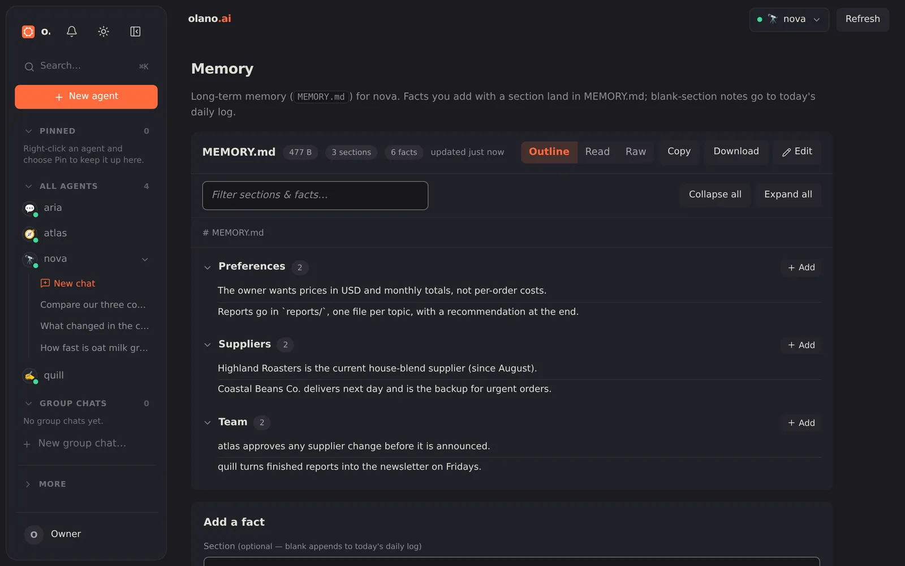

# Memory

What each agent remembers: `MEMORY.md` (durable facts) and the daily logs.
Edit them directly — this is the fastest way to correct something an agent has
learned wrongly. See [Memory and self-learning](../feature-guides/memory-and-self-learning.md).

<figure markdown="span">
  { loading=lazy }
  <figcaption>nova's MEMORY.md as an outline of sections and facts, with Add a fact below.</figcaption>
</figure>

The page names the agent whose memory it shows in its own top bar, with an
agent picker — it is the same selection the sidebar's agent list drives, so
picking an agent here or clicking one in the sidebar changes both. (On a phone
the sidebar is a drawer, which is why the page carries a picker of its own.)
