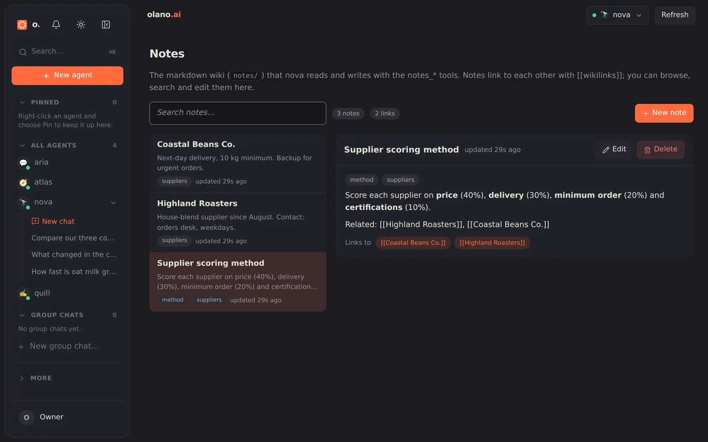

# Notes

The agent's markdown wiki: linked notes with backlinks, searchable, editable by
both you and the agent. Good for structured knowledge that is neither a fleeting
memory nor a document — project pages, contact sheets, running decisions.
See [Notes](../feature-guides/notes.md). Like Memory, the page carries the agent picker in its
top bar.

<figure markdown="span">
  { loading=lazy }
  <figcaption>A note with its tags and its links to other notes.</figcaption>
</figure>
