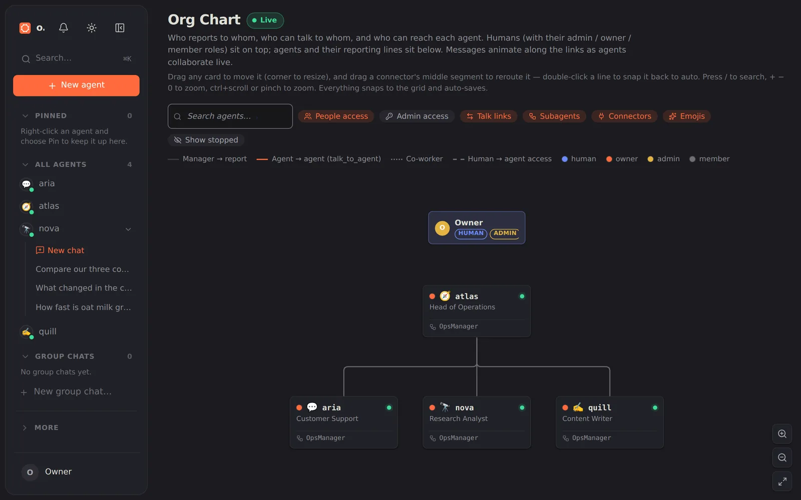

# Org Chart

A visual map of your agents: who manages whom, who reports to whom, and who
counts as a peer. Editing the chart here changes what the agents are actually
allowed to do — the hierarchy grants messaging permissions (see
[Agent-to-agent and the org chart](../feature-guides/agent-to-agent.md)).

<figure markdown="span">
  { loading=lazy }
  <figcaption>A manager with three reports. The lines are also messaging permissions.</figcaption>
</figure>

**Connectors on each card.** Every agent card shows a row of small icons, one
per messaging connector the agent is set up with (WhatsApp, Telegram, Discord,
Slack, Signal, email, SMS and the rest), so you can see at a glance which agent
answers where. A healthy connector shows just its icon. A corner dot means it
needs a look:

| What you see | Meaning |
|---|---|
| Icon only | Connected and working. |
| Amber dot | Connecting: still starting, reconnecting, or waiting for you to finish pairing (for example a WhatsApp QR code that has not been scanned yet). |
| Red dot and red ring | Needs attention: the connector could not start (often a missing token or password) or the service refused it. Hover the icon to read the reason. |
| Greyed out | The agent itself is stopped, so none of its connectors are running. |
| Pulsing ring | The agent is answering a message that arrived on that connector right now. |

When a card is too narrow for every icon, the last slot shows **+N**; hover it
to list the rest. If any of the hidden connectors has a problem, the **+N**
carries its dot. Click a card to open its details: the **Connectors** section
lists each connector with its status and, for a failing one, the reason, and
**Manage connectors** opens that agent's **Connectors** tab to fix it.
Typing a connector name in the chart's search box (for example `whatsapp`)
highlights every agent on it. The **Connectors** toggle above the chart hides
or shows the icons; the chart refreshes their status on its own every half
minute and whenever an agent starts or stops.
