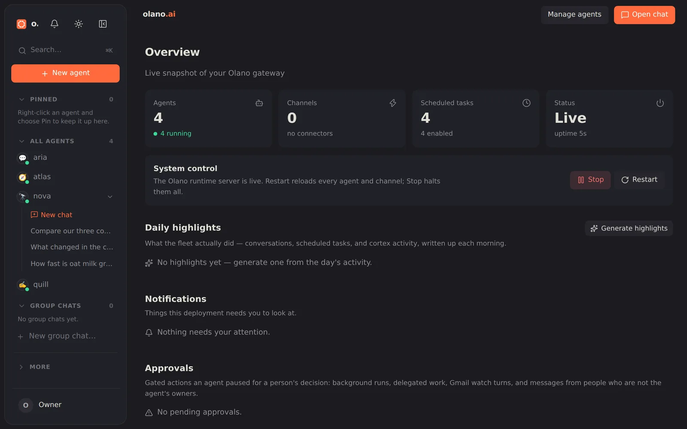

# Overview

The landing page and the recovery surface: it is the one section that always
renders, even when something else is broken. It shows which agents are online,
recent activity, disk health, and — most importantly — the **Approvals inbox**.

<figure markdown="span">
  { loading=lazy }
  <figcaption>Overview on a demo deployment with four agents and four scheduled tasks.</figcaption>
</figure>

Four tiles head the page: **Agents**, **Channels**, **Scheduled tasks** and
**Status**. Click or tap the **Agents** tile to jump straight to the Agents
section. The **Channels** tile counts the connectors your agents are configured
with, and the line beneath it says how many are actually connected right now —
"2 active" when everything is up, or "1 of 2 active" when one is configured but
did not come online. That second reading usually means an expired or wrong
credential; open the agent's **Connectors** tab, where the connector reports what
it is waiting for.

Above the tiles, a usage strip summarizes the last 30 days. On an Olano-managed
deployment it leads with **Credits left** — your account balance, the same
number the deployment page at cloud.olano.ai shows — followed by **Credits used
(30d)**, which is what the window *consumed*, not what remains. A freshly
deployed box correctly reads "used: 0 credits" while the balance is full;
that zero means nothing has been spent yet, not that the account is empty. The
**Olano credits** card further down the page shows the same balance with the
monthly-allowance meter and a top-up link. A self-hosted install running on an
Olano API key ([Models and credits](../models-and-credits.md#olano-credits-on-a-self-hosted-install))
shows the same strip and card for the account's balance, without the monthly
meter: account credits have no period.

**Notifications** is the section above Approvals: everything the deployment
needs you to look at — a connector that did not start because its credential is
missing, an issue assigned to you, a background run that failed, disk over
threshold. A row that names something opens it, so following the row is how you
act on it. Each row says **how long ago** it happened — "5 mins ago", "2 hours
ago", "3 days ago" — which is what separates a problem that is still live from
one that fixed itself overnight; on a desktop browser, hovering that age shows
the exact date and time. When the same problem keeps recurring it collapses into
a single row with a *seen N times* badge, and the age then tracks the **most
recent** occurrence, with the first one named in the same hover. Dismiss rows
one at a time, or use **Mark all read** and **Clear read**; a notification also
disappears on its own once its condition clears. The **bell** in the sidebar
(the topbar on a phone) carries the unread count and the newest few rows.

**Approvals** is a section on this page, not a separate tab. When an agent wants
to run something that needs human sign-off (see
[HITL](../feature-guides/human-in-the-loop.md)), the request appears here with
the exact action described, and it waits for you to approve or reject. The
sidebar shows a badge with the pending count.

**Disk** is a collapsible card on the same page, and it answers two different
questions. Expand it and the first block, **Where the space went**, accounts for
the *whole* machine in a few groups:

- **Container images** — the software this deployment runs on: the agent
  runtime, the sandbox agents execute their commands in, the dashboard, and the
  database. Several gigabytes on any install, and re-downloaded whenever the
  deployment updates. The "reclaimable" note next to it is what **Clean now**
  would recover (superseded copies left behind by past updates).
- **Container volumes and containers** — the database's stored data (threads,
  agent memory), TLS certificates, and the running containers' own working
  space and logs.
- **Olano home** — your side of the machine: agent workspaces, conversation
  transcripts, memory, skills, the credentials vault and the shared tool layer
  agents install packages into.
- **Swap file** — a file the machine uses as overflow memory. It takes its full
  size on disk whether or not it is being used.
- **System & other host files** — the operating system, system logs, package
  caches and the deployment's own checkout. Measured as what is left over,
  because the runtime is sandboxed and cannot read those directories directly.

On a typical managed deployment the Olano home is the *smallest* of these — a
box can be 60% full with only a few hundred megabytes of your own data on it.
That is expected, and this card is how you confirm it rather than guess.

The second block, **Largest directories in the Olano home**, then breaks down
just that home slice folder by folder; click any row to see one level deeper.
Both blocks refresh on their own (the home is walked once a day); **Scan now**
re-measures everything immediately.
