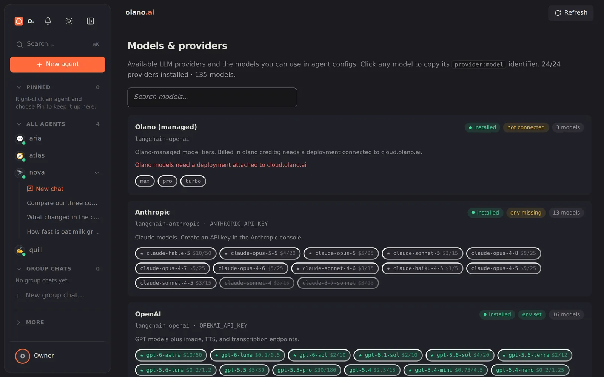

# Providers

Opened from the **account menu** (bottom-left) under **Setup**, or from ⌘K.

Model providers and their models. Shows which providers are genuinely usable
here (a key in the vault, a live sign-in session, or a local model server), and
lets you set the deployment's preferred model. Olano-managed tiers appear at the
top (see [Models and credits](../models-and-credits.md)).

<figure markdown="span">
  { loading=lazy }
  <figcaption>Providers with their install and sign-in state, and the models each one offers.</figcaption>
</figure>

A provider's model chips turn **green** once everything it needs is in place —
the package installed *and* its key present or its sign-in live — so you can see
at a glance which models you can actually run. Chips stay neutral while a
requirement is missing, while a connected provider is reporting that it is not
currently working, and on models the provider has deprecated (shown struck
through). Click any chip to copy its `provider:model` identifier.

## The Olano card on a self-hosted install

On a self-hosted install the **Olano** card carries a **Run on Olano credits**
form. Paste an Olano API key created under **API keys** on `cloud.olano.ai`
(it starts with `sk-olano-`); the dashboard checks it with your account, stores
it in the vault and hands it to every running model. The card then shows the
key's prefix, **Buy credits** and **Manage keys** links to your account, and
**Replace key** / **Remove**. Removing it returns the install to your own
provider keys at the agents' next start. On an Olano Cloud deployment the card
has no form: the deployment bills its own credits.

If the card says the key was **refused**, it was revoked on `cloud.olano.ai` or
pasted incompletely; paste a valid one. If it says **stored but not in use**,
another key outranks it on this box (a gateway key set in the environment, or
an enrolled deployment key): the install keeps that key and the pasted one
waits in the vault until the other is removed. A key that comes from the
environment variable `OLANO_CREDITS_KEY` cannot be replaced or removed from
the card; change it where it is set and restart the runtime.

Connecting a key on an account with **no credits yet** is fine: the card and
the setup wizard say so, agents on the Olano tiers answer with an out-of-credits
message until you buy some on the Billing page, and nothing else changes.

If the box's environment sets a gateway
key directly, the card says so and that key wins over a pasted one.
