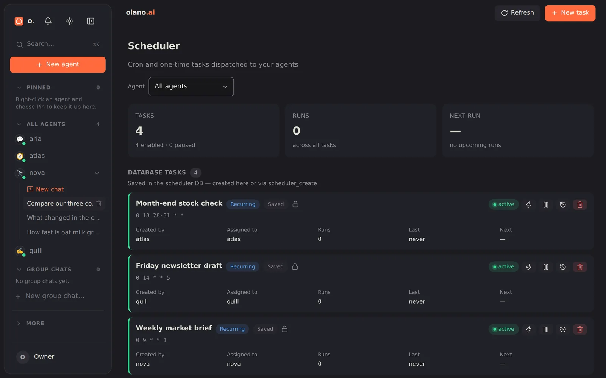

# Scheduler

Every scheduled job across the deployment: what runs, when it runs next, and
what happened last time. Create, edit, pause and delete jobs, and trigger one
immediately to test it. Jobs are defined per agent (see [Scheduler and heartbeat](../feature-guides/scheduler-and-heartbeat.md)).

Each job has a **Model** field and, for models that advertise effort levels,
a **Reasoning effort** field. "Agent default" (the first choice, and what an
untouched job uses) follows whatever the agent is configured with; picking a
specific model pins that one job to it without changing the agent, which is
how the same agent can run a cheap nightly digest and a bigger weekly analysis.
The card shows the job's model and effort, each run is billed to the model that
ran, and a model whose provider is not connected is refused when you save.

<figure markdown="span">
  { loading=lazy }
  <figcaption>Scheduled tasks with their schedule, the agent that runs them and their run history.</figcaption>
</figure>

## The task form

Besides the name, the agent, the prompt and the schedule, a task carries two
optional overrides. Both default to the agent's own settings, so a task that
leaves them alone behaves exactly as the agent would in chat.

| Field | What it does |
|---|---|
| **Model** | The model this task runs on. *Agent default* follows whatever model the agent is configured with. Pick one to run only this task on it. The list holds the models this deployment can actually use. Changing the model changes which effort levels are offered below. |
| **Reasoning effort** | How much thinking the model does before answering on this task's runs. Shown only when the model the task runs on advertises effort levels, and every option is a level that model accepts, so a task can never be saved with an effort its model rejects. *Agent default* uses the agent's own setting. Higher levels cost more tokens and time per run. |

The same two fields appear on the agent page's **Schedule** card for jobs
defined in the agent's configuration, and an agent creating a task for itself
can set them through its scheduler tools.
