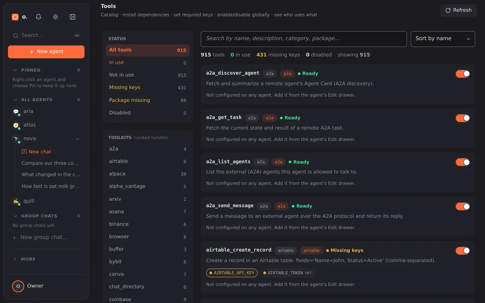

# Tools

Opened from the **account menu** (bottom-left) under **Setup**, or from ⌘K.

Browse every tool available on the deployment, grouped by category, each with a
description of what it does. Tools that exist but are switched off show as
locked with the reason — for example a tool that needs a credential you have not
set yet — so you can find out a capability exists instead of it being invisible.

<figure markdown="span">
  { loading=lazy }
  <figcaption>The tool catalog, filterable by status and toolkit.</figcaption>
</figure>

You do not have to come here to give an agent a toolkit. Ask the agent —
*"connect yourself to GitHub"* — and it adds the toolkit to itself
(`self_add_toolkit`), tells you which sign-in it needs and sends the link for
it, then restarts when you say so; `self_remove_toolkit` takes one away again.
AgentFather does the same for any agent (`olano_add_toolkit`). A toolkit added
this way is the same as one you tick on the agent's **Tools** tab: it applies
after the agent restarts.

**Fleet-wide tools.** A few tools are badged **fleet-wide**, with a note under
the row explaining what that means. They act across the *whole deployment*
rather than only for the agent holding them: reading the shared runtime log,
another agent's chat transcripts or workspace, the credentials vault, or
running a command as a different agent. Anyone who can chat with an agent can
ask it to use the tools it holds — so a fleet-wide tool belongs only on an
operations agent you trust with the entire deployment. AgentFather ships with
them; nothing else gets them unless you tick them yourself.

Two rules back the badge up. Agents cannot hand these to each other or to
themselves — a bot asked to "give yourself the log reader" is refused, and so
is AgentFather doing it on a scheduled run or on another agent's behalf;
adding one is a decision an administrator makes here, in the dashboard. And
holding the tool is not enough to use it: these tools answer only when an
administrator is the person on the turn, so an ordinary member chatting with
an agent that holds them still cannot read another agent's logs or
transcripts. Ordinary tools are unaffected — the badge is the whole list.
