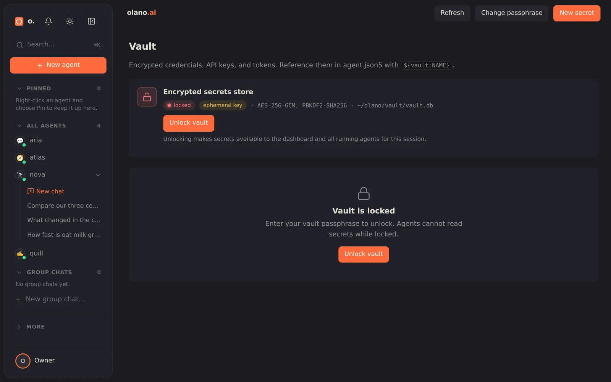

# Vault (admin only)

Opened from the **account menu** (bottom-left) under **Administration**, or
from ⌘K.

The encrypted credential store: every API key, bot token and service password.
You can add, rename and delete entries, and set **per-agent overrides** so two
agents using the same credential name authenticate as different identities.

<figure markdown="span">
  { loading=lazy }
  <figcaption>A locked vault: agents cannot read secrets until it is unlocked.</figcaption>
</figure>

**Who can see a stored value.** An admin can reveal one here in the dashboard.
An agent cannot, by default: asking the vault for a credential returns a
*masked* preview (`PKBM************`), enough to confirm which key is stored
without putting the secret in the conversation. The full value is an explicit,
owner-only request that needs human approval before it reaches the agent. So an
agent can list names and *use* a credential freely, and only a person can turn
one back into plaintext.

**Entries the runtime keeps for itself are not listed.** The deployment's own
connection credentials (the key it uses to reach Olano-managed models, the
signing key for its link to Olano Cloud) live in the same encrypted store, but
they are created and renewed by the runtime, never by you. They do not appear
on this page, cannot be revealed, changed, removed or overridden from the
dashboard, and agents cannot read or use them. Whether the deployment is
connected is shown on the **Overview** provider card instead.

**Rekey** changes the vault passphrase and re-encrypts every stored secret under
the new one. Use it if the passphrase may have been exposed.

The vault re-locks whenever the server or dashboard restarts, and the dashboard
prompts you to unlock it before anything that needs a credential can run.
