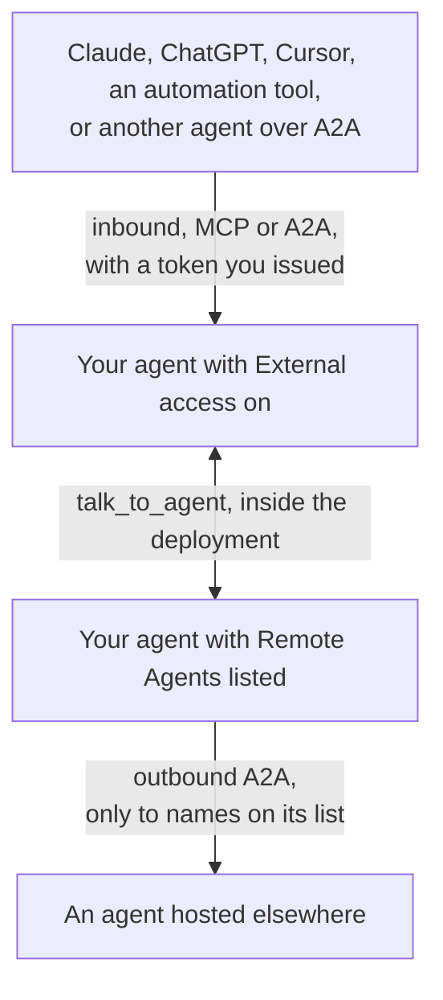

# Beyond the deployment: A2A and MCP

Everything in [Agent-to-agent and the org chart](agent-to-agent.md) is about agents on
**this** deployment talking to each other. Two further doors connect them to
the world outside, each built on an open protocol so the other side can be
anyone's software:

- **Outbound — A2A.** Your agent hands work to an agent hosted elsewhere
  (another company's, another Olano deployment's) using the Agent2Agent
  protocol.
- **Inbound — MCP.** An outside platform that speaks the Model Context
  Protocol (Claude, ChatGPT, Cursor, an agent framework, an automation tool)
  sends *your* agent a message and reads the reply.

Both are off until you switch them on, both are audited in the **Agent to
Agent** tab, and neither changes how your own agents talk to each other.

## Talking to an outside agent (A2A)

1. Ask the remote party for their agent's base URL and, if it requires one,
   a credential. Store the credential in the vault (Config → Credentials, or
   ask your agent to send you a magic link for it).
2. On your agent's **Advanced** tab, add an entry under **Remote Agents**
   ([`agent.json5` reference](../agent-json5.md#remote_agents-external-agents-over-a2a)): a short `name`,
   the `url`, the `auth` mode and the credential as a vault reference.
3. Restart the agent. It now has `a2a_list_agents` (what it may talk to),
   `a2a_discover_agent` (read the remote Agent Card: skills, endpoints,
   authentication), `a2a_send_message` (send a request and get the reply) and
   `a2a_get_task` (poll a long-running remote task).

What the agent can and cannot do: it can only address names on its list —
there is no URL parameter, and it cannot add entries itself. Each reply is
treated as input from another organisation: your agent reports it rather than
following instructions embedded in it, and it is told not to forward secrets
or private data you did not ask it to share. Multi-turn exchanges continue
automatically within one of your conversations (the remote `context_id` is
remembered), or explicitly by passing the `context_id` back.

What the platform enforces on every call: `https://` only; the configured URL
**and** the endpoint the remote Agent Card advertises are checked against the
same outbound-request policy as every other web tool (no private networks, no
cloud metadata addresses, your agent's own allow/deny lists); the card's
endpoint must live on the same origin as the URL you configured unless you
opt out per entry; credentials are read from the vault at call time and sent
only to that vetted endpoint; replies are capped in length; and every send and
reply appears in **Agent to Agent** under the **External** segment, as a
conversation between your agent and the remote agent's configured name with an
**A2A** badge. `a2a_send_message` counts as an external write for approval
purposes, so an agent in Supervised or Locked-down mode asks before sending.
Fleet-wide rules live in `config.yaml → remote_agents`
([`remote_agents:` — fleet rules for talking to outside agents (A2A)](../config-yaml.md#remote_agents-fleet-rules-for-talking-to-outside-agents-a2a)).

## Letting an outside platform reach your agent (MCP and A2A)

1. **Switch the doors on home-wide.** **Config → External access**: turn on
   *MCP endpoint*, *A2A endpoints*, or both. The deployment must have an
   `https://` public URL; a plain-http public endpoint is refused.
2. **Publish the agent.** Open the agent → **External access** tab (clearly
   labelled as the opposite of its MCP tab), switch on *Reachable over MCP*
   and/or *Reachable over A2A*, and write the **public description** — what
   the agent can do for an outside caller, what it needs, what it will not do.
   It is required, it is what every remote caller sees, and it is not the
   system prompt. Save and restart the agent. The tab then shows the exact
   endpoints: the MCP endpoint and the agent's tool name `ask_<agent>`, and
   the A2A Agent Card and JSON-RPC address.
3. **Give the caller a credential.** Either
   - **mint a token** on the same tab (or on **Config → External access** for
     the fleet view): a label, the agents it may reach (or *every exposed
     agent*), a lifetime. The token is shown **once**; only a hash is kept.
     Revoke it from the same list at any time. An agent can also send an
     administrator a token-minting page with `magic_link_mint_access_token`
     — the token appears on that page, never in the chat; or
   - **let the client sign in with OAuth**. Clients that cannot paste a
     header (a Claude.ai custom connector, an A2A client following the card)
     discover the deployment's own authorization server, register themselves,
     and send you to the dashboard's **consent page**. There an administrator
     sees who is asking and which agents they requested, ticks the agents to
     grant (or *every exposed agent*), and allows or declines. The client then
     receives a short-lived access token and a rotating refresh token; both
     appear in the token list tagged *OAuth*, and **Config → External access →
     OAuth clients** lists the applications, each with a *Forget* button that
     revokes everything it holds.
4. **Point the client at it.** For MCP: a server of type *Streamable HTTP* at
   `<public URL>/api/mcp` with the header `Authorization: Bearer <token>` (or
   the OAuth sign-in). Its tool list shows `olano_list_agents` plus one
   `ask_<agent>` tool per exposed agent; `thread_id` on a call continues a
   conversation. For A2A: the agent's card URL
   `<public URL>/api/a2a/agents/<agent>/.well-known/agent-card.json`; the
   card declares both the bearer scheme and the OAuth flow. A client that
   calls an agent without a token is pointed at that agent's own sign-in
   details, so an OAuth-capable client can find the sign-in by itself.
   Applications that cannot keep a secret (command-line and desktop tools)
   can register and sign in as public clients.

**From chat, only an administrator can do any of this.** AgentFather (or any
agent holding the admin tools) has `olano_set_agent_external_access` to flip
an agent's flags and set its description, and every agent has
`self_set_external_access` for itself plus `magic_link_mint_access_token`;
all three refuse unless the person on the turn is an administrator (a peer
agent, a scheduled run, an inbound MCP or A2A caller, or a non-admin member
is refused with an explanation). The per-agent switch that decides whether an
agent even holds those tools is the `external_access` self-configuration
capability ([`agent_autonomy:`](../config-yaml.md#agent_autonomy-what-agents-may-change-about-themselves)).

You can also plug in **your own identity provider** instead of, or next to,
the built-in sign-in: fill *External identity provider* (issuer and JWKS URL)
under Config → External access, and the endpoints accept that issuer's
access tokens — bound to this deployment as audience, with `agent:<name>` /
`agents:*` scopes deciding reach.

What the platform enforces: no unauthenticated access (a missing or bad token
gets a standard 401 pointing at the metadata document); a token reaches only
the agents it names, and only while they are published; the `Host` header is
checked against the public URL to defeat DNS-rebinding; each inbound call runs
as a normal turn on a thread named after the caller (`mcp::<label>::<thread>`
or `a2a::<label>::<conversation>`) **as an outside, non-owner caller** — the
agent's approval (HITL) rules apply, so an action that needs approval waits in
the **Approvals** inbox rather than running because a stranger asked, and
while it waits the call is held; the caller never sees the agent's
configuration, files or other threads; OAuth codes are single-use, tokens are
short-lived and refresh tokens rotate. Every call appears in **Agent to
Agent** as a conversation between `mcp:<label>` or `a2a:<label>` and the
agent, and the agent's transcript keeps the turn under that thread.
