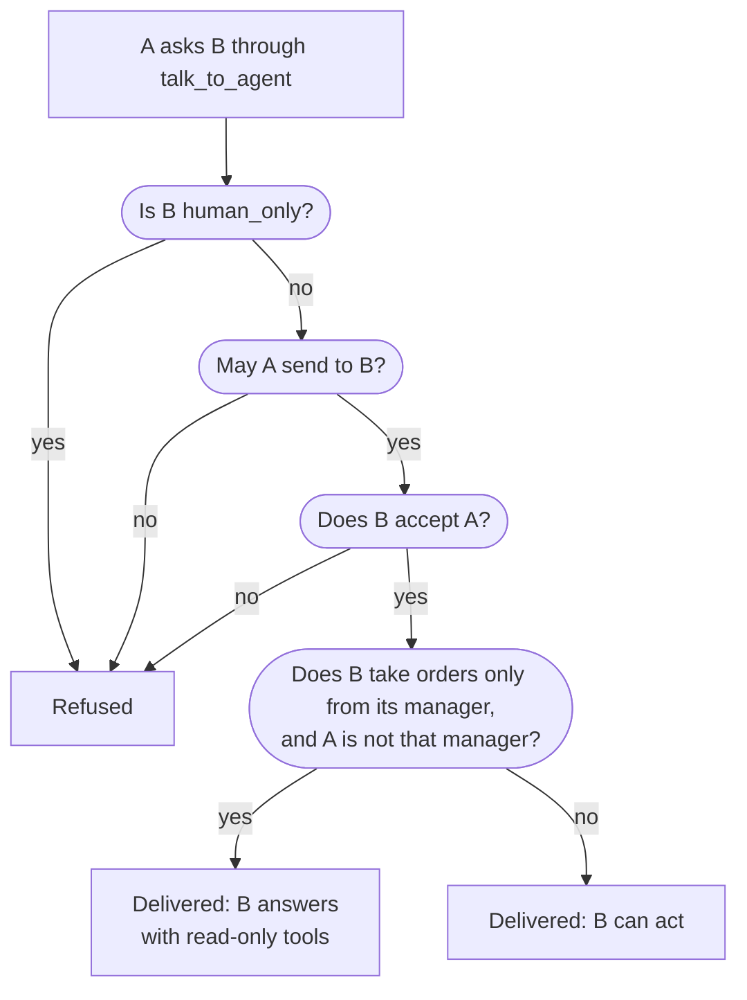
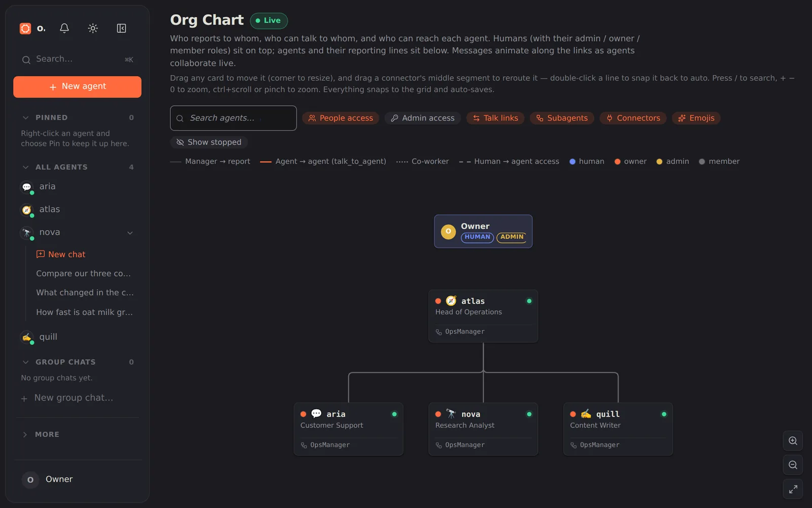

# Agent-to-agent and the org chart

Agents can send each other work with `talk_to_agent`. Who may do that is
governed by two things that combine: the **org chart** and the **allow-lists**.

**The org chart** (`org.manager`, `org.reports`, `org.coworkers`, `org.title`)
places an agent in a hierarchy. A manager and its direct reports may **always**
exchange messages, regardless of any allow-list. That is deliberate: declaring a
reporting line is meant to be enough to make delegation work, without
duplicating names into two more lists.

Sending and accepting always pass between a manager and its direct reports.
Between anyone else, each side's allow-list decides, as described below.

**The allow-lists** control everyone else:

- `org.input_agents` — who may message this agent.
- `org.output_agents` — who this agent may message.
- `org.input_mode` / `org.output_mode` — `everyone`, `none`, or `list`.

The rule that surprises people: **an empty list means unrestricted**, not
"nobody". A fresh agent with no `org` block can talk to any other agent, which
is the historical default. To lock an agent down, set the mode explicitly:
`input_mode: "none"` blocks every peer *except* its own manager and reports, so
delegation still works.

Three more controls:

- **`org.mutating_from_manager_only: true`** — admitted peers may ask this agent
  for information, but only its manager can make it *do* something. A good
  setting for an agent that owns a system of record.
- **`human_only: true`** — refuse all inbound agent messages. Use it for an
  agent that must only ever take direction from a person.
- **`org.autogenerate: true`** — derive the allow-lists from the hierarchy
  (manager + reports + coworkers) instead of maintaining them yourself.

**Awareness is separate from permission.** `agent_visibility` decides which
peers an agent is *told about*. `mode: "none"` (the default) means it does not
know its colleagues exist; `"all"` tells it about everyone; `"list"` names
specific peers. Telling an agent about a peer does not grant it permission to
message that peer, and granting permission does not automatically tell it the
peer exists — for a delegation to happen, you usually want both.

**Supervisors, managers, co-workers, specialists.** These are patterns, not
separate features:

- A **supervisor / manager** is an agent with `reports`. It receives goals and
  splits them across its reports.
- **Co-workers** are peers listed in `coworkers`. Display-only on the chart —
  give them messaging rights through the allow-lists or `autogenerate`.
- A **specialist** is either a top-level agent (if it needs its own inbox,
  schedule or memory) or a **subagent** of the agent that uses it (if it does
  not). Subagents are internal, invisible to the roster, and cheaper to run.

Watch what happens on the **Agent to Agent** dashboard tab, and edit the
structure on **Org Chart**.

<figure markdown="span">
  { loading=lazy }
  <figcaption>A manager and its three reports on the Org Chart tab: each line lets the two agents message each other.</figcaption>
</figure>
