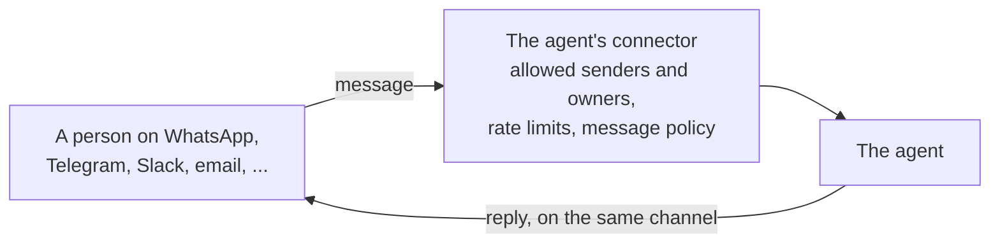

# Channels and connectors

Channels are how people reach an agent. Configure them on the agent's
**Connectors** tab, which documents every field for every connector.



Supported: **Telegram**, **Slack**, **Discord**, **WhatsApp** (three
connectors, see below), **Signal**,
**Email/IMAP**, **Matrix**, **Mattermost**, **SMS**, **Home Assistant**,
**DingTalk**, **Feishu** and **Lark**, **WeCom (Enterprise WeChat)**, **WeChat
(Weixin / iLink Bot)**, **QQ**, **BlueBubbles (iMessage)**, **DeBox**, the
**OpenAI-compatible API** (below), and inbound webhooks.

Three of those names are easy to mix up:

- **Feishu** and **Lark** are the same connector: Lark is Feishu's
  international edition, run by ByteDance from a separate cloud with its own
  App IDs. The picker offers each as its own row; the Lark row is the Feishu
  form with **Brand / region** preset to Lark (saved as `extra.domain: "lark"`
  under `type: "platform:feishu"`). An app created in one console never
  authenticates on the other, so pick the row that matches where the app was
  made.
- **WeChat (Weixin / iLink Bot)** is the personal messenger: a WeChat account
  linked by QR, no developer console. **WeCom (Enterprise WeChat)**, formerly
  *WeChat Work*, is the company product: an AI Bot with a bot ID and secret
  from the WeCom admin console. Asking an agent to *"connect WeChat"* gets the
  personal one; say **WeCom**, **Enterprise WeChat** or **WeChat Work** for the
  company product, and the agent offers only that.

## Three ways to connect WhatsApp

**WhatsApp** pairs by scanning a QR code with your phone, the way WhatsApp Web
does. Nothing to register and no business account, but it drives a personal
WhatsApp session, so it is best for your own number and small-scale use.

**WhatsApp (Twilio Business API)** connects through a Twilio account to a
registered WhatsApp business sender. There is no QR code and no session to keep
alive, and it is built for customer-facing traffic. Pick it when your WhatsApp
business number already lives in Twilio, or you want Twilio's console, balance
and usage reports.

**WhatsApp (Meta Cloud API)** connects straight to Meta's own WhatsApp Business
Platform with your Meta app, with no provider in between. Templates, their
approval status and the category WhatsApp bills each one under, and every
delivery report come directly from Meta. Pick it when your number is in your own
WhatsApp Business Account, or you want no second provider's fees or console.

The two business connectors give an agent the same WhatsApp tools, with the
same names and the same instructions (see
[below](#whatsapp-business-the-agents-tools-and-who-may-use-which)), so an
agent's prompt does not change when you move from one to the other.

| | WhatsApp | WhatsApp (Twilio Business API) | WhatsApp (Meta Cloud API) |
|---|---|---|---|
| How it connects | Scan a QR code with your phone, like WhatsApp Web | A Twilio account and a registered WhatsApp business sender | Your own Meta app on the WhatsApp Business Platform |
| Best for | Your own number, small-scale use | Customer-facing traffic, a number already in Twilio | A number in your own WhatsApp Business Account |
| Group chats | Yes | No, one-to-one only | No, one-to-one only |
| Quoting the message being answered | Yes | No | When **Quote the message being answered** is on |
| Starting a conversation | Any time | Within 24 hours of the customer's last message, otherwise an approved template | Within 24 hours of the customer's last message, otherwise an approved template |
| Usage and billing reports | None | Twilio's balance and spend reports | Per message, from Meta |

##### Setting up WhatsApp (Twilio Business API)

Setting it up takes values from the Twilio console and nothing else:

1. Log in at console.twilio.com. The **Account Info** panel on the home page
   shows the **Account SID** (it starts with `AC`) and the **Auth Token** (click
   **Show**). Enter both in the connector on the Connectors tab.
2. To try it without waiting for Meta, use Twilio's WhatsApp sandbox: open
   Messaging, Try it out, Send a WhatsApp message, and from your phone send the
   join code shown there to +1 415 523 8886. Under **Sandbox settings** on the
   same page, clear **When a message comes in** and save, or Twilio's demo
   answers your messages as well.
3. Enter `+14155238886` as the **WhatsApp sender number**, add your own phone
   number under **Allowed sender numbers**, save and restart the agent.

There is no webhook to configure. When the agent starts, the connector tells
Twilio to deliver incoming messages to the deployment's own public address, and
it checks every delivery against your Auth Token before the agent sees it. With
your own registered number, anyone who writes to it reaches the agent. The
shared sandbox number cannot open a conversation with a new number by itself, so
there the agent hears only the numbers under **Allowed sender numbers**, and
only once each has sent the join code (a join lasts three days; send it again
after that). A listed number that has not joined yet is retried automatically.
If a message does not arrive, the connector's diagnostics on the Connectors tab
say whether incoming messages are set up and, if not, why. A self-hosted install
needs a public https address Twilio can reach; Olano Cloud deployments always
have one.

Moving to your own number later means registering it as a WhatsApp sender
(Messaging, Senders, WhatsApp senders), which requires Meta business
verification; clear **Allowed sender numbers** then to accept everyone. Register
a Twilio phone number or a number your business owns that is not on WhatsApp
yet. When WhatsApp's sign-up offers **Use a display name only**, do not pick
it: that gives a free number in area code 555, which Twilio does not support
(see below). If the number was already routed somewhere else in Twilio (a
Studio flow or another app), connecting it here sends its incoming messages to
the agent instead, and the diagnostics name what was replaced.

The **WhatsApp sender number** has to be one of the account's own WhatsApp
senders, or the sandbox number. Any other number (a typo, a number registered
on another Twilio account) fails in the worst way on WhatsApp: Twilio accepts
every message and WhatsApp drops each one later. So the connector checks the
number against the account when it starts: the **sender** row of its
diagnostics turns red and names the numbers the account does have, and every
send from it, ordinary or template, is refused with that reason until the
number is corrected. **whatsapp_sender_status** shows the same list to the
agent.

One kind of number passes that check and still does not work: **a free 555
number from WhatsApp** (a United States number starting +1 555, what **Use a
display name only** gives at sign-up). The Twilio Console lists it as online
under your WhatsApp Business Account, yet Twilio does not support these
numbers: Twilio refuses to route its incoming messages (the diagnostics show
*Invalid Address*) and templates sent from it fail with error 63027. The
connector recognizes one: the **sender** row turns red and says so, and the
agent explains it when a template fails. The fix is to register a Twilio phone
number, or a number your business owns, as a WhatsApp sender on the same
Twilio account and the same WhatsApp Business Account, then enter it as the
**WhatsApp sender number**. Templates belong to the Business Account, not to a
number, so the ones already approved send from the new number without another
review.

##### Setting up WhatsApp (Meta Cloud API)

It takes two IDs, a token and your app's secret, all from Meta:

1. In the Meta App Dashboard (developers.facebook.com/apps), create or open a
   **Business** app and add the **WhatsApp** product. Under WhatsApp, **API
   Setup**, copy the **WhatsApp Business Account ID** and the **Phone number
   ID** of the number the agent should use (the phone number ID is a long
   string of digits shown under the number, not the number itself).
2. Create a token that does not expire: in Business settings
   (business.facebook.com/settings), **System users**, add a system user,
   assign it your app and the WhatsApp Business Account, then **Generate
   token** with the `whatsapp_business_messaging` and
   `whatsapp_business_management` permissions. The temporary token on the API
   Setup page works for a first try but expires after 24 hours.
3. In the App Dashboard, **App settings**, **Basic**, click **Show** next to
   **App secret**.
4. On the agent's Connectors tab add **WhatsApp (Meta Cloud API)**, enter the
   token, both IDs and the app secret, save and restart the agent. The token and
   the app secret are kept in the agent's vault, never in its configuration.

There is no webhook to configure. When the agent starts, the connector
subscribes your app to the WhatsApp Business Account (only if it is not
subscribed yet) and points this one number's webhook at the deployment's own
public address. Meta checks that address once, then delivers every message
and delivery report for the number there, and the connector checks each
delivery's signature against the app secret before the agent sees it. Without
the app secret the agent can still send, but every incoming message is refused.
Only the number's own webhook is changed, never the address set for the whole
Business Account or the app, so several agents can share one Business Account
and one app, each with its own number, and each hears only its own number. If
the number was pointed at another address before, it is replaced and the
diagnostics name the old one. If Meta refuses the setup, the diagnostics show
the address and the verify token to enter by hand in the App Dashboard
(WhatsApp, **Configuration**, subscribing the **messages** field). A
self-hosted install needs a public https address Meta can reach; Olano Cloud
deployments always have one.

The connector checks everything it can when it starts, and its diagnostics on
the Connectors tab show the result, one row each:

- **Connection**: whether Meta accepts the token, and a warning when the token
  expires within 7 days.
- **Permissions**: whether the token holds the two permissions above, and for
  this Business Account. Without `whatsapp_business_messaging` nothing can be
  sent or received; without `whatsapp_business_management` the connector can
  neither read templates nor set up incoming messages.
- **Sender**: the number, its display name and whether Meta has it online. A
  phone number ID that is not on the Business Account you entered turns this
  row red and names the numbers that are; a token that cannot read the number
  at all stops the connector.
- **Incoming**: whether the webhook is set up, and when the last delivery
  arrived.
- **Window**: how many customers can currently receive an ordinary message
  (see the next section).

**Meta's test number** from the API Setup page works for trying the connector,
but it only delivers to up to five phone numbers you add on that page (under
**To**). A send to anyone else fails, and the agent says why. For real
customers, add your own number to the Business Account in WhatsApp Manager.

**Allowed sender numbers** (optional) limits who the agent answers. Leave it
empty to answer everyone who writes to the number. Besides phone numbers it
takes the ID Meta sends instead of a number for someone who hides it behind a
WhatsApp username, such as `US.13491208655302741918`; the agent can reply to
such a person as usual. **Read receipts and typing indicator** (on by default)
marks each message read as it arrives and shows *typing...* while the agent
prepares its answer. **Quote the message being answered** (off by default)
makes each reply quote the person's message.

##### What differs between the connectors

All three connectors handle text, images, documents and voice notes in both
directions, and all three transcribe an inbound voice note and can reply with
generated speech. The differences worth knowing before you choose:

- **Quoting a specific message does not work outbound on the Twilio
  connector.** Twilio has no way to send a quoted reply, so the agent answers
  in the conversation rather than threading onto one message. It still *sees*
  which message a customer replied to. The QR connector quotes normally, and
  the Meta connector quotes when **Quote the message being answered** is on.
- **Both business connectors start a conversation only with an approved
  template.** WhatsApp allows a business to send freely only within **24
  hours** of the customer's last message, and otherwise only a template Meta
  approved in advance. This is Meta's rule and applies to every business
  connection, whichever provider carries it.
- **Groups work on the QR connector.** The Meta connector answers one-to-one
  chats only; a group message is ignored.
- **Account balance and spend reports are Twilio's.** The Meta connector
  reports instead, per message, whether Meta billed it and under which
  category (see the tools below); Meta's own invoices are in WhatsApp Manager.

## The 24-hour window, and why a scheduled WhatsApp message may not send

More than 24 hours after a customer's last message, WhatsApp delivers only
**pre-approved template messages**, and it discards an ordinary message with no
error at all. So that a message can never vanish silently, the agent refuses
such a send and says the window has closed, instead of reporting success for
something the customer never received.

The Meta connector knows a window only from the messages it received itself,
because Meta keeps no message history anyone can ask for: someone who last
wrote before the connector was set up counts as outside the window until they
write again. What it received is kept across restarts.

Outside the window the agent sends an approved template instead: it lists the
templates WhatsApp approved for the account, picks the one that fits, and fills
in its placeholders (see the next section). There is nothing to set up for this
on the Connectors tab. Attachments cannot be sent outside the window at all,
with or without a template.

This affects scheduled jobs, reminders and any other message the agent starts
on its own. A scheduled job's reply to a WhatsApp chat is an ordinary message,
so it arrives only if that person wrote in the last 24 hours. For a job that
must reach someone either way, name the template in the job's instructions, for
example *every Monday at 9, send the weekly_summary template to +1 555 123 4567
with this week's total*. Replies to an incoming message are always inside the
window and are never affected.

## WhatsApp Business: the agent's tools, and who may use which

Beyond replying in a conversation, an agent with either business connector,
WhatsApp (Twilio Business API) or WhatsApp (Meta Cloud API), gets one toolkit,
**WhatsApp Business**. The tools have the same names, take the same values and
answer in the same shape on both connectors, so one set of instructions works
whichever carries the agent's number; when an agent has both, the tools use the
Meta one. Every tool is listed on the connector's own panel (Connectors tab,
edit the connector, the **Tools** section) with an on/off switch, and the same
switches are on the agent's Tools tab. The tools come in two kinds, so the
agent that talks to customers and the agent that manages the WhatsApp Business
account can be different agents with different powers.

**Everyday tools**, on for every agent that has the connector. Switch one off
to take it away from that agent.

- **whatsapp_template_list** lists the templates WhatsApp approved for the
  account, with their placeholders and buttons. On the Meta connector it also
  shows each template's header and footer, and the category WhatsApp actually
  bills it under, noting when WhatsApp moved it to another category than the
  one it was created in.
- **whatsapp_template_send** sends an approved template to a number: the only
  message WhatsApp delivers to someone who has not written in the last 24
  hours, and the way a business starts a conversation. The agent fills every
  placeholder (a template is never sent with one left empty, and never unless
  WhatsApp approved it), then waits a few seconds for WhatsApp's verdict and
  says whether the message was delivered or why WhatsApp refused it, for
  example a Twilio sandbox number that has not joined, or a recipient missing
  from the list of Meta's test number. A line break inside a placeholder
  becomes a space, because WhatsApp refuses one there. A template whose name
  exists in several languages is sent in the language the agent names. On the
  Meta connector a placeholder in the template's header is filled as
  `header` and one in a button's link as `button_1`, `button_2` and so on, as
  the list shows; an image, video or document header takes an https link to
  the file.
- **whatsapp_message_status** checks later whether a message was sent,
  delivered or read, or why it failed. On the Meta connector it also says
  whether Meta billed the message and under which category, or that it was
  free (a reply inside the 24-hour window, for example).
- **whatsapp_window_status** says whether the 24-hour window is open for a
  number, so the agent knows whether an ordinary message or only a template
  will arrive, and when the window closes.

**Account administration**, off until an administrator switches them on for
the one agent that manages the account, because what they change or read
belongs to the whole WhatsApp Business account (or Twilio account) and every
agent on it. No agent can switch
them on by itself, for itself or for another agent: it takes an administrator,
on the connector panel or the Tools tab, or by asking AgentFather while signed
in as one.

- **whatsapp_template_create** creates a template and submits it to WhatsApp
  for approval: the text with its placeholders, and optionally buttons, either
  up to ten reply buttons the person answers with one tap, or up to two
  website buttons and one phone button.
  On the Meta connector a template goes to WhatsApp's review the moment it is
  created, so there are no unsubmitted drafts; the agent shows you the text
  first.
- **whatsapp_template_submit** submits a template that was created without
  submitting (Twilio). On the Meta connector, where creating already submits,
  it says where the template stands instead.
- **whatsapp_template_status** reports the approval status of one template or
  of all of them, with WhatsApp's reason when it rejected one, and on the Meta
  connector its quality rating and any change of category.
- **whatsapp_template_delete** deletes a template. It needs the template's
  name typed back, because a deleted template is gone for every agent on the
  account and a replacement waits for WhatsApp's review again. On the Meta
  connector it deletes the one language the agent picked, not every language
  of that name.
- **whatsapp_sender_status** lists the account's WhatsApp numbers: whether
  each is online, Meta's quality rating, the daily messaging limit, and the
  business profile.
- **whatsapp_profile_update** changes the business profile customers see when
  they open the business in WhatsApp: the about line, description, address,
  email, website and category. The display name is changed in the Twilio
  Console or in WhatsApp Manager, since Meta reviews it.
- **twilio_account_balance** shows the Twilio account's balance (Twilio only).
- **twilio_usage_summary** shows the WhatsApp spend for this month, last
  month, today or yesterday, by category, with the account's total (Twilio
  only; on Meta, billing is per message, above, and invoices are in WhatsApp
  Manager).

The managing agent uses its own connector's account when it has a business
connector. Otherwise it needs keys in its vault, which the Tools tab asks for:
**WHATSAPP_META_ACCESS_TOKEN** and **WHATSAPP_META_WABA_ID** for a Meta
account, or **TWILIO_ACCOUNT_SID** and **TWILIO_AUTH_TOKEN** for a Twilio
account.

What keeps this safe:

- **Only the owner, or an administrator, can have the agent use any of these
  tools.** A customer writing to the agent on WhatsApp cannot make it list,
  send, create or delete a template, or read the account, even on an agent
  that holds the tools. Scheduled jobs you set up run with your authority, so a
  reminder job can send a template.
- **Approval before acting.** Under the Supervised and Locked-down security
  profiles, every template send, creation, submission and deletion, and every
  profile change, waits for your approval. The Trusted profile does not ask, so
  choose Supervised for an agent whose template sends you want to review.

**On Twilio, templates need your own WhatsApp number.** Twilio's shared
sandbox number (+1 415 523 8886) can send only Twilio's own three sample templates, never the
ones you created, so from the sandbox every template send fails (Twilio error
63027), even right after the person wrote to you. The agent says so instead of
trying. Register your own number in the Twilio Console (Messaging, Senders,
WhatsApp senders) and enter it as the connector's **WhatsApp sender number**;
templates approved for your account then send from it. Ordinary replies work
from the sandbox as before. If a send from your own number still comes back
with error 63027, the agent reports the number's state and the WhatsApp
Business Account it belongs to. A free 555 number from WhatsApp is not
supported by Twilio (see above). A number that is not online delivers nothing.
For an online number, the usual cause is that WhatsApp does not hold that
template for its Business Account: it was approved while the Twilio account
was connected to another Business Account, or deleted or disabled in WhatsApp
Manager since. Look for it in WhatsApp Manager, under that Business Account,
Message templates; if it is not there, creating and submitting the template
again puts it there.
**whatsapp_sender_status** shows every number with its account.

On the Meta connector the same kind of failure reads *template does not exist*
(error 132001): WhatsApp holds no approved template of that name, in that
language, on the connector's Business Account. The agent names the Business
Account to look in; WhatsApp Manager, Message templates, under that account,
shows whether the template is there and in which languages.

A typical conversation with the managing agent:

- *"Create a utility template that tells a customer their order is ready, with
  their name and order number, and a button to track it."* The agent drafts
  it, shows you the draft, checks it against WhatsApp's rules, and submits it
  once you agree.
- *"Is the order-ready template approved yet?"* It asks WhatsApp and
  answers with the status, or WhatsApp's reason if it was rejected.
- *"Is our number online, and how much did WhatsApp cost us this month?"* It
  reads the sender status and, on Twilio, the usage summary.
- *"Send the order_ready template to +1 555 123 4567 for Maria, order 1042."*
  That is the sending side, on the customer-facing agent.

WhatsApp's rules for a template, which the agent checks before submitting so a
review is not wasted: placeholders are either numbered {{1}}, {{2}} and so on
without gaps, or named in lowercase such as {{first_name}}, never both in one
template (the agent fills a named one by its name); two placeholders never sit
side by side; the text neither starts nor ends with one; each placeholder needs
at least two more words of fixed text around it; every placeholder has a
realistic sample value for the reviewers; and the text is at most 1024
characters (640 with website or phone buttons). A website button's address may
end with one placeholder; button titles are at most 20 characters. **UTILITY**
is for updates about something the customer asked for, like orders,
appointments or account alerts. **MARKETING** is for promotions. One-time-code
templates are built in the Twilio Console or in WhatsApp Manager.

WhatsApp usually reviews a template within 24 hours. The status then reads
*approved*, *rejected* (with a reason), or later *paused* or *disabled* if
recipients block or report it. A submitted template cannot be edited: to change
one, create a corrected copy under a new name. Meta bills each template message
it delivers, and WhatsApp's policy requires that people agreed to receive
messages from the business.

## WhatsApp owners, files and repeated messages

These apply to the WhatsApp connector paired by QR code, except where a point
names the business connectors.

- **Owners can be listed by phone number, on all three connectors.** An entry
  such as `+65 9123 4567` in *Owner numbers* is recognised as that person's
  account whatever form WhatsApp, Twilio or Meta reports them in, including
  WhatsApp's privacy identifiers; on the Meta connector a business-scoped user
  ID works too. Owners can always write to the agent, even when the allowed
  list omits them, and get the treatment described in
  [Human in the loop (HITL) and approvals](human-in-the-loop.md). On the Twilio sandbox
  number, also list an owner under *Allowed sender numbers*, because the
  sandbox only hears numbers on that list.
- **Files sent to the agent are kept in its workspace.** Documents
  (spreadsheets, PDFs, Word files), videos and other files are saved in the
  agent's `uploads/` folder, like photos. A document's text is also given to
  the agent directly, but only the saved file has everything: a spreadsheet's
  every row and its formulas, a template the agent can fill in. Files over
  100 MB are not copied.
- **A message is answered once.** When the linked phone reconnects, WhatsApp
  can deliver messages again that the agent already handled. The connector
  remembers the message ids it processed, including across restarts, and
  ignores the repeats.

## Group replies, and making an agent stay quiet in groups

Every group-capable connector (Telegram, WhatsApp, Discord, Slack, Matrix,
Mattermost, DingTalk, DeBox) carries two independent selects under **Behavior**
on its Connectors panel:

- **Group replies** — which group messages get an answer. *All messages* (the
  usual default) answers everything; *@mentions only* answers when the bot is
  @mentioned, replied to, sent a `/command`, or matched by one of the wake-word
  patterns on the same panel; *Never reply (silent)* answers nothing in groups.
- **Group listening & history** — which group messages the agent did *not*
  answer are kept in its own local history, so it can be asked later what a
  group discussed. Off by default, so nothing is stored until you turn it on.

Direct messages are always answered, in every mode — these two settings govern
group traffic only.

Two things to know when you want an agent genuinely silent in groups:

- **Set both.** *Never reply (silent)* stops the answers; *Group listening &
  history* set to *Off* (its default) stops the recording. They are separate
  choices because "watch without answering" is the common case.
- **Restart the agent.** A connector's settings are read when the agent starts,
  so a saved change reaches the running connector only on its next restart —
  the panel says as much at the top. Until then the form shows the new value
  while the live connector still uses the old one. On WhatsApp you can confirm
  which one is in force without waiting for someone to post: the connector's
  **Diagnose** panel reports the modes the *running* connector resolved, in
  words ("Group replies: none — never answers in groups"). If that disagrees
  with the form, the agent has not been restarted since the change.

Two deliberate exemptions survive *Never reply (silent)*: a group listed under
**Free-response chats** on the same panel is answered anyway (a per-chat
exemption is more specific than the global mode), and a `/command` is answered
when its sender is listed under **Allowed users** or **Owner users** — the
owner's way back in. With both of those user lists empty nobody is singled out,
so in silent mode even a `/command` goes unanswered rather than letting any
group member wake the agent.

## Replying to a specific message

When someone long-presses an earlier message and taps **Reply**, the agent now
sees what they are replying to. Before, a reply arrived looking like any other
message — so "does this still apply?" reached the agent with no "this", and it
had to guess or ask.

The quoted message is shown to the agent above the new one, marked as a quote.
It is treated as **context, not instructions**: quoting a message never gives
its text authority over the agent, which matters in group chats where the
quoted words were usually written by someone else. Long quotes are shortened.

**Replying to a photo, a voice note or a file works too.** Pointing at a
picture and asking "what does this say?" is how people use chat, and a photo
sent without a caption has no text to quote — so the agent is told what kind of
attachment was quoted and is handed the file itself, saved into the agent's
workspace exactly like an attachment sent directly to it. It can then look at
the image, transcribe the voice note, or read the document, and answer about
the thing you pointed at. If the file cannot be fetched — too large, or an old
message whose copy has expired on the messaging service — the agent is told a
reply happened and that the attachment was unavailable, rather than being left
to guess.

Text quoting works today on **Telegram**, **WhatsApp**, **Discord**,
**Feishu/Lark** and **WeCom**. Quoted attachments work on **WhatsApp** (images,
video, voice notes and documents), **Telegram** (photos, voice notes, audio and
documents) and **Discord** (images and audio); on the others a quoted
attachment is announced but not fetched. On **Slack**, **Matrix**, **iMessage**,
**Email** and the two WhatsApp business connectors (**Twilio** and **Meta Cloud
API**) the agent is told that a reply happened but not yet what was quoted. The remaining connectors do not report replies yet.

Nothing to configure — it is on for every agent. On WhatsApp the feature lives
in the bundled bridge, so it starts working after the agent's WhatsApp channel
next restarts; your pairing is kept and you will not be asked to scan a QR
again.

## The OpenAI-compatible API

Add the **OpenAI-compatible API** connector to let any OpenAI-compatible app or
SDK talk to one agent — Open WebUI, LobeChat, LibreChat, the official OpenAI
client libraries, or your own code. The agent answers as itself: same prompt,
same tools, same memory as on any other channel.

The form shows you both things you need. Press the generate button beside
**API key** to mint one (or paste your own), save it, and restart the agent.
The **API base URL** field above it is the real address for this agent on this
deployment — copy it as-is with the copy button; it is not a template to edit.
Give your client that URL as its base URL and the key as its API key.

The agent's name is a segment of that URL — that is what selects which agent
answers, so several agents can each serve their own endpoint on one deployment.
The model field your client sends is ignored (the agent *is* the model);
`/v1/models` advertises the agent's name if the client wants to pick from a
list.

**The API key is required for that public URL.** Without a real one it answers
403 and the agent is reachable only from the deployment machine itself. Keys
shorter than 8 characters, and obvious placeholders like `changeme`, count as
missing.

Available endpoints: `/v1/chat/completions` (streaming and non-streaming),
`/v1/responses` (including `previous_response_id` chains), `/v1/runs` with
`/v1/runs/{id}/events` for structured progress as an agent works, `/v1/models`
and `/health`.

Conversations continue automatically: a client that resends its conversation
each turn is recognised and kept on one thread. To control that explicitly, send
an `X-Olano-Session-Id` header — the same value continues the same conversation,
a new value starts a fresh one. (That header needs the API key set; without one
it is refused, so nobody can read another conversation by guessing ids.) A
`system` message applies to that request only and is never stored.

**Bind host** and **Bind port** live under **Advanced** and most setups never
touch them: the port is allocated per agent automatically, and the base URL
above works regardless of either. Set them only when something on your own
network must reach the agent's port directly. If you do expose it on the
network, an API key is mandatory — the server refuses to start without one.

To rotate the key, clear the current one, generate a new one and save the
connector; the eye and copy buttons beside the field show and copy the value
when you need it again.

**The rule that causes the most confusion: credentials never go in
`agent.json5`.** Write the channel with its settings only —

```json5
channels: [{ type: "telegram", allowed_users: ["123456789"] }]
```

— and store the token in the vault under the name that connector expects
(`TELEGRAM_BOT_TOKEN`, `SLACK_BOT_TOKEN` + `SLACK_APP_TOKEN`,
`DISCORD_BOT_TOKEN`, and so on; the Connectors tab names the key for each).
The Connectors tab does that for you: type the token into the connector's
credential field and press **Save**, and it is stored in the vault as that
agent's own value, never in `agent.json5`. If the vault cannot take it (for
example, it is locked), nothing is saved and the message says why.

**WhatsApp and WeChat (Weixin) don't start from a token — they pair by QR
code.** Their connector forms open on a **Pair / Link** button: click it, scan
the QR with the phone that owns the account, and the credentials are issued
and stored automatically (for WeChat the scanned login is also pinned to the
agent, so several agents can each hold their own WeChat account). The
credential fields for these two sit collapsed under the form as an advanced
manual fallback — you never need them for a normal setup. Asking the agent in
chat works too: it shows the same QR right in the conversation.

**Two agents on the same platform need per-agent overrides.** Every agent reads
the same credential name, so if two agents both use the shared
`TELEGRAM_BOT_TOKEN` they authenticate as the *same bot* — and one of them
silently stops receiving messages. Store each agent's token as a per-agent
override: ask the agent to connect itself (it sends a magic link and stores the
token under its own name), or in the **Vault** page pick the agent when saving
the key. Never paste a token into a chat — a magic link is how an agent
collects one ([Ask the agent: self-configuration, magic links and admin tools](ask-the-agent.md)).

Restart the agent after adding a connector. A connector with no credential is
skipped at boot and raises a dashboard notification naming the key to set, and
the connector's diagnostics on the Connectors tab say the same. That is the
symptom to look for when a bot never replies.

**WhatsApp attachments need a current bridge.** WhatsApp hands out media
encrypted, so voice notes, photos, videos and files are decrypted by the local
WhatsApp bridge before an agent ever sees them — which means an out-of-date
bridge shows up as attachments that arrive with nothing in them. A voice note is
the visible case: it carries no text of its own, so the agent is left answering
an empty message and replies as if nothing had been said, while the same voice
note on Telegram transcribes normally. Updating the deployment ships a current
bridge and the agent restarts it on its own, keeping the existing pairing — no
re-scanning a QR. If an attachment still cannot be read, the agent is told so
explicitly and asks the sender to resend, rather than answering an empty
message. Very large attachments are skipped by design; the ceiling is
`WHATSAPP_MEDIA_MAX_BYTES` (25 MB by default), and the decrypted files are kept
for `WHATSAPP_MEDIA_RETENTION_HOURS` (24) before being cleaned up.

**For non-technical owners**, an agent with the right tools can send a single
secure link that walks the person through connecting their own accounts —
scanning a QR for WhatsApp, pasting a validated bot token for Telegram or
Slack — without any token passing through the chat.

## LinkedIn outreach: profile visits, connection requests, inbox and posts

The **LinkedIn** connection on the Connections page can post as you, but
LinkedIn does not let ordinary apps send connection requests, follow people,
read messages or comment. The **LinkedIn outreach** toolkit does those things on
your own LinkedIn account, in one of two ways: through Olano Cloud, as a paid
add-on (of a managed deployment, or of your account for a self-hosted install
running on an Olano API key), or through your own Unipile workspace (below),
on any install. With neither, the tools say what is missing and do nothing.

**Turning it on.** First switch the **LinkedIn outreach** add-on on, in the
place that matches your install:

- **An Olano Cloud deployment:** in the Olano Cloud console, on the instance's
  page, open the **Plan** tab, and under **LinkedIn outreach** choose how many
  LinkedIn accounts to pay for (one seat per account, so one per agent that
  will do outreach). You can also pick it while deploying a new instance, in
  the Add-ons step. It takes effect right away.
- **A self-hosted install on an Olano API key** ([Models and credits](../models-and-credits.md#olano-credits-on-a-self-hosted-install)):
  on `cloud.olano.ai`, under **Billing**, the **LinkedIn outreach for your API
  keys** card. The seats are bought for your account on their own monthly
  subscription and shared by every install using your API keys; the first
  switch-on opens a checkout, and the seats appear once the payment is
  confirmed.

Either way you can add seats, disconnect an account or switch the add-on off
from the same place later. See [cloud.olano.ai](https://cloud.olano.ai) for the
current price. Without the add-on the tools answer that it is not switched on,
and say which of the two places to go.

Then add the **LinkedIn outreach** toolkit to an agent (Tools tab, or ask the
agent to add it with `self_add_toolkit`) and ask the agent to connect LinkedIn:
it calls `linkedin_connect_account` and gives you a secure link. Open it, sign in to LinkedIn on that page (two-step verification, if you
use it, happens there too) and approve. Your password never passes through the
chat or the agent. The link expires after about an hour; ask for a new one if
it lapses. Each agent has its own LinkedIn account, so two agents can work two
different accounts (each uses one seat), and connecting a different account
replaces the agent's current one. When every seat is taken, the agent says
which agents hold them; add a seat or disconnect one first.

**Using your own Unipile workspace instead.** If you already have a
[Unipile](https://www.unipile.com) account, put its API key and DSN in the
Vault as `UNIPILE_API_KEY` and `UNIPILE_DSN` (the DSN is shown in the Unipile
dashboard, for example `api1.unipile.com:13111`; with or without `https://`).
An agent can ask you for them with a secure link (`magic_link_request_secret`),
so they never pass through the chat. As soon as both resolve for an agent, its
LinkedIn tools talk to your workspace directly: no add-on and no credits,
Unipile bills you, and it works on self-hosted installs too. Set them on one
agent (its Vault override or `env`) to use them for that agent only. Which
LinkedIn account of the workspace an agent uses:

| How | When |
|---|---|
| `UNIPILE_ACCOUNT_ID` in the Vault | Always wins: the Unipile account id of the LinkedIn account this agent must use |
| The sign-in link | Ask the agent to connect LinkedIn: the account the link adds to your workspace becomes this agent's |
| Automatic | A workspace with exactly one LinkedIn account that no other agent uses is picked up without asking |

The same daily limits and the same approvals apply as on the managed service.
Disconnecting deletes the account from your workspace only when it was added
through the agent's sign-in link; an account you connected in the Unipile
dashboard yourself is left there.

**What the agent can then do:**

| Tool | What it does | Needs your approval | Charged |
|---|---|---|---|
| `linkedin_account_status` | Is LinkedIn connected, did the last sign-in link finish, what are the daily limits | No | No |
| `linkedin_visit_profile` | Opens a member's profile, so they see the visit in "Who viewed your profile", and reads it | No | Yes |
| `linkedin_follow_profile` | Follows a member | Yes | Yes |
| `linkedin_send_invitation` | Sends a connection request, with a personal note (up to 300 characters) or without one | Yes | Yes |
| `linkedin_list_sent_invitations` / `linkedin_withdraw_invitation` | Lists pending requests you sent, and withdraws one. LinkedIn shows how long ago a pending request was sent only in its own words ("Sent today", "Sent 1 week ago"), never an exact time, so that is what the list shows | No | No |
| `linkedin_list_conversations` / `linkedin_read_conversation` | Lists your inbox and reads one conversation, oldest message first | No | No |
| `linkedin_send_message` | Replies in a conversation, or sends a first message to someone you are already connected with | Yes | Yes |
| `linkedin_list_posts` | Lists a member's recent posts (does not notify them) | No | No |
| `linkedin_comment_on_post` | Comments on a post, publicly, under your name | Yes | Yes |
| `linkedin_react_to_post` | Reacts to a post (like, celebrate, support, love, insightful, funny) | No | Yes |
| `linkedin_disconnect_account` | Disconnects the account, which frees its seat for another agent | Yes | No |

"Needs your approval" follows your approval settings: with the default
settings, anything that speaks for you to another person waits for a yes on
the Approvals page or in chat first.

**What it costs.** The add-on is billed with your subscription, per seat; adding
a seat charges the rest of the current billing period right away, and removing
one or switching the add-on off credits the unused part to your balance.
Switching it off disconnects every LinkedIn account at once. On top of the
seats, each charged action above costs a small amount of credits. Nothing is
charged when LinkedIn refuses an action, or when nothing was sent (for example
a connection request to someone you are already connected with). The agent
tells you what each action cost; the Insights tab shows the total as
**LinkedIn outreach**.

**Daily limits.** LinkedIn restricts accounts that act too fast, so each account
has a rolling 24-hour limit per kind of action (visits, follows, connection
requests, messages, comments, reactions). The agent can tell you the current
limits with `linkedin_account_status`. When one is reached the agent stops and
continues the next day. LinkedIn has limits of its own on top: a weekly cap on
connection requests, and, on free accounts, only a few requests with a personal
note per month. When LinkedIn refuses, the agent passes on LinkedIn's reason and
can offer to send the request without a note.

**Messages and posts are other people's words.** What the agent reads in your
inbox or in someone's posts is treated as information, never as instructions to
the agent, so a message that says "ignore your instructions" changes nothing.

**When LinkedIn signs you out.** LinkedIn ends sessions on its own schedule. The
agent then says the account needs reconnecting and offers a new sign-in link.

LinkedIn's terms do not allow automating an account, and LinkedIn may restrict
accounts it believes are automated. The limits above keep the pace well below
what LinkedIn tolerates, but the risk stays with the account owner: keep the
outreach personal and relevant.
