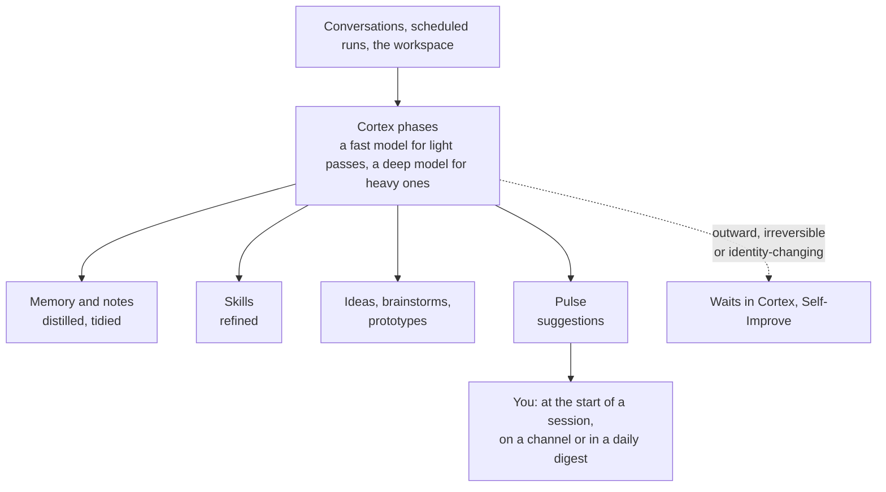
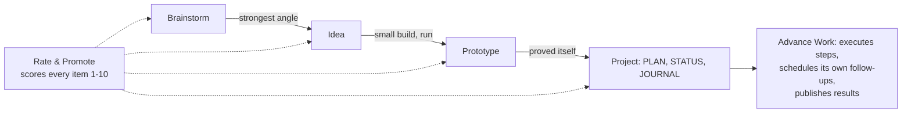

# Cortex and Pulse

**Cortex** is the autonomous cognition engine: the work an agent does between
conversations. Distilling learnings into memory, tidying its notes and
workspace, refining its skills, expanding ideas, and generating suggestions.
Watch it in the **Cortex** tab.

It runs on two model tiers — a `fast_model` for light passes and a `deep_model`
for heavy ones — with `max_deep_runs_per_day` (default 12) as the cost ceiling.
`intensity` (`relaxed` by default, or `balanced` / `aggressive`) sets the
overall pace.

**Cortex is off until you turn it on.** On a new deployment the **Cortex
engine** row in **Cortex → Autonomy** reads Off in the "All agents" column, so
no agent does background cognition: no scheduled phases, no distilling of
conversations into memory, and no `cortex_*` tools in chat (an agent can still
read and write its memory when you ask it to). Switch the "All agents" column
on to start it for every agent, at the relaxed cadence unless you pick another;
or leave the fleet off and set one agent's own column to On to pilot it there
first. An agent that was set Off on its own stays off either way.

Settings resolve with one rule in both directions: **the agent wins when it has
an opinion, the deployment applies when it doesn't**. Every per-agent toggle is
three-state, including the master switch, so "off for the fleet, on for one
agent" works as well as the reverse.

## The funnel: brainstorms, ideas, prototypes, projects

Everything creative Cortex produces lives in one staged funnel, **brainstorm →
idea → prototype → project**. Each item is a folder in the agent's workspace
(`brainstorming/`, `ideas/`, `prototypes/`, `projects/`) tracked by a single
index, and the Cortex tab shows all four stages for every agent. Items move down
the funnel by **promotion**: a brainstorm's strongest angle becomes an idea, an
idea becomes a small runnable prototype (run on the spot when it is safe to, with
the output kept in its `RESULTS.md`), and a prototype that has proved itself
becomes a project with a `README`, a phased `PLAN.md` of checkboxes, a `STATUS.md`
and a `JOURNAL.md`. A promoted item stays where it was, marked promoted and
linked to what it became; the new item links back. **Create project** on a card
still jumps straight to a project, for the case where you have already decided.

You can also review the funnel from a conversation with **AgentFather**: ask it
what an agent (or every agent) has been brainstorming, which ideas score below
4, to discard all of an agent's brainstorms, or to promote a specific idea to a
prototype. It reads the items and their ratings, recommends what to keep, and
does the same discard, restore and promote the cards do, each behind an
approval card. See [Asking the agent](ask-the-agent.md#reviewing-cortex-across-agents).

**Ratings.** The **Rate & Promote** phase reads every active item's folder and
gives it a score from 1 to 10 with a one-line reason, a recommendation
(**promote**, **execute**, **explore**, **keep** or **discard**) and the single
most useful next step. The score shows on the card and in the item's drawer, and
the agent reports it when you ask about an item in chat. Ratings are always
written, whatever the autonomy posture; what happens next depends on it.

**With Fully Autonomous on** (the default once Cortex is on), the funnel runs
itself:

- An item recommended for promotion and scored at or above the **promotion
  threshold** (`cognition.promote_threshold`, default 8) is promoted to the next
  stage, at most `max_promotions_per_run` (default 1) per run and never past the
  daily deep-run cap. An item recommended for discarding and scored 3 or lower is
  discarded; its folder stays and **Restore** brings it back
  (`cognition.auto_discard`, default on, turns this half off).
- **Advance Work** then executes. It takes the highest-rated prototype or project
  with a doable next step and finishes one real step end to end: builds, runs,
  verifies, ticks the `PLAN.md` box it genuinely completed and records the result
  in the item's folder. When the work continues past the run, it **schedules a
  follow-up step for itself** (a check tomorrow, a daily pull, the next phase);
  those appear in the **Scheduler** tab named `Cortex: <item>`, bounded to a few
  pending steps per agent (`cognition.max_self_scheduled_tasks`, default 6), two
  per item and at most hourly, and each runs as a normal turn of the agent inside
  the item's folder. It writes procedures it will need again as learned skills,
  publishes results as a page from the item's folder when they are worth showing
  (you set the viewer password under the agent's **Pages**), asks another agent
  on the deployment when that agent has a capability it lacks (sending an email,
  say), and sends you a notification when something is ready to look at.
- **It works as a team.** Every background run that executes, rates or plans
  is handed the same roster the agent sees in chat, with what each teammate can
  do: the services its tools reach (email, calendar, Slack, GitHub, a CRM, a
  trading account), whether it has a shell, and the MCP servers it is connected
  to with their tool counts. When a step needs one of those, the run asks that
  agent for exactly that piece and records the reply in the item's folder, so a
  project whose plan says "post the summary to Slack" or "pull the open tickets
  from Linear" gets done by the agent that holds the connection. Who an agent
  may see and message is still yours to set: the agent's **Agent visibility**
  and the org chart apply to background runs exactly as they do in chat.
- `cognition.approval_required` still holds on every one of those runs, the
  self-scheduled steps included: by default an email, a payment or an identity
  edit waits in **Cortex → Self-Improve** (the tab that lists everything Cortex
  is holding for your approval), and the item's `STATUS.md` says so.

**With Fully Autonomous off**, ratings are advice. Each promotion candidate
becomes a card in **Cortex → Self-Improve** whose **Approve** does exactly what the
autonomous run would have done; nothing is discarded, and Advance Work develops
items without scheduling, publishing or reaching out.

**Nothing is generated twice.** Every generating run (brainstorming, ideas,
prototyping, a brainstorm promoted to an idea) is handed the whole portfolio:
every brainstorm, idea, prototype and project, including the ones already
promoted and the ones discarded, and is told that a rewording, a narrower or
wider cut, or a recombination of existing items is not new. What the model
returns is then checked against all of it on content, not just title: a
candidate that restates an item at any stage or status is dropped and named in
the run's summary ("Skipped 2 near-duplicates: ..."), a candidate that matches
an active item of the same kind improves that item instead of adding a copy,
and two candidates from the same run that repeat each other keep only the
first. A discarded item stays discarded; it is never recreated under a new
name. The Rate & Promote reviewer looks for duplicates among what already
exists too, and marks the weaker copy **discard** with a link to the one to
keep, so the pair is visible in the item's details rather than silently
merged.

Steer all of it with **Creative direction** (`CORTEX.md`): the reviewer reads
your goals and your Avoid list and rates against them.

**When a background run fails.** A run that a provider refuses with a
temporary condition — a rate limit, an overloaded model — is not lost: the
scheduler runs that phase again about 15 minutes later with a fresh start, and
once more an hour after that if needed, before waiting for the next scheduled
time. Runs across the deployment also never all start in the same minute (each
agent's scheduled minute is spread out) and no more than `worker_max_concurrency`
of them talk to a model at once, so the deployment does not bring a rate limit on
itself. A failure the deployment can heal on its own reaches the notification
bell and the Pulse **Ops** lane only once the same run has failed **twice in a
row**; a failure that needs you — an expired sign-in, a locked vault, an empty
balance — rings immediately, with the fix-it button. A success clears the
streak.

Where `intensity` and `max_deep_runs_per_day` govern *how many* runs happen,
two settings bound what a *single* run may spend: the **Step budget** (how many
internal steps of thinking and tool use it may take, default 100 ≈ 25 rounds)
and the **Time limit** (wall-clock seconds, default 1200). A run that exceeds
either stops and its work for that run is discarded. Both follow the same
two-tier rule as everything else and are edited side by side in **Cortex →
Autonomy** — the "All agents" column for the whole deployment, the per-agent
column for one, `Inherit` to follow the deployment. Raise them together: a
larger step budget behind the old time limit just fails on time instead. The
Step budget **is** the recursion limit — there is no second control by that name,
and none for ordinary chat, which is not bounded this way. Each field's help text
names the config key it writes, so a value you have read about in a config file
can be traced back to the row that sets it.

**Phases & schedule**, the second part of the settings card, is one row per phase:
what it is, when it next runs, how the last run went, the same two columns of
on/off, and **Log** / **Run now**. On a phone each phase becomes a small block
instead of a line — the phase's full name, then its schedule, then the two
scopes each behind an "All agents" / agent-name label, then the two buttons —
so it is always clear which phase you are about to run and which scope a switch
belongs to.

Background work has no one watching it, so a run that fails, times out or needs
setup raises a **notification** — the sidebar bell and the Overview
Notifications section — naming the agent, the run and the fix, and clearing
itself when that run next succeeds. You do not have to open Cortex to find out
something went wrong. Runs stopped by a guard rail you configured (over budget,
nested too deep) stay quiet: they are working as intended.

**Talking about any of it happens in Chat.** Every button in Cortex that asks
the agent to do something — "Chat" on a Pulse card, an idea, brainstorm,
prototype or project; "Explore more" on an idea, brainstorm or prototype; "Send
to Agent" on a prototype; "Fix with agent" on a self-check finding — takes you
to the Chat tab on that item's own conversation, switching to the agent the item
belongs to. The first time, the message box arrives **pre-filled, not sent**: a
short framing that says what you are there to do ("The user wants to explore
more about this idea …") and gives the agent the full workspace path to the
item's files, ending in `User:` so you type what you actually want and press
Send yourself. Nothing goes to the agent until you do. Each item keeps one
conversation, so coming back opens its history with an empty message box and
continues where you left off rather than starting over; it is a normal chat,
with attachments, the model override, tool approvals and the full history. The
conversation carries a violet **CORTEX** badge in your conversation list so you
can find it later. The same hand-off works from the simple shell's Cortex page.

**Pulse** is the output you actually see: short, proactive suggestions surfaced
at the start of a session, optionally pushed to channels or emailed as a daily
digest. `quiet_hours_start` / `quiet_hours_end` keep it from interrupting, and
the per-session and per-day caps keep it from becoming noise.
