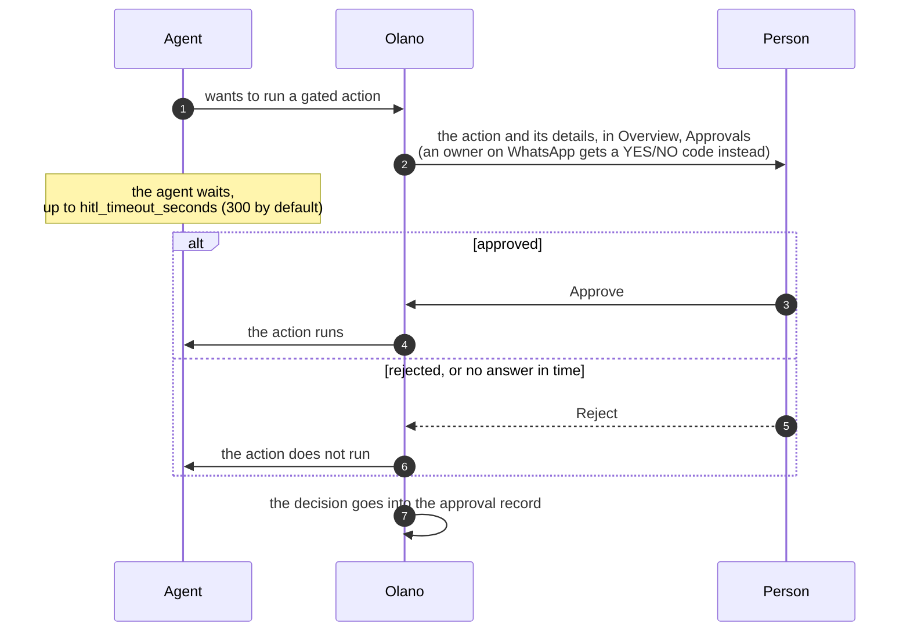

# Human in the loop (HITL) and approvals

When an agent wants to do something consequential, it can stop and ask. The
request appears in the **Approvals** section of the dashboard Overview with the
exact action described, and the agent waits for your decision (up to
`security.hitl_timeout_seconds`, default 300).

Approval is decided in three layers, each overriding the one before:

**1. The profile** (`security.profile`) sets the baseline:

| Profile | Meaning | Always asks before |
|---|---|---|
| `developer` *(default)* | Trusted — act freely | money, writing secrets, running commands in another agent's workspace |
| `safe` | Supervised — ask before writes | the above, plus external writes, shell commands, reading secrets |
| `production` | Locked down — strictest | the above, plus filesystem writes and delegating to subagents |

**2. Toggles** add categories on top: `security.hitl_write_tools: true` adds
external writes; `security.hitl_shell: true` adds shell commands.

**3. Per-tool overrides** win over everything:
`security.tools.<tool_name>.approval` set to `"always"` or `"never"`.

`security.hitl_enabled: false` is the master off switch — full autonomy, no
approvals at all. All three profiles enable it by default.

**Two things are always individually approved, in every profile:** running a
command in *another agent's* workspace, and a [browser](browser.md) action that
submits a form, buys, pays, sends, posts or deletes. There is no configuration
that turns either off, and neither the chat's *Auto* mode nor *Accept all*, a
remembered "always allow", a scheduled run or a background run approves one on
a person's behalf.

`security.hitl_auto_approve_low_risk` (default `true`) lets clearly-safe actions
through without asking, so the queue stays meaningful.

Cortex has its own approval setting. `cognition.auto_approve` decides whether
background work skips the queue, but `cognition.approval_required` — default
`["external_send", "irreversible", "identity_edit"]` — always needs a human,
whatever `auto_approve` says. Anything that sends something outside, cannot be
undone, or rewrites who the agent is, gets a person in the loop: the item waits
in **Cortex → Self-Improve** instead of being applied, and a background run that
tries such a step pauses on it the same way. So does a step the agent scheduled
for itself from a background run (`cortex_schedule`, shown in **Scheduler** as
`Cortex: <item>`): it runs under the same rule as the run that booked it, not
with the free hand a task you scheduled yourself gets. Fully Autonomous still
handles everything else on its own: new skills, memory, procedures, tidy-ups,
promotions down the funnel and the execution of prototypes and projects. An owner
who really wants an agent to act unattended on all of it sets
`approval_required: []` for that agent; one who wants only identity protected
lists just `["identity_edit"]`.

**Approvals from WhatsApp.** When someone talks to an agent on any of the
three WhatsApp connectors, the outcome of a risky action depends on who they
are:

- **An owner** has risky actions approved without being asked, unless **Ask
  owners in chat before risky actions** is on in the connector's **Behavior**
  section (`chat_approvals: true`). Owners are the numbers in *Owner numbers*;
  on the QR connector the numbers in *Allowed phone numbers* count as owners
  too, while on the Twilio and Meta connectors *Allowed sender numbers* is a
  list of customers and makes nobody an owner. Then the agent posts the action and its details in
  the chat with a four-character code and waits; the owner replies `YES 4F2A`
  to let it run or `NO 4F2A` to stop it. Only the owner whose message started
  the request can answer, and a reply without the code does nothing. With no
  answer before `security.hitl_timeout_seconds` the action is rejected, and so
  is one whose prompt could not be delivered.
- **Anyone else** never decides: their risky actions wait in the dashboard's
  Approvals list for someone with access to the agent.

**The approval record.** Every approval decision is written to an append-only
file, `audit/approvals.jsonl` in the Olano home: the action and its details,
when it was asked, the outcome (approved, rejected, timed out, or abandoned when
the server stopped before anyone answered), who decided (a dashboard user as
`human-<username>`, a messenger sender as `<platform>:<id>`) and through which
surface. Actions an owner's messages had approved without asking are recorded
too. Read it on the **Overview** page under **Approvals → Approval history**,
which can be narrowed to one agent. Admins see the whole record; a member sees
the rows for agents they have access to.
