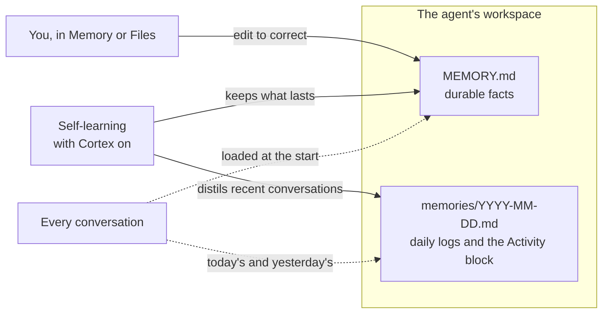

# Memory and self-learning

Memory is markdown files in the agent's workspace, which means you can read and
correct it directly — in the dashboard's **Memory** tab, the **Files** tab, or a
text editor.

- **`MEMORY.md`** — durable facts the agent has learned and should keep.
- **`memories/YYYY-MM-DD.md`** — a daily log. Today's and yesterday's are loaded
  into every conversation.

**Self-learning** (`memory.self_learning`, on by default) is part of the Cortex
engine, so it runs only for an agent Cortex is on for, and Cortex is off until
you turn it on ([Cortex and Pulse](cortex-and-pulse.md)). While it runs it reads recent
conversations, distils what is worth keeping, and writes it into the daily log
and `MEMORY.md`. A weekly pass consolidates. `self_learning_interval` (default
3600 seconds) sets the pace.

The same background pass (so, again, only with Cortex on for the agent) also
keeps an **Activity** record in the daily log —
what the agent *did*, as opposed to what it learned: each scheduled run,
heartbeat finding, request from another agent, and Cortex phase, one line each
with the time and a short excerpt of the request and the reply. It is written
deterministically (no model call, no credits) on every cycle, so it is there
even on days when the distillation itself is skipped, and it is bounded — one
block per day, capped in length — so a busy day cannot crowd out the rest of the
prompt. Ordinary conversations with people are not copied into it; those go
through distillation only. Ask the agent what it did yesterday and it reads
this block; the dashboard **Overview → Daily highlights** shows the fleet-wide
version of the same day.

Turning on `memory.rag` also indexes memory for meaning-based search, so the
agent can find something it learned months ago without it being in the prompt.

**Per-customer memory** (`memory.per_customer`) is the multi-user variant — see
[Multi-user: two different features](multi-user.md).

If an agent has learned something wrong, editing `MEMORY.md` is the fix, and it
takes effect on the next reply.
