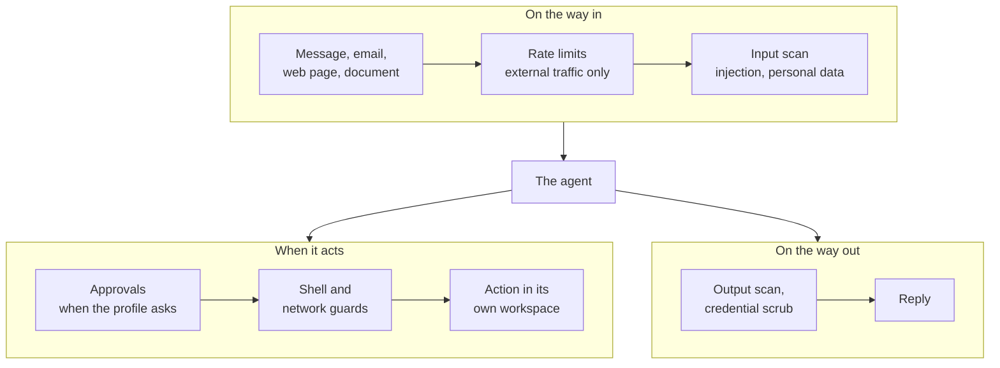

# Privacy and security

Several independent checks stand between what reaches an agent and what it
does. The settings on this page switch them on, off or tighter:

**Trust level** (`security.trust_level`, 0–4) is the broad autonomy dial:

| Level | Name | What it can do |
|---|---|---|
| 0 | Observer | Read only; can suggest, not act |
| 1 | Assistant | Write to memory and logs only |
| 2 | Collaborator *(default)* | Create and edit workspace files; containerised shell |
| 3 | Autonomous | Full workspace; auto-approves low-risk operations |
| 4 | Developer | Local shell; auto-approves most things. Development and CI only |

**Personal data.** `pii_scan_input` and `pii_scan_output` (both on by default)
look for personal data moving in and out; `pii_action` decides what happens —
`warn` (default), `redact`, or `block`. `pii_scan_peer` extends scanning to
agent-to-agent traffic; it is off by default because internal traffic is usually
already inside your boundary.

**Prompt injection.** `input_scan` (on) checks incoming text for attempts to
hijack the agent's instructions — the classic risk when an agent reads email,
web pages or documents from people you do not control. `output_scan` (on)
screens what goes out. `web_scan` (off) extends the check to fetched web
content; turn it on for agents that browse widely.

**Credentials.** `credential_scrub` (on) strips anything that looks like a
secret from what the agent says, so a key that ends up in a log or an error
message does not get repeated into a chat.

**Network.** `ssrf_protection` (on) blocks requests to internal network
addresses — the defence against an agent being talked into fetching
`http://localhost/admin`. Which *public* destinations an agent's tools may
reach is a separate pair of lists, `egress_allow` / `egress_deny`, set for the
whole deployment in **Config → Outbound access** and narrowed per agent in its
**Advanced** tab; both empty (the default) allows everything. See
[`agent.json5` reference](../agent-json5.md#security) for the format and exactly what they govern.

**Shell.** `shell_guard` (on) blocks dangerous command patterns.
`skill_audit` (on, `strict`) reviews skills before running them.

**Sandboxes are isolated from each other.** An agent's shell commands, and any
server it runs (such as the server behind a [page](pages.md)), run in its own
sandbox. No other agent's sandbox, and no other container on the machine, can
open a network connection to it, so one agent cannot reach what another agent
is serving. Sandboxes can still reach the internet, subject to the outbound
lists above. The isolation is set up automatically; the agent's Terminal tab
says when a machine could not set it up.

**Disk encryption (managed instances).** A managed instance created on Olano
Cloud keeps everything it stores (agents, memory, files, conversations, the
vault, the database) on an encrypted volume that is unlocked automatically
when the instance boots. This is *standard custody*: it protects your data
against disclosure from stolen disks, snapshots, backups and offline storage
access; the instance decrypts at boot using Olano-operated key infrastructure,
and Olano's production control plane retains the technical capability to
authorize key release. What is yours alone is the **recovery key**: a second
key that opens the volume without Olano's key service, for example to read your
data from a disk image if the instance or Olano is gone. Create it from
**Config → Disk encryption** in the instance's own dashboard: the instance
generates it, shows it exactly once, and asks you to type it back before it
counts. Olano never sees the key and cannot show it again; keep it in a password
manager or printed somewhere safe. Losing it is not fatal while the instance
runs (create a new one; the lost one stops working once the new one is
confirmed), but without one your data can be opened by Olano's key service
alone. The same card shows whether a backup of the volume's encryption header
(the keyslots, never your data) is held off the instance, which is what lets the
recovery key open the volume again if the header on the disk is damaged.
Conversation history on such an instance is additionally encrypted inside the
database, so a database file read outside the instance shows no message text.

**Rate limits.** `security.rate_limits` caps how much an agent can do:

- `per_tool: { tool_name: max_calls_per_minute }` — cap a specific tool.
- `messages: { per_minute, per_hour, per_day }` — cap inbound messages across
  all platforms. Omit a window, or set it to `null`, for unlimited.
- `per_platform: { telegram: { per_minute, … } }` — per-connector caps.

Two things to know. **Message limits are opt-in**: the schema shows a default
of 60, but limiting only activates once you set a `rate_limits` block
explicitly. And they apply **only to external inbound traffic** — scheduled
jobs, heartbeat runs and the agent's own background work are exempt, so a rate
limit never throttles the agent's own initiative.

(`requests_per_minute` is a legacy alias for `messages.per_minute`. Prefer the
`messages` form.)

These override the deployment-wide `rate_limits:` in `config.yaml` for that
agent.

**A note on boundaries.** An agent reaches its own workspace, plus shared
folders you declare and read-only skill sources. Other agents' directories are
deliberately invisible to it — a "permission denied" there is the isolation
working, not a bug to work around. Cross-agent work happens through tools that
are individually approved, not through the filesystem.
