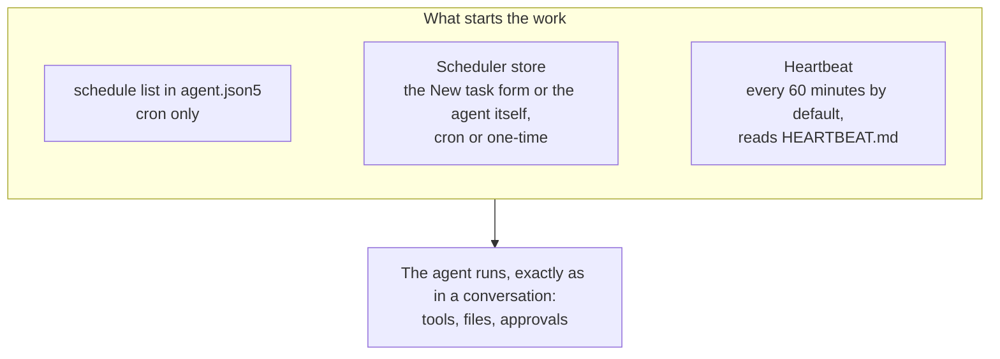

# Scheduler and heartbeat

**Scheduled jobs** live in the agent's `schedule` list and appear in the
dashboard's **Scheduler** tab, where you can also create, pause, edit and
trigger them.

```json5
schedule: [
  {
    name: "Morning revenue check",
    cron: "0 9 * * 1-5",
    timezone: "America/Costa_Rica",
    message: "Check yesterday's revenue and flag anything unusual.",
  },
  {
    name: "Weekly deep analysis",
    cron: "0 7 * * 1",
    message: "Review last week's numbers in depth and write the report.",
    model: "olano:pro", // this job only; the agent's own model is unchanged
  },
]
```

**Schedules are standard cron.** Every cron expression here (this list, a
stored task, the Advanced field of the task form, a `when:` line in the
heartbeat file) has five fields: minute, hour, day of month, month and day of
week. The day of week counts from Sunday: `0` or `7` is Sunday, `1` is Monday,
so `1-5` is Monday to Friday. Names work as well (`mon-fri`, `mon,thu`, `sun`).
The Scheduler tab's weekday picker and calendar show the days a task runs on,
and an agent that creates or reads a task is told the same days by name.

Schedules saved before this numbering was adopted were rewritten once into
weekday names for the days they were already running on, so no existing task
changed its days. If one of yours now reads, say, `tue,wed,thu,fri,sat` where
you meant weekdays, it had been running a day late; edit it to `mon-fri`.

A job is a **message sent to the agent** at a time you choose — so anything the
agent can do in a conversation, it can do on a schedule. Use `thread_id` to keep
a job's history in one continuous conversation.

**A model per job.** `model` (`provider:model`, for example `olano:turbo` or
`anthropic:claude-sonnet-4-6`) runs that one job on a model other than the
agent's configured one, so a cheap tier can do the nightly digest and a bigger
one the weekly analysis on the same agent. Leave it out and the job follows the
agent's model, including later changes to it. Each run is billed to the model
that ran, and the run's conversation in the chat list shows which model it was;
on a managed deployment a bigger tier spends credits faster. A model whose
provider is not connected is refused when the job is saved, and a model that
stops working later fails the run with that reason in the job's history rather
than falling back silently. The same field exists on tasks in the Scheduler tab
("Model", with "Agent default" as the first choice) and on the scheduling tools
an agent or AgentFather uses.

**And a reasoning effort per job.** `reasoning_effort` sets how much thinking
the model does before answering on this job's runs, independently of the
agent's own `reasoning_effort`: a nightly digest can run at `low` while the
weekly analysis runs at `high` on the same agent. The value must be one of the
levels the model the job runs on accepts (`model` when set, else the agent's
configured model); the Scheduler tab's "Reasoning effort" field appears only
for such a model and lists exactly that ladder, and every surface that saves a
job refuses a level the model does not take, naming the ones it does. Leave it
out to follow the agent's own setting. Higher levels cost more tokens and time
per run; a level that stops being valid later (a model retired, a package
changed) is dropped for that run with a log line rather than failing the job.



**What a run knows about the time.** Every scheduled run's message opens with
the current date, weekday and time in the job's own `timezone` (UTC beside it),
and every model call the agent makes, scheduled or not, ends its instructions
with today's date. A brief that says "weekdays only" is decided from that
clock, never from the newest date the agent happens to find in its files. The
agent still calls `get_current_time` for the exact time of day during a long
run. Set `LIONCLAW_CLOCK_TIMEZONE` in the deployment's environment to have the
date line name your business timezone beside UTC; `LIONCLAW_CLOCK_STAMP=0`
turns the date line off.

**Late and missed runs.** A firing is not always on the second: the runtime can
be busy, or restarting, at the moment a job is due. A job that fires late still
runs, for up to `scheduler.misfire_grace_minutes` (six hours by default, set in
`config.yaml`), and its message says when it was due and how late it is, so a
morning report that starts at 08:40 is written as a late morning report rather
than dated to the wrong moment. A firing that fell inside a restart runs as
soon as the runtime is back, as long as it is still inside that window
(`scheduler.catch_up_on_boot`, on by default); a dashboard **Run now** never
counts as late. Past the window the firing is recorded in the job's history as
*skipped*, naming the reason, and a notification on the bell says which job
was skipped or failed and links to it; the notification clears by itself on
the job's next completed run. Heartbeat polls and Cortex background phases
keep a short five-minute window, since their next tick is minutes away.

**A run that never ends.** Only one run of a job executes at a time, so a run
that keeps going holds the job: every later firing is recorded as *skipped:
the previous run was still executing*, and a job that fired once and then
never again usually means exactly that. A scheduled run is therefore bounded
by `scheduler.max_run_minutes` (three hours by default). A run still going at
the limit is stopped, its history row says so, the bell carries a notice, and
what it wrote before the cut is kept; the next firing runs normally. Set the
limit to `0` to remove it. The **Next** column on the Scheduler tab shows the
job's next fire time; a dash there on an active job means the runtime holds
no job for it, which saving the task again repairs.

**Fan-out.** With multi-user mode on, `for_each_customer: true` runs the job once
per end user, and the message can use `{customer_key}`, `{platform}` and
`{user_id}`. Use `action` instead of `message` to run a named script from
`allowed_actions`.

**Two places jobs live.** The `schedule` list above is one of them; the other is
the scheduler's own store, which is what the Scheduler tab's "New task" form
writes and what an agent creates when it schedules something itself. The
Scheduler tab merges both and badges each row, so nothing is hidden — but the
difference matters when you go looking for what is triggering a job. A
`schedule` entry is cron-only and lives in the agent's configuration; a stored
task can also be one-time and can be handed to a different agent later.

**Asking an agent about the schedule.** Any agent can read and change its own
scheduled work in chat, and AgentFather can do the same for *every* agent in the
deployment — across both places — so "what wakes the finance agent at 3am?",
"pause that job", or "schedule a Monday summary for the support agent" are all
things you can simply ask for. Changing, creating or immediately running another
agent's job always raises an approval card first, because it makes that agent
start working on instructions you supplied. Ask to see a job's full instructions
before approving an edit: a listing shows only its name, schedule and the first
couple of lines.

**Heartbeat** is different and simpler: the agent wakes up periodically (default
every 60 minutes) and reads `HEARTBEAT.md` in its workspace — a plain markdown
file of standing instructions. It is the low-ceremony way to say "keep an eye on
this" without writing a cron entry. Control it with the `heartbeat` block per
agent, or `heartbeat:` in `config.yaml` for the fleet.
