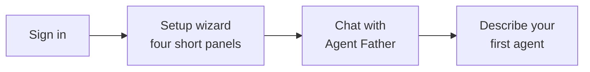
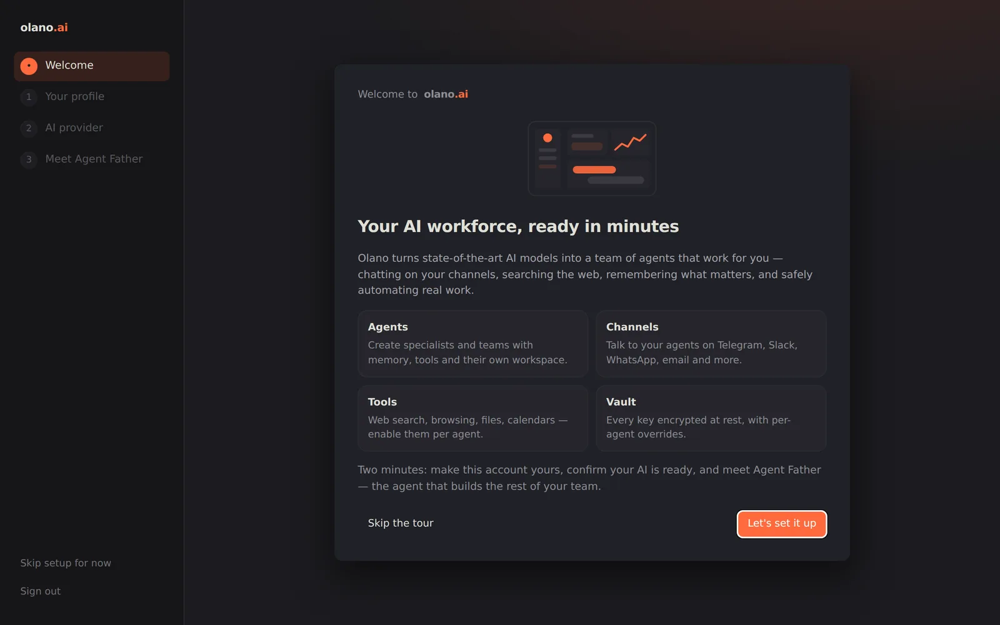
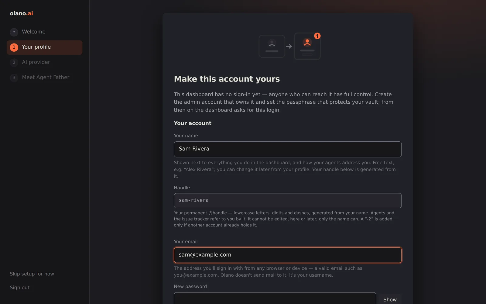

# Getting started

## Olano Cloud

Deploy an instance on `cloud.olano.ai`, open the dashboard address it gives
you, and the setup wizard below takes over. Nothing to install and nothing to
keep running yourself — see [Olano Cloud](olano-cloud.md). Your sign-in is
created on the instance before it is reachable, so the first screen you see is
**Sign in**: use the email you signed up with and the temporary password from
your welcome email (also copyable from the deployment card in the cloud
console). The dashboard address carries no credential — nothing signs you in
by itself, and a **Create your account** screen on a fresh cloud instance
means its setup has not finished; wait a minute and reload rather than
creating an account.

While the instance still has that temporary password, the sign-in screen says
so itself: it greets you as a new instance and shows a **First sign-in** note
that the password is in the email we just sent you, with a link that opens
your deployment's **Security** tab in the cloud console, where the password
stays copyable. **Forgot password?** points to the same place. Once you have
set a password of your own (the setup wizard's profile panel, or a password
change), the note is gone for good and the screen is the ordinary sign-in
form. The note never shows your email or the password; it only says where to
find them.

## Self-hosted

The quickest install is the Docker Compose stack in the Olano repository
(`deploy/self-host/`): three containers from the public images, set up and
started by one line on a Linux server, a Mac with Docker Desktop, or Windows
with Docker Desktop and WSL 2:

```bash
curl -fsSL https://raw.githubusercontent.com/olano-ai/olano/main/install.sh | bash
```

The installer checks for Docker with the Compose plugin (on Linux it offers to
install it, and asks first), downloads the stack's files into `~/olano`, and
runs its setup script, which writes the generated settings into `.env`, pulls
the images and starts the stack. Options for the setup script go after
`bash -s --`, for example
`curl -fsSL …/install.sh | bash -s -- --host olano.example.com --sandbox`.
If you would rather download the files yourself, the README beside the compose
file lists them and the same script runs as `bash setup.sh`.

Everything the install keeps lives in a `data` directory next to the compose
file; backing that directory up backs up the install. Updating is
`docker compose pull && docker compose up -d`; the README covers pinning a
version, moving the data directory and the day-to-day commands.

### The address

Unless you say otherwise, the setup script picks the address on its first run:

- **A server with a public IP address on its own network interface** (a
  typical VPS): it serves **https** on `<your-ip-with-dashes>.sslip.io`, for
  example `https://203-0-113-7.sslip.io`. sslip.io is a public service whose
  names point at the IP address written in them, which lets the dashboard get a
  Let's Encrypt certificate with no domain of your own.
- **Anything else** (a laptop, a home server, a cloud VM behind NAT such as
  AWS EC2): `http://localhost:3200`, reachable on that machine only.

Choose explicitly with an option:

| Option | Address |
|---|---|
| `--host olano.example.com` | https on your own domain; point its DNS record at the machine first. The reliable route for anything long-lived |
| `--host auto` | https on `<your-ip>.sslip.io`, also on a NAT'd cloud VM whose ports 80 and 443 are forwarded to it |
| `--local` | `http://localhost:3200` only |

For either https mode, ports **80** and **443** must be reachable from the
internet: in a cloud firewall or security group, open **22** (SSH), **80** and
**443**, and nothing else. The certificate is obtained on the first visit and
renewed on its own. sslip.io names share Let's Encrypt's rate limit with every
other sslip.io user, so issuance can occasionally be refused for a while; a
domain of your own avoids that. Whatever the mode, the plain-http port 3200 is
published on the machine's loopback only, never to the network, so from
another computer it is reached through an SSH tunnel
(`ssh -L 3200:localhost:3200 you@server`, then `http://localhost:3200`), which
also works while a certificate is still pending.

### The setup code

A fresh install has no accounts, and the first person to create one becomes
its admin. So that this is you and not someone who found the address first,
the dashboard asks for a one-time **setup code** before it creates that first
account. It is three groups of four letters and digits, like `ABCD-EFGH-JKMN`,
and you will find it:

- in the setup script's output, printed next to the address;
- in the `.env` file beside the compose file, on the `OLANO_SETUP_CODE` line;
- in the runtime's log (`docker compose logs olano`), under
  **FIRST-RUN SETUP CODE**.

Case, spaces and dashes do not matter. A wrong code is refused with a message
saying where to look, and after ten wrong tries the form waits fifteen minutes
before accepting another. The code stops working the moment the first account
exists; from then on the dashboard asks for that account's email and password.
An instance on Olano Cloud never asks for it: its account is created before the
instance is reachable.

### Sandbox mode

By default an agent's shell commands (and the Terminal) run inside the
runtime's own container. `--sandbox` gives every agent its own **sandbox
container** instead, the way an Olano Cloud instance runs them: a non-root
container per agent with only that agent's workspace in it and resource
limits, so one agent's commands cannot read another agent's files or the
runtime's. If an agent's sandbox cannot start, that agent has no shell rather
than falling back to the runtime container.

The cost is on the host: to start those containers the runtime is given the
host's Docker socket, and access to the Docker socket is equivalent to root on
the machine. Agents never get it, but a flaw in the runtime would reach the
whole host. Use sandbox mode on a machine you alone control. `--no-sandbox`
turns it off again; both are remembered across runs of the setup script.

Running from source (the Python package, with the dashboard on port **3200**
and the runtime API on **8765**, both configurable in `config.yaml`) is
described in the repository's README. Either way, from then on everything
happens in the dashboard and in conversation with your agents, exactly as on
the cloud.

Models are paid for either way you like: paste your own provider keys, or run
on Olano credits with an Olano API key from `cloud.olano.ai` (see
[Models and credits](models-and-credits.md#olano-credits-on-a-self-hosted-install)).
The wizard offers both.

## The setup wizard

The first time an admin opens the dashboard on a fresh deployment, a
full-screen wizard walks through four short panels, then drops you straight
into a conversation with Agent Father:



<div class="grid" markdown>

<figure markdown="span">
  { loading=lazy }
  <figcaption>The Welcome panel.</figcaption>
</figure>

<figure markdown="span">
  { loading=lazy }
  <figcaption>Your profile, on an instance with no accounts yet: the handle is generated from your name as you type.</figcaption>
</figure>

</div>

1. **Welcome.**
2. **Your profile.** A deployed instance ships with one account: the email
   you signed up with and a temporary password from your welcome email. You
   signed in with that password a moment ago; this panel is where you create
   your own user on it — it keeps your email and asks for your name, a
   password of your own, and the passphrase that protects the vault.
   Your **handle** (the permanent `@name` agents and the issue tracker refer to
   you by, like `carlos-rivera`) is generated from your name and shown as you
   type; it is not editable, here or later, while the name always is. Saving
   replaces the temporary password everywhere — it stops working at once, and
   any other browser still using it is signed out — while **this** browser
   stays signed in as the user you just created: the rest of the tour, and
   Agent Father's chat at the end of it, run as you, not as the provisioned
   sign-in. On an instance with no accounts yet the same panel also asks for
   your email (and, on a self-hosted install, the
   [setup code](#the-setup-code)) and creates the admin account, and signs you
   in as it. On a
   managed cloud deployment this panel is required, because the instance was
   provisioned with temporary credentials that must be replaced; the vault
   half asks for the temporary passphrase only if the vault is locked, and
   then links to your deployment card where it is copyable.
3. **AI provider.** On a managed deployment your plan's Olano Credits already
   cover the AI, so this panel just shows what is included; bringing your own
   keys stays optional. Self-hosted installs choose here: paste an Olano API
   key to run on Olano credits (the panel then lists what is included and your
   balance), paste a provider key, or both.
4. **Meet Agent Father.** What Agent Father does for you — creating agents
   from a description, reconfiguring them, connecting messaging channels and
   services, inviting your team, keeping things running, and asking for your
   approval before it changes anything. The panel also tells you that Agent
   Father wakes up when you continue and greets you in the chat — usually
   within seconds, up to a minute on a brand-new instance — and offers
   starting points: things to try (create an agent from a description,
   change an agent's model, tools or channels, list the available providers
   and connectors) and things worth telling it about yourself (whether this
   is personal or business use, what your business or interests are, which
   systems and platforms you use, and which repetitive daily or weekly tasks
   you would like to hand to AI). Press **Meet Agent Father** and setup is
   over: the dashboard opens Agent Father's chat showing *Agent Father is
   waking up…* until its hello arrives, and it then asks what you would like
   to build first.

There is no separate step for a first agent, a messenger or web search: you
ask Agent Father for those in the chat, and web search is already available
on a managed deployment. Everything the wizard touches lives in the dashboard
afterwards (your profile in the account menu, Providers, Vault).

## Three ways to do everything

Every task in this guide can be done from one of three places, and they never
disagree:

| Surface | Good for |
|---|---|
| **The dashboard** | seeing everything at once; admin work; anything with a form |
| **Asking an agent** | connecting a service, a messenger or a key; changing the agent's model, instructions, subagents or skills — the agent uses its built-in `self_*` tools and sends a **magic link** when a browser is needed ([Ask the agent: self-configuration, magic links and admin tools](feature-guides/ask-the-agent.md)) |
| **Asking AgentFather** | anything about the deployment as a whole: new agents, teammates and access, diagnostics, settings, updates — with an approval card in front of every change ([Building agents from a conversation](building-agents.md)) |

There is no command line to learn: an agent never asks you to open a terminal,
and nothing in this guide requires one.

Inside a chat session, slash commands control the conversation — `/model` to
switch models, `/new` to start a fresh thread, `/memory` to inspect what the
agent remembers, `/verbosity` to change how much it narrates. `/help` lists
them — the ones *that* agent exposes on *that* surface, plus any custom
commands you defined, so it never offers something it will then refuse.
