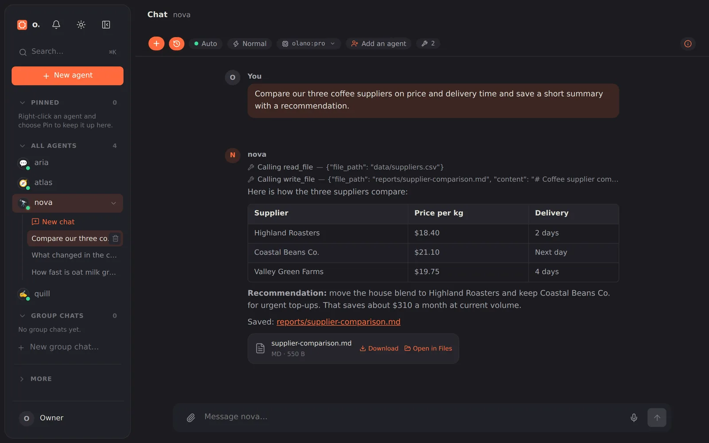

# Olano User Guide

Olano runs a team of AI agents for you: each one with its own identity, memory,
tools and connections, reachable from the dashboard, from messengers and from
other agents. This guide is the reference for the people who run a deployment,
whether on [Olano Cloud](olano-cloud.md) or on their own machine.

<figure markdown="span">
  { loading=lazy }
  <figcaption>An agent at work: it read a spreadsheet, wrote a report into its workspace and handed the file back in the chat.</figcaption>
</figure>

It is written to be searched rather than read front to back. Use the search
box, or start from one of these:

- **New here?** [What Olano is](what-olano-is.md), then
  [Getting started](getting-started.md).
- **Looking for a screen?** [The dashboard](dashboard/index.md) has one page
  per tab, from [Chat](dashboard/chat.md) and [Agents](dashboard/agents.md) to
  [Config](dashboard/config.md).
- **Writing a config?** Every field, its accepted values and its default:
  [`agent.json5`](agent-json5.md) for one agent, [`config.yaml`](config-yaml.md)
  for the whole deployment, [`organization.yaml`](organization-yaml.md) for the
  org chart.
- **Setting something up?** The [feature guides](feature-guides/index.md) walk
  through [channels and connectors](feature-guides/channels-and-connectors.md),
  [MCP servers](feature-guides/mcp-servers.md),
  [approvals](feature-guides/human-in-the-loop.md),
  [scheduling](feature-guides/scheduler-and-heartbeat.md),
  [memory](feature-guides/memory-and-self-learning.md) and more.
- **Choosing a model or watching costs?** [Models and credits](models-and-credits.md).
- **Something is off?** [Common problems](common-problems.md).

Every agent on a deployment carries this same guide and can answer questions
about the platform from it, so asking an agent is always an option too:
[Building agents from a conversation](building-agents.md) explains what
AgentFather can set up for you from a plain description.

The version switcher in the header selects the guide for the release you run.
`latest` is the newest release; `edge` follows the main branch.
