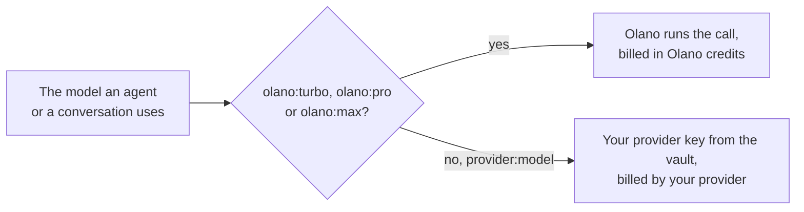

# Models and credits

## Two ways to pay, not two modes

| | Olano-managed | Bring your own key (BYOK) |
|---|---|---|
| What you pick | `olano:turbo`, `olano:pro`, `olano:max` | `anthropic:claude-sonnet-4-6`, `openai:gpt-5.5`, … |
| Who holds the provider account | Olano | you |
| What you are billed in | Olano credits | your provider bills you directly |
| Setup needed | none on Olano Cloud; an Olano API key on a self-hosted install | a provider API key in the vault |

**A deployment can do both at once.** Billing is a property of the model you
choose, not a mode the whole box is in — one agent can run on credits while
another runs on your own OpenAI key. Pick per agent, and per conversation with
`/model`.

BYOK shows tokens and estimated dollars, because you own that provider bill and
want to reconcile it. Olano-managed shows credits.

## The Olano tiers

| Tier (what you see) | Value to write in config | Reasoning effort | Use it for |
|---|---|---|---|
| **Olano Turbo** *(default)* | `olano:turbo` | not applicable | Everyday work. Fast, cheap, no knobs. Start here. |
| **Olano Pro** | `olano:pro` | `low` / `medium` / `high` | Harder analysis, longer chains of work, better judgement. |
| **Olano Max** | `olano:max` | `low` / `medium` / `high` | The most powerful frontier models, for genuinely hard problems. |

The name you see and the value you write are the same word for every tier. They
were not always: the top tier's id used to be `olano:reasoning`, which is why
you may still find that string in an older `agent.json5`.

> **`olano:reasoning` no longer works.** It was retired, not aliased, so an
> agent still configured with it fails to build, with an error naming
> `olano:turbo`, `olano:pro`, `olano:max` — and the model picker shows the raw
> `olano:reasoning` instead of a product name, which is how you spot one.
> **The fix is to edit the value to `olano:max`.** Nothing rewrites it for you,
> and the change is nothing more than the new spelling: same tier, same
> routing, same credit rate.

The word "reasoning" does still appear here, in the **Reasoning effort** column
above and in a model's `reasoning_effort` setting. That is how hard a model
thinks about a single request — an unrelated setting that happens to share the
word, and it is not going anywhere.

Every tier offers a very large context window; the dashboard's model picker
shows the exact figure for each, and the context bar in a conversation shows how
much of it you are using.

**What backs a tier is not fixed.** Olano routes each tier to whatever currently
serves that capability and speed point best, and re-routes as the model
landscape changes. That is the value of a tier: you buy a capability level, and
you get upgrades without changing a config. It also means you should choose a
tier by the *job*, not by assumptions about a particular underlying model.

`olano:turbo` is the default and always available. When in doubt, start an agent
on Turbo and move it up only when its work demonstrably needs more.

## Deployment default models (`default:*`)

Three **aliases** sit above every concrete model:

| Alias | Picker name | Out of the box it points at |
|---|---|---|
| `default:turbo` | **Default · Turbo** | `olano:turbo` on an Olano-managed deployment; a bring-your-own-key model elsewhere |
| `default:pro` | **Default · Pro** | `olano:pro` on managed; a bring-your-own-key model elsewhere |
| `default:max` | **Default · Max** | `olano:max` on managed; a bring-your-own-key model elsewhere |

An alias is not a model — it is a pointer the whole deployment shares. Any
agent, subagent, team member or chat conversation set to one follows whatever
target is configured in **Config → Default models** (the `default_models:`
block of `config.yaml`), and the target must be a concrete `provider:model` —
never another alias. Change a target once and every agent on that alias
switches the next time it boots or reloads, with no per-agent edits. The
pickers show what an alias currently resolves to ("Default · Turbo — currently
Olano Turbo"), and clearing a target in Config restores the deployment's own
built-in default.

Use an alias when an agent should simply run on "the deployment's
everyday/heavier/top brain"; pin a concrete model only when that one agent
genuinely needs that one model. Catalog agents install on the aliases —
experts on `default:turbo`, team supervisors on `default:pro` — which is what
makes "move the whole fleet to a different model" a one-field change.

One caveat on a bring-your-own-key install: an alias is only as usable as its
current target. If the target's provider has no key or connection, every agent
on that alias fails at its next turn — the chat picker greys the alias out for
the same reason.

## What brain a new agent starts on

You almost never have to pick one. Every agent you add — from the New agent
dialog, from an integration, or asked for in plain language — starts on **`default:turbo`**, the deployment's
everyday brain. On an Olano-managed deployment that resolves to `olano:turbo`,
so it works on credits from its first turn with nothing to configure; on a
bring-your-own-key install it resolves to the bring-your-own-key target shown
in **Config → Default models**.

**AgentFather starts on `default:turbo` as well.** Its turns are conversation
and tool calls — a catalog lookup, a config change behind an approval card, a
log read — and the everyday brain answers those in a beat where the deeper tier
made every one of them wait. It used to start on `default:pro`; an AgentFather
still on that tier from an earlier version is moved to `default:turbo` on the
next runtime start, unless you picked a different model for it yourself. If you
want it on the deeper tier for a hard design session, change its model in the
**Overview** tab or use `/model` for that one conversation — a choice you make
is never rewritten.

Two things override this, in order:

1. **A model you name.** Ask for an agent on a specific model, or set one in
   the New agent dialog, and that is what you get — even if its provider is not
   connected yet (you get a warning, not a substitution).
2. **A `preferred_model` in your home config**, which applies to agents
   installed without naming a model.

Changing an agent's model later is one field — the **Overview** tab of the
agent's page in the dashboard, `model` in `agent.json5`, or `/model` for a
single conversation. Nothing rewrites a model you chose yourself.

## Utility models

Two Olano groups exist that are **not** tiers and never appear in a model
picker:

- **`olano:vision`** — backs `image_describe`, so an agent can see images.
- **the Olano image group** — backs `image_generate` and `image_edit`.

The product calls these on the agent's behalf. They guarantee a *capability*
(accepts images, produces images) rather than a speed-and-capability point,
which is why they stay independent of the tiers. **They cannot be an agent's
brain** — setting one as `model`, `cognition.fast_model` or
`cognition.deep_model` makes the config fail to load.

On a managed deployment these run on credits automatically, so vision, image
generation, image editing, speech-to-text and text-to-speech all work with zero
configuration. To use your own provider instead, pin it in `config.yaml` under
`media:` (vision, image) and `speech:` (voice) — see
[`media:` — vision and image generation](config-yaml.md#media-vision-and-image-generation).

## Credits

Credits are the unit for everything Olano-managed: model calls on the tiers,
the utility models behind vision, image and speech, and managed services such as
web search and [LinkedIn outreach](feature-guides/channels-and-connectors.md).

- The dashboard shows your balance and what has been consumed; the **Insights**
  tab breaks usage down by agent, by model tier ("Credits by tier"), and by
  kind of work ("Where credits went": chat, Cortex, scheduled tasks,
  highlights, subagents…). Every model and service call records its charge on
  the deployment as it happens, so these figures are measured locally and
  include background work. Your account **balance** (Overview's "Credits
  left", and the cloud deployment page) is the billing-period view — a
  different window than the charts, so the totals need not match exactly.
- `credits.display` in `config.yaml` switches cost displays between `usd` and
  `credits`. It is a display setting only.
- Buy more from Olano Cloud (see [Olano Cloud](olano-cloud.md)).
- Per-agent `budget` caps (see [Budgets](feature-guides/budgets.md)) work alongside credits to
  stop one agent consuming everything.

## Olano credits on a self-hosted install

A self-hosted install can run on Olano credits too. It takes an **Olano API
key** instead of a deployment:

1. On `cloud.olano.ai`, open **API keys** and create a key. It is shown once;
   copy it whole (it starts with `sk-olano-`). You can create several, one per
   install, and revoke any of them there at any time.
2. Buy **account credits** on the Billing page. They belong to your account,
   not to any deployment, and they never expire.
3. Paste the key on the dashboard's **Providers → Olano** card, or in the
   **AI provider** panel of the setup wizard. The dashboard checks the key with
   your account before storing it in the vault.

From then on the install behaves like a managed one for billing: the Olano
tiers, image generation and editing, vision, transcription, web search and page
fetching run on your account's credits with no provider account; agents on the
`default:*` tiers switch to the Olano tiers at their next start; the Overview
and Insights pages show the credit book, and `credits.display` defaults to
`credits` (you can still choose dollars). Everything else about the box is
unchanged: it is still yours, with no plan, no cloud card and no hidden
sections.

The same key also lets the install **sign in to MCP servers through Olano's
sign-in service**, so a box without a domain or certificate of its own can
still finish an MCP server's sign-in ([MCP servers](feature-guides/mcp-servers.md)).
That covers MCP servers only: the one-click **Connect with Olano's app** on the
Connections tab stays an Olano Cloud feature, and a self-hosted install
connects those services with its own OAuth app.

Removing the key (same card) reverses all of it: default-tier agents go back
to your provider keys at their next start, and the managed image, speech and
web services switch off until a key is connected again. A box with no key and
no deployment has no credit balance; there BYOK is the only route, and cost
tracking is in dollars against your own provider bills.

## When a managed service says it is temporarily unavailable

Sometimes an agent answers with something like *"The turbo tier (Olano-managed)
is temporarily unavailable — the request was refused upstream of this
deployment."* That is an Olano-side problem, not yours:

- **Your credits are untouched.** Nothing was consumed, and the balance you see
  is still yours to spend.
- **Nothing on your deployment is misconfigured.** There is no key to set and no
  setting to change — a message that asks you to fix a credential is a different
  error with different wording.
- **Your own provider keys keep working.** If you have BYOK configured, pointing
  the agent at one of your own models (dashboard → the agent → **Model**, or
  `/model` in chat) keeps it running until the tier recovers.

**The message names what is affected.** It can be a tier you chose (*the turbo
tier*, *the pro tier*) or one of the services Olano runs on the agent's behalf —
*image understanding*, for instance, which is what reading an image uses. That
distinction matters: if it names a single service, everything else keeps working,
and only the requests that need that service fail.

**You will not see it for a passing blip.** Olano retries a request like this a
few times on its own, waiting a little longer between attempts, before it gives
up and tells you — so a message that does appear means the problem has already
outlasted several tries.

Wait a few minutes and send the message again. If it still fails, write to
**support@olano.ai** and say which service the message named. In dashboard chat
the error carries an **Email support** button that opens a pre-filled message
naming the service and your deployment.

Two nearby errors that read similarly but mean the opposite, because the fix is
yours in both cases:

| What it says | What it means |
|---|---|
| *out of olano credits … buy more on your deployment card* | Your balance is spent. Buy credits (see [Olano Cloud](olano-cloud.md)); BYOK models keep working meanwhile. |
| *Your Olano account is out of credits* | Same, on a self-hosted install running on an Olano API key: buy account credits on the Billing page at `cloud.olano.ai`. |
| *Your Olano API key was not accepted* | The key pasted on Providers → Olano was revoked on `cloud.olano.ai` or pasted incompletely. Create a new one under API keys and paste it whole; nothing retries on its own. |
| *No Olano API key is connected on this box* | A self-hosted install with no Olano API key (none pasted, or it was removed) still has an agent on an Olano tier. Connect a key on Providers → Olano, or switch that agent to a provider model. |
| *your `<provider>` account is out of balance* | A **BYOK** provider account of yours ran dry. Top it up with that provider. |
