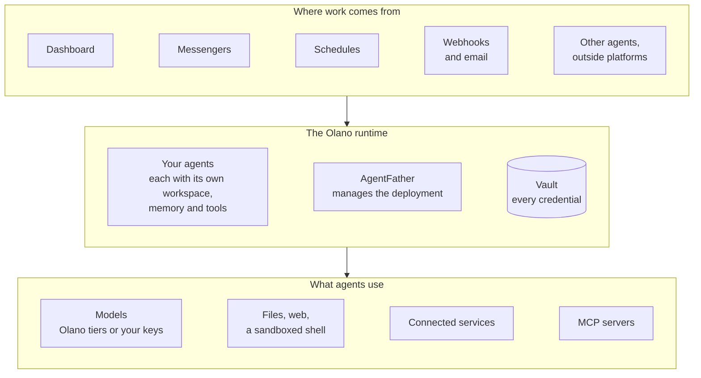

# What Olano is

Olano runs **agents**: long-lived AI workers that hold their own memory, reach
real systems through tools, and talk to people on the messaging platforms those
people already use.

An agent is four things:

| Piece | What it is |
|---|---|
| **Configuration** | `agent.json5` — the agent's name, model, prompt, tools, channels, schedule, permissions. |
| **Workspace** | A directory the agent owns: its memory, notes, files, skills, and scratch space. |
| **A model** | The reasoning engine. Either an Olano-managed tier billed in credits, or your own provider key. |
| **Surfaces** | How work reaches it: the dashboard, a messaging channel, a schedule, a webhook, or another agent. |

## The pieces

- **The runtime** is one long-running process. It boots every agent, keeps the
  channels connected, runs the scheduler, and serves the dashboard API.
- **The dashboard** is the web control panel — the primary way to operate a
  deployment. Everything in this guide that mentions a "tab" means a dashboard
  section.
- **The agents themselves.** Every agent carries built-in tools to configure
  itself, connect services, and send **magic links** so a person can finish a
  sign-in or hand over a key from their own phone; **AgentFather** carries the
  tools to manage the whole deployment. Asking an agent is a first-class way
  to operate Olano, not a shortcut — see [Ask the agent: self-configuration, magic links and admin tools](feature-guides/ask-the-agent.md).
- **The vault** is the encrypted credential store. Every API key, bot token and
  service password lives there. Credentials never belong in a config file.

How the pieces fit together:



## Where things live on disk

Olano keeps everything under one home directory, `~/.olano/` by default
(override with `OLANO_HOME`). An install made under an earlier default keeps
the `~/olano/` or `~/.lionclaw/` it already has; nothing is moved.

**About the name `lionclaw`.** Olano was first called lionclaw: it was built in
Singapore, the Lion City. The name survives in a few identifiers that are kept
so existing installs keep working: the `LIONCLAW_*` environment variables
(every one also accepts the `OLANO_*` spelling), the `lionclaw_docker`
backend, the `lionclaw_memory` default collection, and the older home and
state-folder names `~/.lionclaw/` and `.lionclaw/`. Wherever you see it, read
it as Olano.

```
~/.olano/
  config.yaml                       # deployment-wide settings  (config.yaml reference)
  organization.yaml                 # the org chart             (organization.yaml)
  agents/<name>/
    agent.json5                     # that agent's config       (agent.json5 reference)
    workspace/                      # that agent's own files
      AGENTS.md                     # operating instructions
      SOUL.md                       # persona, tone, boundaries
      IDENTITY.md                   # who the agent is
      USER.md                       # who it works for
      TOOLS.md                      # notes on tool usage
      MEMORY.md                     # durable learned facts
      memories/YYYY-MM-DD.md        # daily logs
      notes/                        # the markdown wiki
      knowledgebase/                # documents indexed for search
      skills/                       # reusable procedures
      reports/                      # every file the agent produces for you
      uploads/                      # files you send it in chat
      downloads/  scratch/  trash/  # conventions the tools use
      system/                       # Olano-owned; replaced on upgrade
  sessions/                         # conversation transcripts
  vault/                            # encrypted credentials
```

The files under `system/` are managed by Olano and overwritten when you upgrade.
Everything else is yours — edit it freely, from the dashboard Files tab or a
text editor. The agent reads `AGENTS.md`, `SOUL.md`, `IDENTITY.md`, `USER.md`,
`MEMORY.md`, `TOOLS.md` and the recent daily logs at the start of every
conversation, so editing them changes how the agent behaves on its next reply.

## Self-hosted or Olano Cloud

Olano runs the same either way:

- **Self-hosted** — you install it on your own machine or server and bring your
  own model provider keys, or run on Olano credits with an Olano API key from
  `cloud.olano.ai`.
- **Olano Cloud** (`cloud.olano.ai`) — a managed instance you deploy in a few
  minutes, kept up to date for you, with Olano-managed models billed in credits
  so you never need a provider account. See [Olano Cloud](olano-cloud.md).

You can mix: a cloud deployment can still use your own provider keys, and a
self-hosted install can use whatever providers you have alongside Olano
credits.
